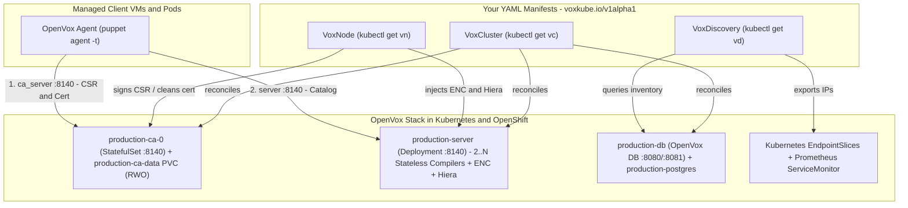

# VoxKube (`voxkube-operator`)

[](#ai-built-notice)
[](#custom-resources)
[](#why-voxkube)
[](LICENSE)

> [!IMPORTANT]
> **AI-Built Project Notice (`#ai-built-notice`)**: This entire project (**`VoxKube`** / `voxkube-operator` -- architecture, CRDs, Go controllers, container images, ESO & `cert-manager` Hiera Bridge, GitHub App authentication, PuppetDB `EndpointSlice` discovery, Helm chart, unit tests, and documentation) was **designed, architected, and built entirely with AI**.

**VoxKube** is a Kubernetes and OpenShift operator that runs a complete [OpenVox](https://voxpupuli.org/openvox/) (open-source Puppet 8) infrastructure using three Custom Resources:

- **`VoxCluster` (`kubectl get vc`)** -- Deploys and manages your OpenVox stack: a dedicated Certificate Authority (`<cluster>-ca`), horizontally scalable stateless catalog compilers (`<cluster>-server`), OpenVox DB / PuppetDB (`<cluster>-db`), and PostgreSQL (`<cluster>-postgres` or an external database).
- **`VoxNode` (`kubectl get vn`)** -- Manages an individual client VM or server: approves its certificate request (CSR), defines its Puppet classes/role/parameters (ENC), provisions `cert-manager` SSL certificates or External Secrets for that machine, and cleans it up from both the CA and PuppetDB when deleted.
- **`VoxDiscovery` (`kubectl get vd`)** -- Queries OpenVox DB for active machines matching your facts or classes and exports their IPs as native Kubernetes `EndpointSlice`s and Prometheus `ServiceMonitor`s.

---

## Why VoxKube? (`#why-voxkube`)

Running Puppet / OpenVox inside Kubernetes or OpenShift traditionally hits four pain points. VoxKube solves all of them out of the box:

1. **Separated CA (`StatefulSet`) vs. Stateless Compilers (`Deployment`)**:
   - OpenVox CA state (`serial`, `inventory.txt`, `ca_crl.pem`, `signed/`, `requests/`) is file-based and not safe for concurrent multi-pod writes.
   - VoxKube runs a dedicated 1-replica **`<cluster>-ca` `StatefulSet`** backed by a standard `ReadWriteOnce` PersistentVolumeClaim (`<cluster>-ca-data`), while **`<cluster>-server`** runs as a stateless `Deployment` (`2..N` replicas) with CA disabled so you can scale catalog compilation horizontally without `ReadWriteMany` storage.
2. **Disaster-Recovery (DR) Safe CA Storage**:
   - The CA bootstrap container checks whether `ca_crt.pem` already exists on the `<cluster>-ca-data` PVC before seeding.
   - If a pod restarts or you restore a cluster from storage backup, VoxKube reuses the existing CA certificate, private key, CRL, and signed client inventory on the PVC. Your existing VMs continue checking in without re-enrolling.
3. **100% OpenShift `restricted-v2` SCC Compliant**:
   - All workloads (`voxkube-operator`, `openvox-server`, `openvox-db`, `postgresql`) run rootless without hardcoded UIDs/GIDs, allowing OpenShift to assign arbitrary namespace UIDs cleanly.
4. **First-Party Multi-Arch Container Images (`linux/amd64` & `linux/arm64`)**:
   - Built directly from official Vox Pupuli OpenVox 8 packages (`yum.voxpupuli.org`) on Red Hat UBI 9 via GitHub Actions:
     - `ghcr.io/yboikov/voxkube-operator:latest`
     - `ghcr.io/yboikov/openvox-server:latest`
     - `ghcr.io/yboikov/openvox-db:latest`

---

## How It Works



---

## 5-Minute Quickstart

### Step 1: Install the Operator via Helm

```bash
helm upgrade --install voxkube-operator ./charts/voxkube-operator \
  --namespace openvox \
  --create-namespace \
  --set image.tag=latest
```

### Step 2: Create a `VoxCluster`

Apply a `VoxCluster` manifest to bring up the CA, Compiler Pool, OpenVox DB, and PostgreSQL:

```yaml
apiVersion: voxkube.io/v1alpha1
kind: VoxCluster
metadata:
  name: production
  namespace: openvox
spec:
  code:
    mode: pvc # Use "git" to sync a Puppet control-repo with g10k
  ca:
    storageSize: 2Gi
  server:
    image: ghcr.io/yboikov/openvox-server:latest
    replicas: 2
    javaArgs: "-Xms512m -Xmx512m"
  database:
    enabled: true
    image: ghcr.io/yboikov/openvox-db:latest
    postgres:
      mode: builtin
      storageSize: 10Gi
  networking:
    externalHostname: puppet.example.com
    serviceType: ClusterIP
```

Check the deployed pods and services:

```bash
kubectl get vc,pods,pvc,svc -n openvox
```

You will see:
- `production-ca-0` (`StatefulSet`) and `service/production-ca` (`:8140`) for CA operations.
- `production-server-*` (`Deployment`) and `service/production` (`:8140`) for catalog compilation.
- `production-db-*` and `production-postgres-0` for OpenVox DB.

---

### Step 3: Enroll & Classify a Client Node (`VoxNode`)

1. Point your client's `/etc/puppetlabs/puppet/puppet.conf` to the CA service and Server service:
   ```ini
   [main]
   certname = web-01.example.com
   ca_server = production-ca.openvox.svc.cluster.local
   server = production.openvox.svc.cluster.local
   environment = production
   ```
2. Submit a certificate request from the client:
   ```bash
   /opt/puppetlabs/bin/puppet ssl submit_request
   ```
3. Create a `VoxNode` resource in Kubernetes to sign the certificate and classify the machine:
   ```yaml
   apiVersion: voxkube.io/v1alpha1
   kind: VoxNode
   metadata:
     name: web-01
     namespace: openvox
   spec:
     clusterRef: production
     certname: web-01.example.com
     state: Active
     classification:
       environment: production
       role: role::webserver
       classes:
         - profile::nginx
       parameters:
         http_port: "8080"
         welcome_message: "Managed by VoxKube"
   ```
4. Run `puppet agent -t` on the client:
   ```bash
   /opt/puppetlabs/bin/puppet agent -t
   ```
   The agent downloads its signed certificate from `production-ca`, requests its catalog from `production`, and applies the classes and parameters defined in `VoxNode/web-01`.

---

## Custom Resources Guide (`#custom-resources`)

### 1. Deploying Puppet Code from Git (`VoxCluster`)

In production, set `spec.code.mode: git` to synchronize your Puppet `control-repo` automatically using `g10k`. VoxKube polls the remote Git repository outbound (`git ls-remote`) so you do not need inbound webhooks through your firewall:

```yaml
spec:
  code:
    mode: git
    git:
      remote: https://github.com/myorg/puppet-control-repo.git
      authType: githubApp # or "none" / "token"
      githubApp:
        appID: 123456
        installationID: 98765432
        privateKeySecretRef:
          name: github-app-private-key
          key: private-key.pem
      pollInterval: 60s
      synchronizedRollout: true
      generateTypes: true
```

To trigger an immediate Git sync without waiting for `pollInterval`:

```bash
kubectl annotate voxcluster production -n openvox voxkube.io/sync-now="$(date +%s)" --overwrite
```

---

### 2. Injecting Secrets & SSL Certificates into Hiera (`VoxNode` + ESO + `cert-manager`)

VoxKube includes a built-in Hiera Secret Bridge that mounts Kubernetes Secrets into `/etc/puppetlabs/puppet/hiera-secrets` and automatically adds `lookup_options` with `convert_to: "Sensitive"` so secrets never leak in Puppet logs or reports:

- **Common Secrets**: List secret names under `spec.hieraSecrets.commonSecrets` on `VoxCluster`, or label any Secret (for example from External Secrets Operator) with `voxkube.io/hiera-secret: "true"`.
- **Role Secrets**: Label a Secret with `voxkube.io/hiera-secret: "true"`, `voxkube.io/hiera-scope: "role"`, and `voxkube.io/hiera-role: "webserver"`.
- **Per-Node SSL Certificates via `cert-manager`**: Request one or more certificates directly on a `VoxNode`:
  ```yaml
  spec:
    certificates:
      - name: public_web
        issuerRef:
          name: letsencrypt-prod
          kind: ClusterIssuer
        dnsNames:
          - app.example.com
        targetCertPath: /etc/nginx/ssl/app.example.com.crt
        targetKeyPath: /etc/nginx/ssl/app.example.com.key
  ```
  VoxKube creates the `cert-manager` `Certificate`, waits for the TLS Secret, and injects `certs::public_web::tls_crt`, `certs::public_web::tls_key`, and `openvox::certs` into that node's Hiera data.

---

### 3. Decommissioning a Node (`VoxNode`)

When a VM is retired, either set `spec.state: Decommissioned` or delete the `VoxNode`:

```bash
kubectl delete voxnode web-01 -n openvox
```

VoxKube's finalizer atomically:
1. Revokes and cleans the node's certificate on `<cluster>-ca` (`PUT /puppet-ca/v1/clean`).
2. Deactivates the node in OpenVox DB (`POST /pdb/cmd/v1` `deactivate node`).
3. Removes its ENC and Hiera entries from `<cluster>-server`.

---

### 4. Exporting PuppetDB Inventory to Prometheus (`VoxDiscovery`)

Use `VoxDiscovery` to turn OpenVox DB into a Kubernetes service discovery source for Prometheus:

```yaml
apiVersion: voxkube.io/v1alpha1
kind: VoxDiscovery
metadata:
  name: puppet-node-exporter
  namespace: openvox
spec:
  clusterRef: production
  syncInterval: 60s
  addressFact: networking.ip
  selector:
    environment: production
    facts:
      kernel: Linux
  ports:
    - name: metrics
      port: 9100
      protocol: TCP
  serviceMonitor:
    enabled: true
    interval: 30s
    preserveNodeHostnameAsInstance: true
    tls:
      enabled: true
      mode: openvoxCA
```

---

## Development & Local Testing

```bash
# Run unit and controller tests
go test ./... -v

# Lint the Helm chart
helm lint charts/voxkube-operator

# Regenerate CRD manifests and deepcopy code after API changes
make generate manifests
```
