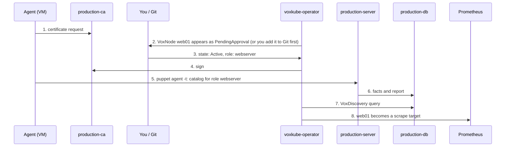

# VoxKube

[](#api-reference-api-reference)
[](#why-run-it-this-way)
[](LICENSE)

## What is VoxKube?

VoxKube runs your Puppet infrastructure on Kubernetes or OpenShift. It uses [OpenVox](https://voxpupuli.org/openvox/), the community-maintained, open-source fork of Puppet, and is driven entirely by YAML.

Traditionally, a Puppet server lives on hand-built VMs. You sign each new machine's certificate by hand on the CA, keep machine roles in a separate tool such as Foreman, scatter secrets across encrypted Hiera files, and maintain a separate list of machines for monitoring. VoxKube replaces all of that with three Kubernetes resources. You describe the Puppet server, the machines it manages and what to monitor; the operator builds and runs everything, and keeps it that way. Approving a new machine, giving it a role, handing it a TLS certificate, muting its alerts or retiring it is a change to one YAML file, so it all fits into Git and ArgoCD like the rest of your cluster.

> [!TIP]
> **Built for OpenShift.** Every pod runs under the default `restricted-v2` SCC (no root, no fixed UIDs), and **OpenShift Routes are included**: set `openShiftRoute.enabled: true` and the operator creates passthrough Routes for the compilers and the CA, adds their hostnames to the certificates, and reports the URLs agents should use in the `VoxCluster` status (`serverExternalURL`, `caExternalURL`). Agents outside the cluster connect on port 443, with no LoadBalancer or NodePort needed.

> [!TIP]
> **Puppet code straight from Git, with GitHub App authentication.** Set `code.mode: git` and point it at your control repo: every branch (or only the ones you list in `branches`) becomes a Puppet environment, deployed by g10k together with its `Puppetfile` modules. Authenticate as a **GitHub App** (the operator exchanges the App's private key for short-lived installation tokens and renews them itself, so there are no personal tokens or deploy keys to rotate), or with an SSH key or HTTPS token. The operator polls the repository, so no inbound webhook through your firewall is needed, and updates the compilers when a branch changes.

## The components

### What you write: three resources

| Resource | Short name | Think of it as | What it does |
|---|---|---|---|
| **`VoxCluster`** | `vc` | *the Puppet server* | Creates and runs the whole OpenVox stack: CA, compilers, database, and the Puppet code deployment from Git (GitHub App, SSH key or HTTPS token). One per Puppet installation. |
| **`VoxNode`** | `vn` | *one managed machine* | Approves the machine's certificate and decides what Puppet applies to it (environment, role, classes, parameters). It can also give the machine TLS certificates from cert-manager and Kubernetes secrets through Hiera, mute its alerts, and retire it cleanly. |
| **`VoxDiscovery`** | `vd` | *machines → Prometheus* | Asks OpenVox DB which machines exist (for example "everything that runs `profile::node_exporter`") and publishes them as scrape targets, so Prometheus finds new machines on its own. |

### What runs in the cluster

For a `VoxCluster` named `production`, the operator creates:

| Component | Kubernetes object | Role |
|---|---|---|
| **Operator** | `voxkube-operator` Deployment | Watches the three resources and creates, updates and repairs everything below. |
| **CA** | `production-ca` StatefulSet (1 pod) + `production-ca-data` PVC | Signs and revokes agent certificates. It is a single pod because the CA keeps its state in files. The CA certificate and its data are **kept** when you delete the cluster, so a rebuilt cluster keeps trusting the existing machines. |
| **Compilers** | `production-server` Deployment (2..N pods) | Compile catalogs for the agents. They hold no state, so you can scale them out or let an autoscaler do it. Their Puppet code comes from Git (via [g10k](https://github.com/xorpaul/g10k)), a PVC or an image. |
| **OpenVox DB** | `production-db` Deployment | PuppetDB: stores facts, catalogs and reports. Optional; `VoxNode` status and `VoxDiscovery` need it. |
| **PostgreSQL** | your database, or `production-postgres` | The database behind OpenVox DB. Use your own (for example CloudNativePG) in production; the built-in one is for demos and loses its data on restart. |
| **Routes** (OpenShift) | `production` and `production-ca` Routes | Optional TLS-passthrough Routes for agents outside the cluster: `puppet.example.com:443` for catalogs, `puppet-ca.example.com:443` for certificates. On plain Kubernetes, use a LoadBalancer or NodePort Service instead. |

### How a machine joins



1. The agent sends a certificate request to the CA.
2. The operator notices it and creates a `VoxNode` in `PendingApproval` (with the default `autosignMode: voxnode`), unless you already created one in Git.
3. You approve it by setting `state: Active`, together with what Puppet should apply.
4. The operator signs the certificate on the CA.
5. The agent fetches its catalog from the compilers, built from your Git code and the `VoxNode`'s classification.
6. The compilers store facts and the run report in OpenVox DB, and `VoxNode` status shows the last run.
7. `VoxDiscovery` finds the machine in OpenVox DB and publishes it as a Prometheus target (steps 7 and 8).

Removing the machine is the reverse: `state: Decommissioned` revokes its certificate, removes it from OpenVox DB and drops its Prometheus target.

## Why run it this way?

- **Scales without shared storage.** Only the CA needs a volume (`ReadWriteOnce`). The compilers are stateless, so there is no `ReadWriteMany` and no NFS.
- **The CA survives disasters.** The CA certificate and its data are not owned by the `VoxCluster`. Delete and recreate the cluster, or restore both from a backup, and existing machines keep working without re-enrolling.
- **GitOps all the way.** Puppet code comes from Git by polling (no inbound webhooks through your firewall, GitHub App authentication supported), and machines are YAML files that ArgoCD can manage.
- **Secrets stay in Kubernetes.** Secrets from External Secrets Operator or cert-manager reach Puppet through Hiera, always as `Sensitive`, so they never show up in logs or reports.
- **Runs on OpenShift as is.** Every pod runs under the default `restricted-v2` SCC, with no fixed UIDs and no root, and OpenShift Routes (TLS passthrough) for the compilers and the CA are built in.
- **Pinned images.** `ghcr.io/yboikov/openvox-server` and `openvox-db` are built from the official OpenVox 8 packages on UBI 9, at a pinned version (see [Image versions](#image-versions)). No Docker Hub images are needed at runtime.

**Where to go next:** [Docs site with the interactive API explorer](https://yboikov.github.io/voxkube-operator/) · [Quickstart](#5-minute-quickstart) · [Guides](#custom-resources-guide-custom-resources) · [API reference](#api-reference-api-reference) · [Releases & upgrading](#versioning--releases)

---

## 5-Minute Quickstart

### Step 1: Install the Operator via Helm

From a release (recommended; the chart pins the matching operator image):

```bash
helm upgrade --install voxkube-operator oci://ghcr.io/yboikov/charts/voxkube-operator \
  --version 0.3.1 \
  --namespace openvox \
  --create-namespace
```

To try unreleased code, publish a **pre-release** (e.g. `v0.3.0-rc.1`, see [Releasing](#versioning--releases)) and install it with `--version 0.3.0-rc.1`. Pushes to `main` don't publish images.

Check what is running with `kubectl -n openvox logs deploy/voxkube-operator | head -1`, which prints the operator version, commit and default OpenVox images.

### Step 2: Create a `VoxCluster`

Apply a `VoxCluster` manifest to bring up the CA, Compiler Pool, OpenVox DB, and PostgreSQL:

```yaml
apiVersion: voxkube.io/v1alpha1
kind: VoxCluster
metadata:
  name: production
  namespace: openvox
spec:
  code:
    mode: pvc # Use "git" to sync a Puppet control-repo with g10k
  ca:
    storageSize: 2Gi
  server:
    image: ghcr.io/yboikov/openvox-server:8.18.0
    replicas: 2
    javaArgs: "-Xms512m -Xmx512m"
  database:
    enabled: true
    image: ghcr.io/yboikov/openvox-db:8.18.0
    postgres:
      mode: builtin # ephemeral, dev/demo only; use mode: external (e.g. CloudNativePG) in production
  networking:
    server:
      externalHostname: puppet.example.com
    ca:
      externalHostname: puppet-ca.example.com
```

Check the deployed pods and services:

```bash
kubectl get vc,pods,pvc,svc -n openvox
```

You will see:
- `production-ca-0` (`StatefulSet`) and `service/production-ca` (`:8140`) for CA operations.
- `production-server-*` (`Deployment`) and `service/production` (`:8140`) for catalog compilation.
- `production-db-*` and `production-postgres-0` for OpenVox DB.

`kubectl get vc` shows the phase moving through `InitializingCA`, `DeployingDatabase` and `DeployingServer` to `Running`. The conditions (`kubectl describe vc production`) show which component is still starting.

With `code.mode: pvc` and no `claimName`, the compilers serve a small demo `production` environment, which is enough for this walkthrough.

---

### Step 3: Enroll & Classify a Client Node (`VoxNode`)

1. Point your client's `/etc/puppetlabs/puppet/puppet.conf` to the CA service and Server service:
   ```ini
   [main]
   certname = web-01.example.com
   ca_server = production-ca.openvox.svc.cluster.local
   server = production.openvox.svc.cluster.local
   environment = production
   ```
2. Submit a certificate request from the client:
   ```bash
   /opt/puppetlabs/bin/puppet ssl submit_request
   ```
3. Create a `VoxNode` resource in Kubernetes to sign the certificate and classify the machine:
   ```yaml
   apiVersion: voxkube.io/v1alpha1
   kind: VoxNode
   metadata:
     name: web-01
     namespace: openvox
   spec:
     clusterRef: production
     certname: web-01.example.com
     state: Active
     classification:
       environment: production
       role: webserver   # the top-scope $role; your site.pp maps it to a class (e.g. include "role::${role}")
       classes:
         - profile::nginx
       parameters:
         http_port: "8080"
         welcome_message: "Managed by VoxKube"
   ```
4. Run `puppet agent -t` on the client:
   ```bash
   /opt/puppetlabs/bin/puppet agent -t
   ```
   The agent downloads its signed certificate from `production-ca`, requests its catalog from `production`, and applies the classes and parameters defined in `VoxNode/web-01`.

---

## Custom Resources Guide (`#custom-resources`)

### 1. Deploying Puppet Code from Git (`VoxCluster`)

In production, set `spec.code.mode: git` to synchronize your Puppet `control-repo` automatically using `g10k`. VoxKube polls the remote Git repository outbound (`git ls-remote`) so you do not need inbound webhooks through your firewall:

```yaml
spec:
  code:
    mode: git
    git:
      remote: https://github.com/myorg/puppet-control-repo.git
      authType: githubApp # or sshKey / httpsToken (with credentialsSecretRef) / none
      githubApp:
        appID: 123456
        installationID: 98765432
        privateKeySecretRef:
          name: github-app-private-key
          key: private-key.pem
      pollInterval: 60s
      synchronizedRollout: true # roll all compilers together when any branch changes
      generateTypes: true
```

To trigger an immediate Git poll without waiting for `pollInterval` (the minimum is `10s`):

```bash
kubectl annotate voxcluster production -n openvox voxkube.io/sync-now="$(date +%s)" --overwrite
```

In synchronized mode a new `sync-now` value also rolls the compilers, so it doubles as "redeploy the code now" even when no branch moved.

---

### 2. Injecting Secrets & SSL Certificates into Hiera (`VoxNode` + ESO + `cert-manager`)

VoxKube includes a built-in Hiera Secret Bridge that mounts Kubernetes Secrets into `/etc/puppetlabs/puppet/hiera-secrets` and automatically adds `lookup_options` with `convert_to: "Sensitive"` so secrets never leak in Puppet logs or reports:

- **Common Secrets**: List secret names under `spec.hieraSecrets.commonSecrets` on `VoxCluster`, or label any Secret (for example from External Secrets Operator) with `voxkube.io/hiera-secret: "true"`.
- **Role Secrets**: Label a Secret with `voxkube.io/hiera-secret: "true"`, `voxkube.io/hiera-scope: "role"`, and `voxkube.io/hiera-role: "webserver"`. The role is a label value, so roles you scope secrets to must be valid label values (letters, digits, `-`, `_`, `.`, at most 63 characters): use `webserver`, not `role::webserver`.
- **Per-Node SSL Certificates via `cert-manager`**: Request one or more certificates directly on a `VoxNode`:
  ```yaml
  spec:
    certificates:
      - name: public_web
        issuerRef:
          name: letsencrypt-prod
          kind: ClusterIssuer
        dnsNames:
          - app.example.com
        targetCertPath: /etc/nginx/ssl/app.example.com.crt
        targetKeyPath: /etc/nginx/ssl/app.example.com.key
  ```
  VoxKube creates the `cert-manager` `Certificate`, waits for the TLS Secret, and injects `certs::public_web::tls_crt`, `certs::public_web::tls_key`, and `openvox::certs` into that node's Hiera data. All values are `Sensitive`, so read them with `.unwrap`.

---

### 3. Decommissioning a Node (`VoxNode`)

When a VM is retired, either set `spec.state: Decommissioned` or delete the `VoxNode`:

```bash
kubectl delete voxnode web-01 -n openvox
```

VoxKube then:
1. Revokes and cleans the node's certificate on `<cluster>-ca` (`PUT /puppet-ca/v1/clean`).
2. Deactivates the node in OpenVox DB (`POST /pdb/cmd/v1` `deactivate node`).
3. Removes its ENC and Hiera entries from `<cluster>-server`.

Each step is retried until it succeeds; a deleted `VoxNode` stays (`Ready=False`, reason `CleanupPending`) until both the CA and OpenVox DB steps went through. If the CA is gone for good, let the deletion finish without cleanup:

```bash
kubectl annotate voxnode web-01 -n openvox voxkube.io/skip-cleanup=true
```

Deleting the whole `VoxCluster` (or its namespace) never blocks on `VoxNode` cleanup.

### Pausing reconciliation

For planned CA or OpenVox DB maintenance, a migration or debugging, set the annotation `voxkube.io/paused: "true"` on a `VoxCluster`, `VoxNode` or `VoxDiscovery`:

```yaml
metadata:
  annotations:
    voxkube.io/paused: "true"
```

While paused, the operator:
- changes no child objects (Deployments, Secrets, ENC/Hiera data, EndpointSlices…)
- makes no CA or OpenVox DB calls
- doesn't requeue on a timer
- sets the condition `Paused=True` (reason `AnnotationSet`) and emits one `Paused` event

A paused `VoxCluster` pauses all its `VoxNode`s and `VoxDiscovery`s too (`Paused=True`, reason `ClusterPaused`). Removing the annotation resumes everything at once, applies whatever changed in the meantime, and removes the `Paused` condition.

- **Deleting a `VoxNode` while paused** waits: its cleanup would call the CA and OpenVox DB, so the finalizer is kept until you unpause. `voxkube.io/skip-cleanup: "true"` still releases it at once, without any calls. Deleting a `VoxCluster` or `VoxDiscovery` isn't blocked.
- **Metrics** keep being exported from the last known status.
- **With ArgoCD self-heal**, set the annotation in Git: an annotation added with `kubectl annotate` is drift and gets reverted.

---

### 4. Exporting PuppetDB Inventory to Prometheus (`VoxDiscovery`)

Use `VoxDiscovery` to turn OpenVox DB into a Kubernetes service discovery source for Prometheus:

```yaml
apiVersion: voxkube.io/v1alpha1
kind: VoxDiscovery
metadata:
  name: puppet-node-exporter
  namespace: openvox
spec:
  clusterRef: production
  syncInterval: 60s
  addressFact: networking.ip
  selector:
    environment: production
    facts:
      kernel: Linux
  ports:
    - name: metrics
      port: 9100
      protocol: TCP
  serviceMonitor:
    enabled: true
    interval: 30s
    preserveNodeHostnameAsInstance: true
    tls:
      enabled: true
      mode: openvoxCA
```

The ServiceMonitor uses `serviceDiscoveryRole: EndpointSlice`, because the operator publishes targets only as EndpointSlices. Requirements for the Prometheus that picks it up:

- Prometheus Operator recent enough to know `ServiceMonitor.spec.serviceDiscoveryRole` (check with `kubectl explain servicemonitor.spec.serviceDiscoveryRole`). An older CRD silently drops the field and Prometheus finds no targets.
- Its service account can `get`/`list`/`watch` `endpointslices` (`discovery.k8s.io`) in the `VoxDiscovery` namespace.
- On OpenShift, monitoring for user-defined projects must be enabled (`enableUserWorkload: true` in `cluster-monitoring-config`), and the namespace must not carry `openshift.io/cluster-monitoring=true` or `openshift.io/user-monitoring=false`.

Labels on the targets come from three places:

- `endpointLabels`: per target, from the node's facts in OpenVox DB (trusted data included), e.g. `role` from `trusted.extensions.pp_role`.
- VoxNode labels `monitoring.voxkube.io/<label>`: per target, set on the machine's `VoxNode`. They override `endpointLabels`, and they still apply while the machine is switched off (its facts can't change then).
- `serviceMonitor.targetLabels`: the same static value on every target of this `VoxDiscovery`, e.g. `env: prod`.

One `VoxDiscovery` for all machines, with the role from Puppet:

```yaml
apiVersion: voxkube.io/v1alpha1
kind: VoxDiscovery
metadata:
  name: node-exporter
spec:
  clusterRef: production
  selector:
    classes: [profile::node_exporter]
  ports:
    - name: metrics
      port: 9119
  endpointLabels:
    role: trusted.extensions.pp_role
    os: os.family
  serviceMonitor:
    enabled: true
    targetLabels:
      env: prod
```

Muting one machine (for example while it is stopped for a few days):

```bash
kubectl -n openvox label vn web01 monitoring.voxkube.io/alerts=false   # target gets alerts="false"
kubectl -n openvox label vn web01 monitoring.voxkube.io/alerts-          # back to normal
```

Write alert rules or Alertmanager routes against `alerts!="false"`, so machines without the label keep alerting.
The `VoxDiscovery` reacts to VoxNode changes immediately. Machines are grouped into EndpointSlices by their
per-target label set, and each slice carries its group's labels as `label.voxkube.io/<label>`. Prometheus exposes
those as `__meta_kubernetes_endpointslice_label_*`, and the ServiceMonitor maps them back with a `labelmap`
relabeling.

Check it end to end:

```bash
kubectl -n openvox get vd                        # DISCOVERED > 0, Ready=True
kubectl -n openvox get endpointslices -l app.kubernetes.io/instance=puppet-node-exporter -o wide
kubectl -n openvox get servicemonitor puppet-node-exporter -o yaml
# Then query: up{namespace="openvox", job="puppet-node-exporter"}
```

#### Alerts for failed or missing Puppet runs

The operator exports the Puppet run state of every `VoxNode` as metrics on its metrics endpoint (see [Operator metrics](#operator-metrics)), read from OpenVox DB, so nothing extra runs on the machines. The operator only publishes the metrics: scraping and alerting are yours to configure, so changes in your monitoring stack never require an operator change. The chart creates the `<release>-metrics` Service (port `metrics`, 8080) to point your monitoring at.

With Prometheus Operator (on OpenShift: user workload monitoring, so the operator must not run in an `openshift-*` namespace), for example:

```yaml
apiVersion: monitoring.coreos.com/v1
kind: ServiceMonitor
metadata:
  name: voxkube-operator
  namespace: voxkube-operator            # the operator's namespace
spec:
  selector:
    matchLabels:
      app.kubernetes.io/name: voxkube-operator
  endpoints:
    - port: metrics
      interval: 60s
---
apiVersion: monitoring.coreos.com/v1
kind: PrometheusRule
metadata:
  name: puppet-runs
  namespace: voxkube-operator
spec:
  groups:
    - name: puppet-runs
      rules:
        - alert: PuppetRunFailed
          expr: voxkube_node_last_report_failed{alerts!="false"} == 1
          for: 10m
          labels:
            severity: warning
          annotations:
            summary: "Puppet run failed on {{ $labels.certname }}"
        - alert: PuppetNodeNotReporting
          expr: (time() - voxkube_node_last_seen_timestamp_seconds{alerts!="false"}) > 7200
          for: 5m
          labels:
            severity: warning
          annotations:
            summary: "{{ $labels.certname }} hasn't reported to Puppet for {{ $value | humanizeDuration }}"
```

`alerts!="false"` skips machines muted with the VoxNode label `monitoring.voxkube.io/alerts=false`. Other `monitoring.voxkube.io/<label>` labels can be used for routing too once you add them to `metrics.nodeLabels` (operator flag `--node-metric-labels`).
---

## API Reference (`#api-reference`)

| | |
|---|---|
| API group | `voxkube.io` |
| Version | `v1alpha1` |
| Scope | All kinds are **Namespaced** |
| Kinds | `VoxCluster` (`vc`), `VoxNode` (`vn`), `VoxDiscovery` (`vd`) |

### Conventions

- **Same-namespace references.** `clusterRef`, every Secret name, and every `SecretKeySelector` are resolved in the namespace of the referencing object. Cross-namespace references are not supported.
- **Durations.** `code.git.pollInterval` and `VoxDiscovery.spec.syncInterval` use Go durations (`30s`, `5m`, `1h`); the API server rejects anything else.
- **Validation.** The CRDs reject incomplete combinations at admission: `autosignMode: psk` without `pskSecretRef`, `postgres.mode: external` without `host` and `credentialsSecretRef`, `authType: sshKey`/`httpsToken` without `credentialsSecretRef`, `nodeClassification.mode: externalHttp` without `externalURL`, and VoxDiscovery `tls.mode: secretRef` without `secretName`. Requires Kubernetes 1.25+ (CEL). `ca.ttl` also accepts `d` (days) and `y` (365 days). PuppetDB housekeeping TTLs (`7d`, `14d`) use PuppetDB's format and are written verbatim to `database.ini`. cert-manager `duration` / `renewBefore` use cert-manager's format (`2160h`).
- **Reconcile cadence.** A `VoxCluster` is reconciled on every change to its spec, to owned objects, to any Secret or `VoxNode` in its namespace, and at least every 60 s (every 15 s while not `Running`, or every `pollInterval` if that is shorter). Setting a new value on the annotation `voxkube.io/sync-now` forces an immediate reconcile, including a Git poll.
- **Rollouts.** Configuration files mounted via `subPath` can't update in place, so every pod template carries `voxkube.io/config-hash` (and `voxkube.io/tls-hash` with a hash of the pod's own certificate). A changed file or a renewed certificate therefore rolls the affected pods.

> [!IMPORTANT]
> **Production checklist**
> - Use `database.postgres.mode: external` (for example CloudNativePG). `builtin` runs one PostgreSQL pod on **ephemeral storage** and is meant for development and demos only.
> - Build the `openvox-server` image from this repository (it includes `openvoxdb-termini`). Older images can't send facts, catalogs or reports to OpenVox DB.
> - The CA Secret `<cluster>-ca-tls` and PVC `<cluster>-ca-data` are **not** deleted with the `VoxCluster`. Back them up; deleting them means re-enrolling every agent.

---

### `VoxCluster`

Deploys one OpenVox stack: CA, compiler pool, OpenVox DB, PostgreSQL (demo) or an external database, Hiera Secret Bridge, ENC, Services and an optional Route.

Printer columns: `.status.phase`, `.status.readyReplicas`, `.status.observedCommit`, `.status.serverURL`, age.

#### `spec`

| Field | Type | Required | Description |
|---|---|---|---|
| `code` | [`ClusterCodeSpec`](#voxclusterspeccode) | no | How Puppet code reaches the compilers. |
| `ca` | [`ClusterCASpec`](#voxclusterspecca) | no | Dedicated OpenVox CA. |
| `server` | [`ClusterServerSpec`](#voxclusterspecserver) | no | Compiler pool. Also supplies the image and pod security context for the CA. |
| `database` | [`ClusterDatabaseSpec`](#voxclusterspecdatabase) | no | OpenVox DB and PostgreSQL. |
| `networking` | [`ClusterNetworkingSpec`](#voxclusterspecnetworking) | no | Exposure of the compilers (`server`) and the CA (`ca`): hostnames, Service types, OpenShift Routes. |
| `hieraSecrets` | [`HieraSecretsSpec`](#voxclusterspechierasecrets) | no | Secret to Hiera bridge. |
| `workflows` | [`ClusterWorkflowsSpec`](#voxclusterspecworkflows) | no | ENC, metadata, reports, maintenance. |
| `placement` | [`PodPlacementSpec`](#voxclusterspecplacement) | no | Node selection, tolerations, affinity and image pull secrets for all VoxCluster pods. |

#### `VoxCluster.spec.placement`

Applied to the CA, compiler, OpenVox DB and built-in PostgreSQL pods. Changing it rolls them.

| Field | Type | Default | Description |
|---|---|---|---|
| `nodeSelector` | map[string]string | – | E.g. `node-role.kubernetes.io/infra: ""` to run on OpenShift infra nodes. |
| `tolerations` | []Toleration | – | Needed for tainted nodes (e.g. infra nodes with `NoSchedule`). |
| `affinity` | Affinity | compilers: soft anti-affinity | Replaces the default. Without it, compilers *prefer* different nodes (`kubernetes.io/hostname`, weight 100); other pods get no affinity. |
| `imagePullSecrets` | []LocalObjectReference | – | Added to every pod, for a private registry or mirror. |

**Probes** (all three JVM pods: CA, compilers, OpenVox DB): readiness as before; a startup probe with the same check allows up to 5 minutes (30 × 10 s) for a cold JVM/JRuby boot; a liveness probe restarts a container only after 2 minutes of failed checks (6 × 20 s), so long compiles and GC pauses don't trigger it.

**PodDisruptionBudgets** (`<c>-server`, `<c>-db`, `maxUnavailable: 1`): created automatically when the component runs at least two replicas (compilers: `replicas`, or `autoscaling.minReplicas` when autoscaling), deleted when it runs one (a PDB on a single replica blocks every node drain). Switch off with `podDisruptionBudget.enabled: false` on `server` or `database`.

#### `VoxCluster.spec.code`

| Field | Type | Default | Validation | Description |
|---|---|---|---|---|
| `mode` | string | `git` | `git` \| `pvc` \| `imageVolume` | Code source. If the chosen mode has no source configured (`git` without `git`, `pvc` without `claimName`, `imageVolume` without `image`), a small demo `production` environment is seeded instead, and `CodeReady` reports reason `DemoCode`. |
| `git` | [`GitCodeSpec`](#voxclusterspeccodegit) | – | – | Control-repo deployed with g10k. Every branch (or every branch in `branches`) becomes an environment. |
| `claimName` | string | – | – | `mode: pvc`: PVC mounted **read-only** at `/etc/puppetlabs/code`. It must contain `environments/`. Use a RWX/ROX volume when running more than one replica. |
| `image` | string | – | – | `mode: imageVolume`: OCI image mounted read-only at `/etc/puppetlabs/code` (Kubernetes image volumes must be enabled on the cluster). It must contain `environments/`. Changing the reference rolls the compilers. |

#### `VoxCluster.spec.code.git`

| Field | Type | Default | Validation | Description |
|---|---|---|---|---|
| `remote` | string | – | **required** | Control-repo URL (`https://…` or SSH such as `git@host:org/repo.git`). |
| `branches` | []string | all branches | each `^[A-Za-z0-9][A-Za-z0-9._/+@-]*$` | Deploy only these branches. g10k gets an anchored `filter_regex` (environments of other branches are purged), `deploy.sh` runs `git ls-remote` for these refs only, and the operator hashes only these branches, so pushes to other branches neither roll the compilers (synchronized mode) nor trigger a sidecar redeploy. `status.observedCommit` is the commit of the first listed branch that exists. If none of them exists: `CodeReady=False` (`GitPollFailed`) and `deploy.sh` fails without touching deployed code. Changing the list rolls the compilers. |
| `authType` | string | `githubApp` | `githubApp` \| `sshKey` \| `httpsToken` \| `none` | `githubApp` without a `githubApp` block is treated as `none`. |
| `githubApp` | [`GitHubAppAuthSpec`](#voxclusterspeccodegitgithubapp) | – | – | For `authType: githubApp`. |
| `credentialsSecretRef` | string | – | – | `sshKey`: Secret with `ssh-privatekey` and optionally `known_hosts` (without it, host keys are accepted on first use). `httpsToken`: Secret with `token` (plus optional `username`, default `x-access-token`) or with `username` + `password`. |
| `pollInterval` | duration | `60s` | Go duration (rejected by the API server if invalid), minimum `10s` (shorter values are raised to it) | How often the operator (synchronized mode) or each sidecar (sidecar mode) checks the remote for moved branches. |
| `synchronizedRollout` | bool | `true` | – | `true`: the operator polls `info/refs` (HTTP(S) remotes only) and rolls all compilers whenever **any branch** moves, so every pod serves the same revision. `false`, or any SSH remote: every compiler runs a `g10k-sync` sidecar that checks the branches (`git ls-remote --heads`) every `pollInterval` and redeploys only when one moved, plus once an hour to pick up Puppetfile modules that track a branch. Each pod does this independently. g10k updates the code in place; Puppet Server re-reads environments on every compile (its default `environment_timeout` of `0`), so new code is used at once, but a compile that runs during a deploy can read a half-updated module and fail that single run. For large or busy control-repos, prefer `mode: imageVolume` with an image built by your CI: every pod then serves an immutable, complete code tree. |
| `generateTypes` | bool | `true` | – | Runs `puppet generate types` for every environment after each g10k deployment. |

How it's wired: ConfigMap `<cluster>-g10k` holds `g10k.yaml`, `deploy.sh`, `sidecar.sh` and `askpass.sh`. Compilers get a `g10k-init` init container, plus a `g10k-sync` sidecar in sidecar mode. HTTPS credentials reach git through `GIT_ASKPASS` and never appear in URLs. SSH keys are copied to a private temp file and used via `GIT_SSH_COMMAND`; under OpenShift's random UIDs the script first adds a `/etc/passwd` entry for the UID (the image makes the file group-writable), since OpenSSH refuses to run without one. `deploy.sh` fails (without touching the deployed code) when the remote can't be reached or has no branches, and when g10k leaves `environments/` empty; in that last case it also deletes the g10k cache so the next attempt clones fresh. A failing `g10k-init` is retried by the kubelet, so a compiler only starts with code; a failing sidecar run is retried on the next poll.

#### `VoxCluster.spec.code.git.githubApp`

| Field | Type | Default | Validation | Description |
|---|---|---|---|---|
| `appID` | int64 | – | **required**, ≥ 1 | GitHub App ID. |
| `installationID` | int64 | – | **required**, ≥ 1 | Installation ID. |
| `privateKeySecretRef` | `SecretKeySelector` (`name`, `key`) | – | **required** | The App's RSA private key in PEM format. |
| `apiBaseURL` | string | `https://api.github.com` | – | Override for GitHub Enterprise Server. |

The operator mints an installation token (`POST {apiBaseURL}/app/installations/{id}/access_tokens`) and caches it in Secret `<cluster>-g10k-git-token` (keys `token` and `username`, annotation `voxkube.io/expires-at`). It mints a new one only when the cached token expires within 10 minutes. The Secret is mounted into the g10k containers. When minting fails (GitHub unreachable, App uninstalled, bad key), `CodeReady` turns `False` with reason `GitAuthFailed`, the last cached token stays mounted, and in synchronized mode the compilers keep their current revision: the operator never falls back to polling the repository unauthenticated.

#### `VoxCluster.spec.ca`

| Field | Type | Default | Validation | Description |
|---|---|---|---|---|
| `enabled` | bool | `true` | – | `false` skips the CA StatefulSet, Service and PVC (use an external CA). The `<cluster>-ca-tls` Secret is still generated (it signs the compiler and DB certificates), and `VoxNode` treats nodes as signed. |
| `storageSize` | quantity | `2Gi` | – | Size of PVC `<cluster>-ca-data` (applied at creation). |
| `storageClassName` | string | – | – | StorageClass for the CA PVC (applied at creation). |
| `ttl` | string | `10y` | – | Validity of the CA certificate, applied when the CA is first generated. |
| `autosignMode` | string | `voxnode` | `voxnode` \| `psk` \| `off` \| `true` | `voxnode`: a CSR is signed when its `VoxNode` is `Active`. `off`: nothing is signed automatically (`VoxNode` only reports the state; sign with `puppetserver ca sign`). `true`: the CA signs every CSR (only for isolated networks: anyone who can reach the CA gets a certificate). `psk`: the CA signs CSRs that carry the pre-shared key, either as the `challengePassword` attribute (`csr_attributes.yaml` → `custom_attributes`) or as the `pp_preshared_key` extension request (`extension_requests`). The autosign script runs in Puppet's Ruby: it decodes the CSR as ASN.1, checks its signature and compares in constant time; anything unparsable is denied. |
| `pskSecretRef` | string | – | required for `psk` (the API server rejects `psk` without it) | Secret with key `psk`. In-cluster service names (`*.svc`) are never autosigned. |
| `javaArgs` | string | `-Xms256m -Xmx384m` | – | `JAVA_ARGS` of the CA. |
| `resources` | ResourceRequirements | – | – | CPU/memory requests and limits of the CA pod. |

#### `VoxCluster.spec.server`

| Field | Type | Default | Validation | Description |
|---|---|---|---|---|
| `image` | string | the operator's pinned OpenVox Server image | – | Used by the compilers, the g10k containers **and the CA StatefulSet**. See [Image versions](#image-versions). |
| `imagePullPolicy` | string | `IfNotPresent` | `Always` \| `IfNotPresent` \| `Never` | Applied to every container that uses `image`. |
| `replicas` | int32 | `2` | ≥ 1 | Compiler replicas. Ignored while `autoscaling.enabled` (the HPA owns the count). |
| `javaArgs` | string | `-Xms1g -Xmx1g` | – | `JAVA_ARGS` for compilers. The CA pod always uses `-Xms256m -Xmx384m`. |
| `maxActiveInstances` | int32 | `2` | ≥ 1 | `jruby-puppet.max-active-instances` on compilers. The CA always uses `1`. |
| `resources` | `ResourceRequirements` | – | – | Applied to the `openvox-server` container. Set `requests.cpu` when using autoscaling. |
| `autoscaling` | [`ServerAutoscalingSpec`](#voxclusterspecserverautoscaling) | – | – | CPU-based HorizontalPodAutoscaler. |
| `securityContext` | [`PodSecurityContextSpec`](#voxclusterspecserversecuritycontext) | – | – | Pod-level overrides for the CA, compiler, OpenVox DB and built-in PostgreSQL pods. |
| `podDisruptionBudget.enabled` | bool | `true` | – | Compiler PodDisruptionBudget (`maxUnavailable: 1`) whenever at least two compilers run (see [placement](#voxclusterspecplacement)). |

#### `VoxCluster.spec.server.autoscaling`

| Field | Type | Default | Description |
|---|---|---|---|
| `enabled` | bool | `false` | Creates `autoscaling/v2` HPA `<cluster>-server`. Turning it off deletes the HPA. |
| `minReplicas` | int32 | `2` | Also the initial replica count. |
| `maxReplicas` | int32 | `6` | Raised to `minReplicas` if lower. |
| `targetCPUUtilizationPercentage` | int32 | `75` | Average CPU utilization target. |

#### `VoxCluster.spec.server.securityContext`

Defaults (with no override): `runAsNonRoot: true`, `seccompProfile: RuntimeDefault`, and **no** UID/GID/fsGroup, so OpenShift `restricted-v2` assigns them. Every container additionally gets `allowPrivilegeEscalation: false`, `runAsNonRoot: true`, `capabilities.drop: [ALL]` and `seccompProfile: RuntimeDefault`.

| Field | Type | Validation | Description |
|---|---|---|---|
| `runAsUser` | int64 | – | Pod UID. |
| `runAsGroup` | int64 | – | Pod primary GID. |
| `runAsNonRoot` | bool | – | Overrides the default `true`. |
| `fsGroup` | int64 | – | Volume supplemental group. |
| `fsGroupChangePolicy` | string | `Always` \| `OnRootMismatch` | Volume ownership change policy. |

#### `VoxCluster.spec.database`

| Field | Type | Default | Validation | Description |
|---|---|---|---|---|
| `enabled` | bool | `true` | – | `false` skips PostgreSQL and OpenVox DB, and compilers don't use PuppetDB (`reports` defaults to `store`). |
| `image` | string | the operator's pinned OpenVox DB image | – | OpenVox DB image. See [Image versions](#image-versions). |
| `replicas` | int32 | `1` | ≥ 1 | Replicas of Deployment `<cluster>-db`. |
| `postgres` | [`ClusterPostgresSpec`](#voxclusterspecdatabasepostgres) | – | – | Database backend. |
| `housekeeping` | [`DatabaseHousekeepingSpec`](#voxclusterspecdatabasehousekeeping) | – | – | Written to `database.ini`. |
| `certificateAllowlist` | []string | – | certnames | Extra certificate CNs allowed to use the OpenVox DB API (e.g. a reporting tool). The compilers and the operator are always allowed; agents aren't. |
| `javaArgs` | string | image default `-Xms256m -Xmx512m` | – | `JAVA_ARGS` of OpenVox DB. Size the heap to your fleet (PuppetDB's guidance: about 1 GB per 1,000 nodes, at least 512 MB). |
| `resources` | ResourceRequirements | – | – | CPU/memory requests and limits of OpenVox DB pods. |
| `softWriteFailure` | bool | `false` | – | Written to `puppetdb.conf` on the compilers. `true`: agent runs succeed while OpenVox DB can't store facts, catalogs or reports (e.g. during a restart or PostgreSQL failover); that run's data is lost. Queries (`puppetdb_query`, exported resources) still need OpenVox DB. |
| `podDisruptionBudget.enabled` | bool | `true` | – | OpenVox DB PodDisruptionBudget, only when `replicas` ≥ 2. |

#### `VoxCluster.spec.database.postgres`

| Field | Type | Default | Validation | Description |
|---|---|---|---|---|
| `mode` | string | `builtin` | `external` \| `builtin` | `external`: any PostgreSQL ≥ 11 with the `pg_trgm` extension available (for example CloudNativePG). `builtin`: a single PostgreSQL pod on an `emptyDir`, **for dev/demo only**. Its data is lost when the pod restarts. |
| `host` | string | – | required for `external` | For example `<cnpg-cluster>-rw.<namespace>.svc`. |
| `port` | int32 | `5432` | – | Connection port (and the built-in container/Service port). |
| `databaseName` | string | `openvoxdb` | – | Database name. |
| `credentialsSecretRef` | string | – | required for `external` | Secret with `username` and `password` keys. A CloudNativePG `<cluster>-app` Secret works as-is. For `builtin` without it, the operator generates `<cluster>-postgres-credentials` once. |
| `sslMode` | string | `require` | `disable` \| `allow` \| `prefer` \| `require` \| `verify-ca` \| `verify-full` | JDBC `sslmode` for `external` (not used for `builtin`). `verify-*` modes need the server CA in the OpenVox DB JVM trust store. |
| `image` | string | `quay.io/sclorg/postgresql-16-c9s:latest` | – | Built-in PostgreSQL image. |

`database.ini`, which contains the credentials, is rendered into Secret `<cluster>-db-database`. A password change (for example CNPG rotating the app Secret) rolls the OpenVox DB pods.

Example with CloudNativePG:

```yaml
spec:
  database:
    postgres:
      mode: external
      host: openvoxdb-rw.openvox.svc
      credentialsSecretRef: openvoxdb-app   # created by CNPG
      sslMode: require
---
apiVersion: postgresql.cnpg.io/v1
kind: Cluster
metadata:
  name: openvoxdb
  namespace: openvox
spec:
  instances: 3
  bootstrap:
    initdb:
      database: openvoxdb
      owner: openvoxdb
      postInitApplicationSQL:
        - CREATE EXTENSION IF NOT EXISTS pg_trgm
  storage:
    size: 20Gi
```

#### `VoxCluster.spec.database.housekeeping`

| Field | Type | Default | `database.ini` key |
|---|---|---|---|
| `nodeTTL` | string | `7d` | `node-ttl` |
| `nodePurgeTTL` | string | `14d` | `node-purge-ttl` |
| `reportTTL` | string | `14d` | `report-ttl` |
| `gcInterval` | int32 (minutes) | `60` | `gc-interval` |

#### `VoxCluster.spec.networking`

Two blocks with the same fields: `server` (the compilers, what agents set as `server`) and `ca` (the CA, what agents set as `ca_server`).

| Field | Description |
|---|---|
| `server` | [`EndpointNetworkingSpec`](#voxclusterspecnetworkingserver--ca) for Service `<cluster>` (port `8140`, named `puppet`) and Route `<cluster>`. |
| `ca` | [`EndpointNetworkingSpec`](#voxclusterspecnetworkingserver--ca) for Service `<cluster>-ca` (port `8140`, named `https-ca`) and Route `<cluster>-ca`. Ignored when `spec.ca.enabled: false`. |

```yaml
networking:
  server:
    externalHostname: puppet.apps.example.com
    openShiftRoute:
      enabled: true
  ca:
    externalHostname: puppet-ca.apps.example.com
    openShiftRoute:
      enabled: true
```

#### `VoxCluster.spec.networking.server` / `.ca`

| Field | Type | Default | Validation | Description |
|---|---|---|---|---|
| `externalHostname` | string | – | – | DNS name agents use for this endpoint. Added to the certificate SANs, and used as the Route host when `openShiftRoute.host` is empty. |
| `additionalDNSNames` | []string | – | – | Extra SANs. |
| `serviceType` | string | `ClusterIP` | `ClusterIP` \| `NodePort` \| `LoadBalancer` | Type of the endpoint's Service. The DB and PostgreSQL Services are always `ClusterIP`. |
| `openShiftRoute.enabled` | bool | `false` | – | Creates a `route.openshift.io/v1` Route with TLS `passthrough` to the endpoint's Service. Setting it back to `false` deletes the Route. Skipped if the Route API doesn't exist. |
| `openShiftRoute.host` | string | `externalHostname` | – | Route host (also added as a SAN). |
| `openShiftRoute.annotations` | map[string]string | – | – | Annotations on the Route. |

The CA, the compilers and OpenVox DB each have their own certificate. The compiler certificate covers `<cluster>` in every in-cluster form (`name`, `name.ns`, `name.ns.svc`, `name.ns.svc.cluster.local`) plus the hostnames of the `server` block; the CA certificate covers `<cluster>-ca` plus the `ca` block; the DB certificate covers `<cluster>-db`. A certificate is re-issued automatically when its list changes, and only the pods using it roll.

The compilers run with the CA service disabled, and a passthrough Route can't route by path, so the CA needs its own hostname. Agent configuration for the example above (Routes listen on 443):

```ini
# /etc/puppetlabs/puppet/puppet.conf on the agent
[agent]
server     = puppet.apps.example.com
ca_server  = puppet-ca.apps.example.com
serverport = 443
ca_port    = 443
```

`status.serverExternalURL` and `status.caExternalURL` show the URLs to use.

#### `VoxCluster.spec.hieraSecrets`

| Field | Type | Default | Description |
|---|---|---|---|
| `enabled` | bool | `true` | `false` stops rendering the Hiera Secrets and doesn't mount them into compilers. |
| `labelSelector` | map[string]string | `voxkube.io/hiera-secret: "true"` | Secrets whose labels contain **all** of these pairs are injected. When set, it **replaces** the default selector. |
| `commonSecrets` | []string | – | Secret names whose keys go into `common.yaml`, labelled or not. Missing Secrets are skipped. |
| `shards` | int32 | `1` | Number of Secrets the rendered Hiera files are spread over (1–32), because Kubernetes caps a Secret at 1 MiB. `1` writes `<cluster>-hiera-secrets`; more write `<cluster>-hiera-secrets-s<N>-<0..N-1>`, merged into the same directory on the compilers through a projected volume. Node files are placed by a hash of the certname, role files by role name, and `common.yaml` is always in shard 0. Raise it when `status.hieraSecrets.largestShardPercent` approaches 100 (the `HieraSecretsCapacity` condition turns `False` at 80%). Changing it writes the new set next to the old one, rolls the compilers once, and deletes the old set after the rollout. |
| `flatCertificateKeys` | bool | `true` | Also write each VoxNode certificate as flat `certs::<name>::tls_crt` / `tls_key` / `ca_crt` keys next to the `openvox::certs` hash. `false` stores every certificate once (roughly halving its size); use it when your code only reads `openvox::certs`. |

See [Hiera Secret Bridge contract](#hiera-secret-bridge-contract) for scopes and file layout.

#### `VoxCluster.spec.workflows`

| Field | Type | Default | Validation | Description |
|---|---|---|---|---|
| `nodeClassification.mode` | string | `voxnode` | `voxnode` \| `externalHttp` \| `none` | `voxnode`: classification comes from `VoxNode` resources. `externalHttp`: the `VoxNode` classification if there is one, otherwise `GET <externalURL>/<certname>`: HTTP 200 must return ENC YAML, 404 falls back to the default, and any other status, a timeout (10 s) or a connection error fails the catalog request (the agent run fails instead of silently getting the default classification). `none`: no ENC (`node_terminus` isn't set). |
| `nodeClassification.defaultEnvironment` | string | `production` | – | Environment for nodes without a `VoxNode`, and for `VoxNode`s with an empty `classification.environment`. |
| `nodeClassification.autoCreateVoxNode` | bool | `true` | – | Creates a `VoxNode` (label `voxkube.io/auto-created: "true"`) for every certname the CA knows that has none in this cluster (`VoxNode`s of another `VoxCluster` in the namespace don't count): pending CSRs get `state: PendingApproval`, signed certificates get `state: Active`. Revoked certificates and the cluster's own certificate are skipped. |
| `nodeClassification.externalURL` | string | – | – | Base URL for `externalHttp`. |
| `facts.injectKubernetesMetadata` | bool | `true` | – | Adds top-scope ENC parameters `voxkube_cluster`, `voxkube_namespace` and `voxkube_node` (the `VoxNode` name; absent for nodes without one). |
| `reports.processors` | []string | `[puppetdb]` (or `[store]` without a database) | – | puppet.conf `reports`. |
| `reports.webhookURL` | string | – | – | Appends Puppet's built-in `http` processor and sets `reporturl`. |
| `maintenance.globalNoop` | bool | `false` | – | Adds top-scope ENC parameter `noop: true` for every node. Puppet doesn't act on this variable by itself: honour it in your code (for example with `noop()` from `trlinkin/noop`). |

#### `VoxCluster.status`

| Field | Type | Description |
|---|---|---|
| `phase` | string | `InitializingCA` (CA not ready) → `DeployingDatabase` (OpenVox DB or built-in PostgreSQL not ready) → `DeployingServer` (no compiler ready) → `Degraded` (fewer ready compilers than desired, or code delivery failing) → `Running`. `Error` when the reconcile fails (the message is in the `Ready` condition). `Pending` is reserved. |
| `observedGeneration` | int64 | `metadata.generation` last processed. |
| `serverURL` | string | `https://<cluster>.<ns>.svc.cluster.local:8140` |
| `caURL` | string | `https://<cluster>-ca.<ns>.svc.cluster.local:8140`, or empty if `ca.enabled: false`. |
| `serverExternalURL` / `caExternalURL` | string | URL for agents outside the Kubernetes cluster, derived from `networking.server` / `networking.ca`: `https://<route host>:443` with a Route, `https://<externalHostname>:<node port>` for `NodePort`, otherwise `https://<externalHostname>:8140`. Empty when the endpoint has no external hostname. |
| `databaseURL` | string | `https://<cluster>-db.<ns>.svc.cluster.local:8081` (mTLS), or empty if the database is disabled. |
| `caSecretName` | string | `<cluster>-ca-tls` |
| `hieraSecretName` | string | `<cluster>-hiera-secrets` with one shard; empty with more shards (see `hieraSecrets.secretNames`) or when the bridge is disabled. |
| `hieraSecrets` | object | `shards`, `secretNames` (the active shard Secrets), `largestShardBytes` (summed decoded values of the fullest shard, which is what the 1 MiB limit counts) and `largestShardPercent`. Absent when the bridge is disabled. |
| `observedCommit` | string | Control-repo `HEAD` SHA last seen by the operator. |
| `readyReplicas` | int32 | Ready compiler pods. |
| `conditions` | []`Condition` | `Ready`, `CAReady`, `DatabaseReady`, `CodeReady` (reasons `GitSynced`, `GitSidecar`, `GitPollFailed`, `GitAuthFailed`, `PersistentVolumeClaim`, `ImageVolume`, `DemoCode`), `ServerReady`, `HieraSecretsCapacity` (`WithinLimit`, `NearLimit`, `OverLimit`), `Paused` (only while paused, see [Pausing reconciliation](#pausing-reconciliation)). |

#### Resources created per `VoxCluster` `<c>`

All of these are labelled `app.kubernetes.io/name=voxkube`, `app.kubernetes.io/instance=<c>`, `app.kubernetes.io/component=<component>` and `app.kubernetes.io/managed-by=voxkube-operator`. They are owned by the `VoxCluster` (garbage-collected with it) **except the CA Secret and the CA PVC**.

Switching a component off deletes its objects (only those the `VoxCluster` controls): `database.enabled: false` removes `<c>-db*` and the built-in PostgreSQL, `postgres.mode: external` removes the built-in PostgreSQL (including its generated credentials), `ca.enabled: false` removes the CA StatefulSet, Service and config, `hieraSecrets.enabled: false` removes the Hiera Secrets, and a changed `hieraSecrets.shards` removes the previous shard set. This happens at the end of a successful reconcile, once the compiler Deployment has fully rolled out without the component. The CA Secret and the CA PVC are never deleted.

| Kind | Name | Notes |
|---|---|---|
| Secret (`kubernetes.io/tls`) | `<c>-ca-tls` | **Retained.** `ca.crt`, `ca.key`, `ca.pub` (CA, generated once), `crl.pem` (synced from the CA every reconcile), `tls.crt`, `tls.key`, `tls.pub`: the CA endpoint's certificate `CN=<c>.<ns>.svc`, valid 1 year, re-issued 30 days before expiry or when SANs change. It carries the Puppet `pp_cli_auth` extension: the operator uses it as its client certificate for the CA admin API and OpenVox DB. **Mounted only into the CA pod.** |
| Secret (`kubernetes.io/tls`) | `<c>-server-tls` | Compiler certificate (`CN=<c>.<ns>.svc`, **no** `pp_cli_auth`), `ca.crt` and `crl.pem` copied from `<c>-ca-tls` (never `ca.key`). Mounted into the compilers, which roll when the CRL changes. |
| Secret (`kubernetes.io/tls`) | `<c>-db-tls` | OpenVox DB certificate (`CN=<c>-db.<ns>.svc`, no `pp_cli_auth`), `ca.crt`, `crl.pem`. Mounted into OpenVox DB, which rolls on a CRL change only when `database.certificateAllowlist` is set (otherwise it accepts only operator-issued certificates, which are never on the CRL). |
| PersistentVolumeClaim | `<c>-ca-data` | **Retained.** CA state; reused on restart or restore if `ca_crt.pem` exists. The CA refuses to start (pod log: `FATAL: the CA key on the PVC ... does not match the CA Secret`) when the PVC's CA key differs from the one in `<c>-ca-tls`: restore both from the same backup. |
| ConfigMap, StatefulSet, Service | `<c>-ca-config`, `<c>-ca` | CA, port `8140`. |
| ConfigMap | `<c>-g10k` | `git` mode only. |
| Secret | `<c>-g10k-git-token` | `authType: githubApp` only. |
| Secret | `<c>-postgres-credentials` | `builtin` without `credentialsSecretRef`. |
| ConfigMap, StatefulSet, Service | `<c>-postgres-init`, `<c>-postgres` | `builtin` only. |
| ConfigMap / Secret | `<c>-db-config` (`jetty.ini`) / `<c>-db-database` (`database.ini`) | – |
| Deployment, Service | `<c>-db` | Port `8081` (`https`, mTLS). The plain-HTTP listener (`8080`) is bound to `127.0.0.1` inside the pod, for the readiness probe only. Over mTLS it accepts only certificates in its allowlist (`<c>.<ns>.svc`, i.e. the compilers and the operator, plus `database.certificateAllowlist`) and rejects revoked ones (`ssl-crl-path`). Agent certificates can't read other nodes' data. |
| Secret | `<c>-hiera-secrets`, or `<c>-hiera-secrets-s<N>-<i>` with `hieraSecrets.shards` N > 1 | Mounted at `/etc/puppetlabs/puppet/hiera-secrets` (updates live). |
| ConfigMap | `<c>-enc-nodes` | One `<certname>.yaml` per `VoxNode` that is neither `Decommissioned`, `Revoked` nor being deleted (updates live). |
| ConfigMap | `<c>-server-config` | `puppet.conf`, `puppetdb.conf`, `routes.yaml`, `enc.sh`, `enc-default.yaml`, `hiera.yaml`, … |
| Deployment, Service | `<c>-server`, `<c>` | Compilers, port `8140`. |
| HorizontalPodAutoscaler | `<c>-server` | `autoscaling.enabled` only. |
| Route | `<c>`, `<c>-ca` | `networking.server.openShiftRoute.enabled` / `networking.ca.openShiftRoute.enabled` only. A host generated by the router (no `host` set) is kept across updates, as are annotations added by others. |

Annotations set by the operator: `voxkube.io/spec-hash` on managed workloads and Services; `voxkube.io/applied-hash`, `voxkube.io/applied-labels` and `voxkube.io/applied-annotations` on Routes, cert-manager `Certificate`s and `ServiceMonitor`s (they are only updated when what the operator renders changes; labels and annotations the operator set earlier and no longer wants are removed, everything others set is kept); `voxkube.io/config-hash`, `voxkube.io/tls-hash`, `voxkube.io/code-revision` and `voxkube.io/observed-commit` on pod templates.

---

### `VoxNode`

One managed Puppet agent: certificate lifecycle, ENC classification, cert-manager certificates, node-scoped Hiera secrets and last-run status.

Printer columns: `.spec.clusterRef`, `.spec.certname`, `.status.role` (the effective role), `.spec.state`, `.status.phase`, `.status.readyCertificates`, age.

Labels `monitoring.voxkube.io/<label>` on a `VoxNode` become label `<label>` on that machine's targets in every `VoxDiscovery` of its cluster (see [`VoxDiscovery.spec.endpointLabels`](#voxdiscovery)).

#### `spec`

| Field | Type | Default | Validation | Description |
|---|---|---|---|---|
| `clusterRef` | string | – | **required**, immutable | `VoxCluster` in the same namespace. |
| `certname` | string | – | **required**, immutable, `^[a-z0-9]([a-z0-9._-]*[a-z0-9])?$`, max 253, not ending in `.svc` / `.svc.cluster.local` | Agent certname (FQDN). If two `VoxNode`s of a cluster share a certname, the oldest owns it; the others get `DuplicateCertname` and are ignored (never signed, revoked, cleaned or classified; deleting one never touches the certificate). In-cluster service names (`<cluster>.<ns>.svc`, anything ending in `.svc` or `.svc.cluster.local`) are reserved: rejected at admission, and older objects get `ReservedCertname`, are never signed, and are deleted without CA or OpenVox DB cleanup. |
| `state` | string | `Active` | `PendingApproval` \| `Active` \| `Revoked` \| `Decommissioned` | See the [state machine](#voxnode-state-machine). |
| `classification` | [`NodeClassificationSpec`](#voxnodespecclassification) | – | – | ENC data. |
| `certificates` | [][`CertManagerCertRequest`](#voxnodespeccertificates) | – | – | cert-manager certificates injected into Hiera. |
| `secrets` | [][`NodeSecretRef`](#voxnodespecsecrets) | – | – | Secrets injected into this node's Hiera file. |

#### `VoxNode.spec.classification`

| Field | Type | Default | Description |
|---|---|---|---|
| `environment` | string | cluster `defaultEnvironment` | Puppet environment. |
| `role` | string | – | Top-scope parameter `role`. It also selects Hiera file `roles_<role>.yaml`. When empty, the certificate's `pp_role` extension is used (see `status.role`), so role-scoped Hiera secrets also work for machines classified by `pp_role` in `csr_attributes.yaml`. |
| `classes` | []string | – | Classes. |
| `parameters` | map[string]any (JSON) | – | Extra top-scope parameters (any JSON value). `role`, `voxkube_*` and `noop` override keys of the same name. |

ENC output (`enc.sh <certname>`):

```yaml
environment: production
classes: [profile::nginx]
parameters:
  http_port: "8080"
  role: webserver
  voxkube_cluster: production      # facts.injectKubernetesMetadata
  voxkube_namespace: openvox
  voxkube_node: web-01
  # noop: true                     # maintenance.globalNoop
```

#### `VoxNode.spec.certificates[]`

| Field | Type | Default | Validation | Description |
|---|---|---|---|---|
| `name` | string | – | **required** | Logical name, used in the Hiera keys. |
| `issuerRef.name` | string | – | **required** | cert-manager Issuer or ClusterIssuer. |
| `issuerRef.kind` | string | `ClusterIssuer` | `Issuer` \| `ClusterIssuer` | – |
| `issuerRef.group` | string | `cert-manager.io` | – | – |
| `dnsNames` | []string | `[<certname>]` | – | DNS SANs. |
| `ipAddresses` | []string | – | – | IP SANs. |
| `duration` | string | `2160h` | – | `Certificate.spec.duration`. |
| `renewBefore` | string | `720h` | – | `Certificate.spec.renewBefore`. |
| `targetCertPath` / `targetKeyPath` | string | – | – | Passed through in the `openvox::certs` hash. The operator doesn't write files on the VM; your Puppet code must. |
| `secretName` | string | generated | – | Overrides **both** the `Certificate` name and its `secretName`. The operator creates and owns that `Certificate`; if one with the name already exists and belongs to something else, the `VoxNode` reconcile fails with an error instead of taking it over. |

Removing an entry from `certificates` deletes its `Certificate` (only `Certificate`s the `VoxNode` controls).

The generated name is `voxnode-cert-<a>-<b>`, where `<a>` and `<b>` are `metadata.name` and `name`, each lowercased with every character outside `[a-z0-9-]` (dots included) replaced by `-`. When the `VoxNode` name contains a dot, or the result would exceed 63 characters, the name is shortened if needed and ends in `-<hash>` of the original names, so `web01.us.example.com` and `web01.eu.example.com` never collide (since 0.2.8; earlier versions cut the name at the first dot). The `VoxNode` controller watches these Secrets, so `readyCertificates` updates as soon as cert-manager issues them.

Hiera keys in `nodes_<certname>.yaml` (all wrapped in `Sensitive`; call `.unwrap` in your code):

| Key | Value |
|---|---|
| `certs::<name>::tls_crt`, `certs::<name>::tls_key`, `certs::<name>::ca_crt` | PEM strings (`ca_crt` only if present). |
| `openvox::certs` | `{<name>: {tls_crt, tls_key, ca_crt?, target_cert_path?, target_key_path?}}` |

#### `VoxNode.spec.secrets[]`

| Field | Type | Validation | Description |
|---|---|---|---|
| `secretName` | string | **required** | Secret in the same namespace. A missing Secret is skipped. |
| `hieraPrefix` | string | **required** | Each key `k` of the Secret becomes `<hieraPrefix>::k` in `nodes_<certname>.yaml`. |

#### `VoxNode` state machine

| `spec.state` | Operator actions | `status.phase` | `Ready` (reason) | Requeue |
|---|---|---|---|---|
| `PendingApproval` | Nothing is signed. The message says whether a CSR has arrived and which `pp_role` it requests; the CSR's extensions are copied to `status.certificateExtensions`. | `PendingCSR` | `False` (`PendingApproval`) | 1 min |
| `Active`, no CSR yet | – | `PendingCSR` | `False` (`AwaitingCSR`) | 30 s |
| `Active`, CSR pending | Signs it (`PUT …/certificate_status/<certname>`), unless `autosignMode: off`. | `Signed` / `PendingCSR` | `True` (`CertificateSigned`) / `False` (`AwaitingManualSigning`) | 30 s while waiting |
| `Active`, signed, never seen in OpenVox DB | Reconciles certificates, ENC and Hiera. | `Signed` | `True` (`CertificateSigned`) | 30 s |
| `Active`, signed, OpenVox DB query fails | As above; the error is logged and shown in the message. A node already seen keeps `Active` and its last check-in. | `Signed` (`Active` if seen before) | `True` (`DatabaseUnreachable`, or `NodeActive`) | 30 s |
| `Active`, reporting | Reads `/pdb/query/v4/nodes/<certname>`. | `Active` | `True` (`NodeActive`) | 5 min |
| `Active`, deactivated or expired in OpenVox DB | – (the node's next Puppet run reactivates it) | `Signed` | `False` (`NodeDeactivated`) | 5 min |
| `Active`, certificate revoked on the CA | – | `Error` | `False` (`CertificateRevokedOnCA`) | on change |
| `Revoked` | `PUT …/certificate_status/<certname> {"desired_state":"revoked"}` and removes its ENC and Hiera entries. The next `VoxCluster` reconcile copies the new CRL to the compilers and rolls them (annotation `voxkube.io/crl-hash`; Jetty reads the CRL only at startup), so the revoked agent is rejected once the rollout finishes. | `Revoked` | `True` (`CertificateRevoked`) | on change |
| `Decommissioned` | `PUT /puppet-ca/v1/clean`, then PuppetDB `deactivate node`, then deletes the node's `Certificate`s and removes its ENC and Hiera entries. Clears `lastSeenTime`, `lastReportStatus`, `certificateFingerprint` and `certificateExtensions`. A failed CA or DB step is retried; steps that succeeded aren't repeated. Without the operator's own CA (`ca.enabled: false`) or OpenVox DB, that step counts as done. | `Decommissioned` | `True` (`NodeDecommissioned`), or `False` (`CleanupPending`) while a step is failing | 30 s while a step is failing |
| *object deleted* | Finalizer `voxkube.io/node-cleanup` runs the CA and DB steps and is released only when both succeeded (`Ready=False`, `CleanupPending` meanwhile). Released without cleanup when the `VoxCluster` is gone or being deleted, or when the `VoxNode` has the annotation `voxkube.io/skip-cleanup: "true"` (for a CA that is lost for good). The node leaves the ENC and Hiera as soon as deletion starts. | – | `False` (`CleanupPending`) while blocked | 30 s |
| *cluster missing* | – | `Error` | `False` (`ClusterNotFound`) | on cluster change |
| *duplicate certname* (an older `VoxNode` has it) | – (deletion releases the finalizer without cleanup) | `Error` | `False` (`DuplicateCertname`) | 1 min (takes over when the owner is gone) |
| *reserved certname* | – | `Error` | `False` (`ReservedCertname`) | on change |

`VoxNode`s are also re-queued whenever their `VoxCluster` changes (for example when the CA becomes ready).

#### `VoxNode.status`

| Field | Type | Description |
|---|---|---|
| `phase` | string | See the state machine. |
| `certificateSigned` | bool | CA state is `signed` (always `true` with `ca.enabled: false`). |
| `certificateFingerprint` | string | Fingerprint reported by the CA. |
| `certificateNotAfter` | time | Expiry of the signed agent certificate, reported by the CA. Exported as `voxkube_node_certificate_expiry_timestamp_seconds`. |
| `certificateExtensions` | map[string]string | Puppet extensions of the pending CSR, then of the signed certificate (re-read when the fingerprint changes), e.g. `pp_role`, `pp_datacenter`. Registered extensions by name, site-specific ones (`1.3.6.1.4.1.34380.1.2.*`) by OID. `pp_preshared_key` is never shown. |
| `role` | string | Effective role: `spec.classification.role`, else `certificateExtensions.pp_role`. Passed to Puppet as `$role`. |
| `caCleaned` / `puppetDBDeactivated` | bool | `true` once that cleanup step succeeded (`Decommissioned` or deletion); reset to `false` when the node is active, pending or revoked again. |
| `readyCertificates` | int32 | Requested certificates whose Secret has `tls.crt` and `tls.key`. |
| `lastReportStatus` | string | `latest_report_status` from OpenVox DB (`changed`, `unchanged`, `failed`). |
| `lastSeenTime` | timestamp | Latest of the report, facts and catalog timestamps in OpenVox DB. |
| `conditions` | []`Condition` | `Ready`, `Paused` (only while paused). |

---

### `VoxDiscovery`

Exports active OpenVox DB nodes as a headless Service with `EndpointSlice`s, plus an optional Prometheus `ServiceMonitor`.

Printer columns: `.spec.clusterRef`, `.status.discoveredNodes`, `.status.endpointSliceCount`, `.status.serviceName`, `.status.lastSyncTime`, age.

#### `spec`

| Field | Type | Default | Validation | Description |
|---|---|---|---|---|
| `clusterRef` | string | – | **required** | `VoxCluster` whose OpenVox DB is queried. |
| `syncInterval` | duration | `60s` | Go duration (rejected if invalid) | How often OpenVox DB is queried. Changes to the VoxDiscovery spec, its VoxCluster or VoxNodes (state, `monitoring.voxkube.io/*` labels) trigger an extra sync. |
| `selector` | [`DiscoverySelectorSpec`](#voxdiscoveryspecselector) | – | – | Node filter. All criteria must match (AND). |
| `addressFact` | string | `networking.ip` | – | Dotted fact path for the endpoint address (for example `networking.ip6` for IPv6). Nodes without a valid IP are skipped. |
| `ports` | [][`DiscoveryPort`](#voxdiscoveryspecports) | – | **required** | Ports on the Service, the slices and the ServiceMonitor endpoints. |
| `endpointLabels` | map[string]string | – | Names: `[a-zA-Z]([a-zA-Z0-9_]*[a-zA-Z0-9])?`, max 63, not reserved (see `targetLabels`), not also in `serviceMonitor.targetLabels`. Invalid → `Ready=False`, reason `InvalidLabels`. | Per-target labels: label name → fact path (dots for nesting, e.g. `trusted.extensions.pp_role`; `trusted.*` paths are also looked up in the node's trusted data from the inventory). Missing facts are left out; values that are not valid Kubernetes label values are skipped and counted in the `Ready` message. VoxNode labels `monitoring.voxkube.io/<label>` are added on top and win. Machines are grouped into EndpointSlices by label set, so use low-cardinality facts (role, environment, datacenter): when there are more than 10 slices averaging under 2 machines each (e.g. a label on an IP or kernel version), the `Ready` message carries a warning and a `HighCardinalityLabels` Warning event is emitted. |
| `serviceMonitor` | [`DiscoveryServiceMonitorSpec`](#voxdiscoveryspecservicemonitor) | – | – | Optional ServiceMonitor. |

The operator runs this PQL query over mTLS (`GET <databaseURL>/pdb/query/v4?query=…`):

```
inventory[certname, environment, facts, trusted] {
  certname in nodes[certname] { node_state = "active" }
  and environment = "<environment>"
  and certname in resources[certname] { type = "Class" and title = "Profile::Node_exporter" }   # per class
  and (<pql>)
}
```

`VoxDiscovery` is optional: nothing creates one for you, so dev/test clusters without one get no discovery Service or EndpointSlices. If the referenced `VoxCluster` has `spec.database.enabled: false`, the `VoxDiscovery` deletes the headless Service, EndpointSlices and ServiceMonitor it created, never queries OpenVox DB, and reports `Ready=False` with reason `DatabaseDisabled`. It starts working again as soon as the database is enabled.

Fact filters are then applied client-side. Nodes whose `VoxNode` is `Revoked` or `Decommissioned` are dropped. **If the query fails, the existing slices are left untouched** (so Prometheus keeps its targets), and `Ready=False` with reason `QueryFailed` is reported.

#### `VoxDiscovery.spec.selector`

| Field | Type | Description |
|---|---|---|
| `environment` | string | Node environment. |
| `facts` | map[string]string | Exact string match per dotted fact path (`true` and `"true"` are equal). |
| `classes` | []string | Classes in the node's last catalog (written as in Puppet code, `profile::node_exporter`). |
| `pql` | string | Extra PQL filter expression ANDed into the query, e.g. `facts.os.family = "RedHat"`. Write only the expression inside the braces. |

#### `VoxDiscovery.spec.ports[]`

| Field | Type | Default | Validation |
|---|---|---|---|
| `name` | string | – | **required**. Also the ServiceMonitor endpoint `port`. |
| `port` | int32 | – | **required**, 1–65535 |
| `protocol` | string | `TCP` | `TCP` \| `UDP` \| `SCTP` |

#### `VoxDiscovery.spec.serviceMonitor`

| Field | Type | Default | Validation | Description |
|---|---|---|---|---|
| `enabled` | bool | `false` | – | Creates `monitoring.coreos.com/v1` `ServiceMonitor` `<vd>`, one endpoint per port. Skipped if the CRD is absent. Setting it back to `false` deletes the ServiceMonitor and the scraper certificate Secret. |
| `interval` / `scrapeTimeout` | string | `30s` / `10s` | – | Scrape settings. |
| `preserveNodeHostnameAsInstance` | bool | `true` | – | Relabels `__meta_kubernetes_endpointslice_endpoint_node_name` → `instance`, so `instance` is the certname. |
| `additionalLabels` | map[string]string | – | – | Extra labels on the ServiceMonitor. |
| `targetLabels` | map[string]string | – | Keys: `[a-zA-Z]([a-zA-Z0-9_]*[a-zA-Z0-9])?`, max 63 (valid as both Prometheus label names and Kubernetes label keys), not `job`, `instance`, `namespace`, `service`, `endpoint`, `pod`, `container`. Values: Kubernetes label values. Invalid → `Ready=False`, reason `InvalidLabels`. | Static labels on every scraped target, e.g. `role: web`. Set on the headless Service and listed in the ServiceMonitor's `targetLabels`. |
| `tls.enabled` | bool | `false` | – | Sets `scheme: https` and `tlsConfig`. |
| `tls.mode` | string | `openvoxCA` | `openvoxCA` \| `secretRef` | `openvoxCA` mints Secret `<vd>-prometheus-scraper-tls` (`ca.crt`, `tls.crt`, `tls.key`; `CN=prometheus-scraper`, valid 1 year, renewed 30 days before expiry, **no** CA admin rights). `secretRef` uses `tls.secretName` (keys `ca.crt`, `tls.crt`, `tls.key`). Switching away from `openvoxCA` (or turning TLS off) deletes the minted Secret. |
| `tls.secretName` | string | – | – | For `secretRef`. |

Prometheus connects to the endpoint IP, so with TLS the exporter's certificate must contain the node's IP as a SAN (Puppet agent certificates normally don't).

#### Resources created per `VoxDiscovery` `<vd>`

All of these are owned by the `VoxDiscovery` and labelled `app.kubernetes.io/name=voxkube-discovery`, `app.kubernetes.io/instance=<vd>` and `app.kubernetes.io/managed-by=voxkube-operator`.

| Kind | Name | Notes |
|---|---|---|
| Service | `<vd>` | Headless (`clusterIP: None`), no selector. Also labelled with `serviceMonitor.targetLabels`. |
| EndpointSlice | `<vd>-<n>` (IPv4), `<vd>-v6-<n>` (IPv6); `<vd>-<hash>-<n>`, `<vd>-<hash>-v6-<n>` for machines with per-target labels | One set of slices per distinct per-target label set, labelled `label.voxkube.io/<label>=<value>`. At most 100 endpoints each, sorted by certname. `hostname` = the whole certname with dots turned into `-` (at most 63 characters, ending in a hash when shortened), `nodeName` = certname. Surplus slices are pruned. |
| ServiceMonitor | `<vd>` | When `serviceMonitor.enabled`. Always `serviceDiscoveryRole: EndpointSlice`, plus a `labelmap` relabeling for the per-target labels. |
| Secret | `<vd>-prometheus-scraper-tls` | When `tls.enabled` and `mode: openvoxCA`. |

#### `VoxDiscovery.status`

| Field | Type | Description |
|---|---|---|
| `discoveredNodes` | int32 | Endpoints exported. |
| `endpointSliceCount` | int32 | Slices managed (at least 1). |
| `serviceName` | string | `<vd>` |
| `scraperSecretName` | string | TLS Secret used by the ServiceMonitor, if any. |
| `lastSyncTime` | timestamp | Last successful sync. |
| `conditions` | []`Condition` | `Ready` (`Synced`, `QueryFailed`, `ClusterNotFound`, `DatabaseDisabled`, `InvalidLabels`), `Paused` (only while paused). |

---

### Hiera Secret Bridge contract

The compilers use this `hiera.yaml` (global layer, `datadir` `/etc/puppetlabs/puppet/hiera-secrets`), highest priority first:

1. `nodes_%{trusted.certname}.yaml`
2. `roles_%{role}.yaml` (`role` is the ENC top-scope parameter from `VoxNode.spec.classification.role`)
3. `common.yaml`

Secrets are selected by these labels and annotations (on `Secret` objects in the `VoxCluster`'s namespace):

| Key | Kind | Values | Meaning |
|---|---|---|---|
| `voxkube.io/hiera-secret` | label | `"true"` | Opt-in, when `hieraSecrets.labelSelector` is not set. |
| `voxkube.io/hiera-scope` | label | `common` (default), `role`, `node` | Target file. |
| `voxkube.io/hiera-role` | label | role name | Required for `scope=role`. The data goes to `roles_<value>.yaml`. |
| `voxkube.io/hiera-node` | label | certname | Required for `scope=node`. The data goes to `nodes_<value>.yaml`. |
| `voxkube.io/hiera-prefix` | annotation | e.g. `profile::db` | Key `k` becomes `<prefix>::k`. Applies to labelled Secrets and `commonSecrets`. |

Rules:

- **Every** top-level key, including `openvox::certs`, is added to `lookup_options` with `convert_to: Sensitive`.
- Later sources overwrite earlier ones for the same key. The order is: `commonSecrets`, then labelled Secrets (in API list order), then for node files `VoxNode.spec.secrets`, then certificates.
- The bridge is per namespace. With several `VoxCluster`s in one namespace, labelled Secrets apply to all of them.

---

### OpenVox HTTP APIs used by the operator

All CA and DB calls use mTLS with `ca.crt`, `tls.crt` and `tls.key` from `<cluster>-ca-tls`. That certificate carries `pp_cli_auth`, which the default `auth.conf` requires for the CA admin endpoints; the compiler and DB certificates don't.

| Purpose | Request |
|---|---|
| Certificate state | `GET {caURL}/puppet-ca/v1/certificate_status/{certname}` |
| Sign / revoke | `PUT {caURL}/puppet-ca/v1/certificate_status/{certname}` with `{"desired_state":"signed"\|"revoked"}` |
| List CSRs and certificates (auto-create) | `GET {caURL}/puppet-ca/v1/certificate_statuses/any_key` |
| Clean | `PUT {caURL}/puppet-ca/v1/clean` with `{"certnames":["…"]}` |
| CRL sync | `GET {caURL}/puppet-ca/v1/certificate_revocation_list/ca` |
| Certificate extensions | `GET {caURL}/puppet-ca/v1/certificate_request/{certname}` (pending), `GET {caURL}/puppet-ca/v1/certificate/{certname}` (signed) |
| Node status | `GET {databaseURL}/pdb/query/v4/nodes/{certname}` |
| Deactivate node | `POST {databaseURL}/pdb/cmd/v1` (`deactivate node`, v3) |
| Discovery | `GET {databaseURL}/pdb/query/v4?query=<PQL>` |
| GitHub App token | `POST {apiBaseURL}/app/installations/{id}/access_tokens` |
| Git poll | `GET {remote}/info/refs?service=git-upload-pack` |

### Operator metrics

Served on the operator's metrics endpoint (`:8080/metrics`; chart: `metrics.*`), next to the standard controller-runtime metrics. Built from `VoxNode` status at scrape time.

| Metric | Value | Present for |
|---|---|---|
| `voxkube_node_active` | `1` if `spec.state` is `Active` (or empty, the API default), else `0` | every VoxNode |
| `voxkube_node_last_report_failed` | `1` if `status.lastReportStatus` is `failed`, else `0` | `Active` VoxNodes with a report |
| `voxkube_node_last_seen_timestamp_seconds` | `status.lastSeenTime` as Unix time | `Active` VoxNodes seen in OpenVox DB |
| `voxkube_node_certificate_expiry_timestamp_seconds` | `status.certificateNotAfter` as Unix time | `Active` VoxNodes with a signed certificate |

Labels: `namespace`, `voxnode`, `certname`, `cluster`, `role` (`status.role`), `state`, plus the VoxNode labels `monitoring.voxkube.io/<label>` listed in `--node-metric-labels` (chart: `metrics.nodeLabels`, default `alerts`), as `<label>`, empty on nodes that lack one. Other monitoring labels are not exported: the label set is fixed so that labelling one VoxNode never changes the identity of every other series. Add the names you route or silence on (e.g. `team`) to the list. The values refresh as often as the VoxNode controller reads OpenVox DB (every 5 min, 30 s while waiting for a first run).

#### Certificate expiry

Parsed while reconciling and kept in memory (a scrape never reads Secrets):

| Metric | Labels | Value |
|---|---|---|
| `voxkube_ca_certificate_expiry_timestamp_seconds` | `namespace`, `cluster` | Expiry of the cluster's CA certificate (`spec.ca.ttl`, default 10 years). |
| `voxkube_service_certificate_expiry_timestamp_seconds` | `namespace`, `cluster`, `component` (`ca`, `server`, `db`) | Expiry of the CA endpoint, compiler and OpenVox DB certificates. The operator renews them 30 days before. |
| `voxkube_discovery_scraper_certificate_expiry_timestamp_seconds` | `namespace`, `discovery`, `cluster` | Expiry of a `VoxDiscovery`'s operator-minted scraper certificate (`tls.mode: openvoxCA`). |
| `voxkube_crl_next_update_timestamp_seconds` | `namespace`, `cluster` | `nextUpdate` of the cluster's current CRL. |

Example alerts (the chart ships no rules; add them to your own PrometheusRule):

```promql
# CA certificate expires within 180 days: plan the rotation
(voxkube_ca_certificate_expiry_timestamp_seconds - time()) < 180 * 86400
# A service certificate is within 7 days of expiry: renewal (due at 30 days) is stuck
(voxkube_service_certificate_expiry_timestamp_seconds - time()) < 7 * 86400
# An agent certificate expires within 30 days
(voxkube_node_certificate_expiry_timestamp_seconds{alerts!="false"} - time()) < 30 * 86400
```

### Operator command-line flags

| Flag | Default | Description |
|---|---|---|
| `--metrics-bind-address` | `:8080` | Metrics endpoint. |
| `--metrics-secure` | `false` | Serve metrics over HTTPS with authn/authz. |
| `--metrics-cert-dir` | – | Directory with `tls.crt` and `tls.key` for metrics. |
| `--health-probe-bind-address` | `:8081` | `/healthz` and `/readyz`. |
| `--leader-elect` | `false` | Enable leader election (the Helm chart sets `leaderElect: true`). |
| `--watch-namespace` | – (all) | Restrict the operator to one namespace. Secrets are never cached in either mode: the operator watches Secret metadata only and reads the Secrets it needs from the API server, so a cluster-wide operator doesn't hold the cluster's Secrets in memory. |
| `--node-metric-labels` | `alerts` | Comma-separated `monitoring.voxkube.io/<name>` VoxNode labels exported on the `voxkube_node_*` metrics. |

Standard controller-runtime `--zap-*` logging flags are also accepted.

### Image versions

The OpenVox packages inside the images are pinned to exact versions:

| Where | What |
|---|---|
| `images/openvox-server/Containerfile` | `ARG OPENVOX_SERVER_VERSION`, `ARG OPENVOXDB_VERSION` (for `openvoxdb-termini`) |
| `images/openvox-db/Containerfile` | `ARG OPENVOXDB_VERSION` |
| `internal/controller/versions.go` | Defaults used when `spec.server.image` / `spec.database.image` are empty |
| `charts/voxkube-operator/values.yaml` | `cluster.server.image`, `cluster.database.image` |

The build fails if the installed version differs from the pin. The installed package list is in `/usr/share/voxkube/openvox-packages.txt` inside each image, and in the `org.opencontainers.image.version` label.

Tags of each OpenVox image:

| Tag | Example | Pushed by | Mutable? |
|---|---|---|---|
| `<version>` | `8.18.0` | releases, the weekly rebuild | Moves to the newest build of that OpenVox version (the chart uses this tag). |
| `<version>-<sha>` | `8.18.0-1a2b3c4` | releases and pre-releases | **Immutable.** The image built for that release commit. |
| `<version>-<YYYYMMDD>` | `8.18.0-20261123` | the weekly rebuild | **Immutable.** The latest release rebuilt with base-image fixes (UBI, Java, openssl). |
| `<sha>` | `1a2b3c4` | releases and pre-releases | – |

Use an immutable tag or a digest for production GitOps. The weekly rebuild (Mondays) only rebuilds the OpenVox images of the latest release; the operator image is rebuilt only by releases.

Renovate (`renovate.json`) opens one grouped PR when a new OpenVox 8.x release appears, updating every location above. It never proposes 9.x, because the images use the `openvox8` repository. Keep the server and DB on the same version. Pull requests build the images (no push), so a bad pin fails before merge.

### Known limitations

- The CA is generated by the operator; importing an existing Puppet CA isn't supported yet. CA rotation is manual.
- In cluster-wide mode the operator caches all Secrets (needed for the label-based Hiera bridge). Use `--watch-namespace` to limit this.

#### Scaling limits

Estimated from the design, not load-tested. A small installation (up to ~100 machines) is far from all of them.

| Limit | Where it starts | What happens | Fix |
|---|---|---|---|
| **Hiera Secret size**: node, role and common data, including every cert-manager certificate, key and CA, live in `hieraSecrets.shards` Secrets (default 1). Kubernetes caps each at 1 MiB. | With one shard, roughly **100–150 machines with one certificate each** (≈5–7 KB per certificate, about half with `flatCertificateKeys: false`). Plain secrets are a few hundred bytes per machine, so without certificates it's thousands. | `HieraSecretsCapacity` turns `False` with a Warning event at 80%. Over 100% the operator refuses to write (the previous data stays mounted) and the `Ready` condition says to raise `shards`. | Raise `spec.hieraSecrets.shards` (up to 32, so ~3,000+ machines with a certificate each). |
| **ENC and Hiera are re-rendered for every node on every VoxNode reconcile** (each VoxNode check, every 5 min, rebuilds the data of all nodes). | Noticeable in the high hundreds, a problem in the thousands (work grows with the square of the node count). | Operator CPU and API traffic grow; reconciles slow down. | Render once per change (debounced, cluster-level), not once per node. |
| **Compiler capacity**: default 2 pods × 2 JRuby instances (`maxActiveInstances`), 1 GiB heap. One JRuby serves about `runinterval / catalog compile time` agents. | ~500–1000 machines with 30-minute runs and 5–15 s catalogs. | Agent runs queue and time out. | Not a design limit: raise `server.replicas` / autoscaling, or `maxActiveInstances` with ~0.5 GiB more heap per JRuby. |

The CA (one pod, signing only at join and renewal), OpenVox DB (one pod, with an adequately sized PostgreSQL) and `VoxDiscovery` (EndpointSlices of 100) are fine into the thousands.

---

## Versioning & Releases

VoxKube uses [SemVer](https://semver.org/). While the API is `v1alpha1`, minor releases (`0.y.0`) may contain breaking changes, listed in [CHANGELOG.md](CHANGELOG.md).

| Artifact | Versioned as |
|---|---|
| Operator image `ghcr.io/yboikov/voxkube-operator` | Releases: `0.2.0`, `0.2`, `latest`, `<sha>`. Pre-releases: `0.3.0-rc.1`, `<sha>` (they never move `0.3` or `latest`). |
| Helm chart `oci://ghcr.io/yboikov/charts/voxkube-operator` | `0.2.0`, or `0.3.0-rc.1` for pre-releases. The chart `version` always equals `appVersion`, so a chart release installs the same operator release. |
| Operator binary | `--version` and the first log line show version, commit and build date; `dev` for local builds. |
| OpenVox images | Pinned to the OpenVox version, independent of the operator version (see [Image versions](#image-versions)). |

**What CI does**

| Event | Result |
|---|---|
| Pull request | Lint, tests, and all images built **without pushing** (a bad version pin fails here). |
| Push to `main` | Lint and tests only. No images. |
| Release / pre-release (`v*` tag) | Operator image built and pushed. OpenVox images rebuilt only if `images/<image>/` changed since the previous release or the version tag doesn't exist yet; otherwise the existing image just gets the new tags. Chart pushed, files attached to the GitHub Release. |
| Weekly (Monday) | OpenVox images of the latest release rebuilt for base-image security fixes. |
| Release published (not pre-releases) | Docs site rebuilt **from that release's tag** and deployed to GitHub Pages (`.github/workflows/pages.yaml`), so the docs match what `helm install` gives you. Run the workflow by hand to rebuild it from the latest release. |

**Releasing**

1. In a PR: set `version` and `appVersion` in `charts/voxkube-operator/Chart.yaml` to the new version, and move the `[Unreleased]` entries in `CHANGELOG.md` under it. Merge.
2. Create the release, either way:
   - **GitHub UI:** Releases → *Draft a new release* → *Choose a tag* → type `v0.2.0` → *Create new tag on publish*, target `main` → *Generate release notes* → *Publish release*.
   - **CLI:** `git tag -a v0.2.0 -m "VoxKube v0.2.0" && git push origin v0.2.0` (CI creates the release itself).
   - **Pre-release** (to test unreleased code): same, with a tag like `v0.3.0-rc.1` and *Set as a pre-release* ticked. `Chart.yaml` doesn't need to change; the chart is packaged as `0.3.0-rc.1`.
3. CI builds and pushes the images, checks that the tag matches `Chart.yaml`, pushes the chart to `oci://ghcr.io/yboikov/charts`, and attaches the chart package and `voxkube-crds.yaml` to the release (creating it with generated notes if it doesn't exist yet). If the tag doesn't match `Chart.yaml`, the run fails: delete the release and tag, fix `Chart.yaml`, and try again.

**Registry cleanup.** `.github/workflows/ghcr-cleanup.yaml` runs every Sunday. It keeps `latest`, every tag containing a dot (`0.2.1`, `0.2`, `0.3.0-rc.1`, `8.18.0`, `8.18.0-<sha>`, `8.18.0-<YYYYMMDD>`) and the newest 20 `<sha>`-only tags per image, and deletes the rest, including untagged leftovers (never manifests still referenced by a kept image). Run it from the Actions tab with **dry run** (the default for manual runs) to preview.

### Upgrading

#### From 0.2.5 or earlier to 0.3.x

Upgrading directly is fine: every migration (new certificate Secrets, renamed Certificates, clean-up of old objects) runs idempotently on the first reconcile, whichever version you come from. Before upgrading, check:

1. **Metric labels (0.2.7).** `voxkube_node_*` keep only `alerts` from the `monitoring.voxkube.io/*` labels (plus the fixed ones). Add any other label your alerts or dashboards use to `metrics.nodeLabels` in the chart values.
2. **Other clients of OpenVox DB (0.2.7, 0.2.8).** Plain HTTP (8080) is gone, and mTLS only admits the compilers and the operator. Add the certname of any other tool to `spec.database.certificateAllowlist`. Puppet code (`puppetdb_query`, exported resources) runs on the compilers and is unaffected.
3. **Validation (0.2.8).** The CRDs reject incomplete settings (see [CHANGELOG.md](CHANGELOG.md)); `certname` must be lowercase and `certname`/`clusterRef` can't be changed. Test with `kubectl apply --dry-run=server -f <your manifests>`.
4. **Certificate Secret names (0.2.8).** cert-manager Certificates of VoxNodes whose name contains a dot get a new name once (`voxnode-cert-<full-name>-<cert>-<hash>`). Hiera keys don't change. Only something referencing the old Secret names directly needs updating.

What happens: the CA, compilers and OpenVox DB restart once; agents receive re-issued certificates (from item 4) on their next run, so make sure the Puppet code that writes them restarts or reloads the affected services. Afterwards, check that no VoxNode reports `DuplicateCertname`. Optionally set `spec.code.git.branches` to the branches you use as environments.

#### Applying a new release

`helm upgrade` never updates CRDs (Helm only creates them on the first install), so a new schema has to be applied separately and **before** the new operator starts.

**With plain Helm**, for example to 0.2.0:

1. Apply the release's CRDs. `--force-conflicts` is needed because Helm created them on the first install and still owns their fields:
   ```bash
   gh release download v0.2.0 -R yboikov/voxkube-operator -p voxkube-crds.yaml   # or download it from the release page
   kubectl apply --server-side --force-conflicts -f voxkube-crds.yaml
   ```
   This only changes field ownership; existing `VoxCluster`/`VoxNode`/`VoxDiscovery` objects are untouched.
2. Update your custom resources for any **Breaking** entries in [CHANGELOG.md](CHANGELOG.md) (0.2.0: `networking.*` moved to `networking.server.*`).
3. Upgrade the operator:
   ```bash
   helm upgrade voxkube-operator oci://ghcr.io/yboikov/charts/voxkube-operator --version 0.2.0 -n openvox
   ```

**With ArgoCD**, the CRDs in the chart are synced on every sync, so there's no separate step. Recommended:
- Sync option `ServerSideApply=true`. Large CRD schemas can exceed the annotation size limit of client-side apply.
- Don't prune CRDs (`argocd.argoproj.io/sync-options: Prune=false`, or no pruning on the app). Deleting a CRD deletes every resource of that kind.
- Commit the chart version bump and the updated custom resources together, so they land in the same sync.

## Development & Local Testing

```bash
# Run unit and controller tests
go test ./... -v

# Lint the Helm chart
helm lint charts/voxkube-operator

# Regenerate CRD manifests and deepcopy code after API changes
make generate manifests
```

### How this project is built

All code, tests, and documentation in this repository are authored by AI coding agents under human direction, using separate implementation and architecture/QA review loops. Every release is gated by Go/Helm lint, unit and controller tests, and a repeatable 14-stage live E2E suite ([`hack/e2e/`](hack/e2e/README.md)) against real OpenVox 8 agents.
