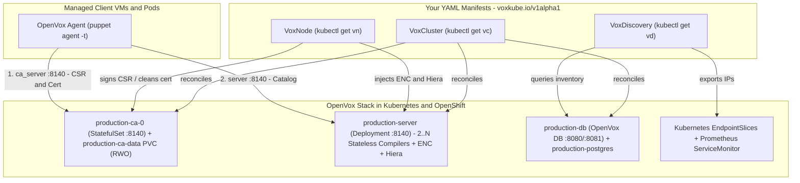

# VoxKube (`voxkube-operator`)

[](#ai-built-notice)
[](#custom-resources)
[](#why-voxkube)
[](LICENSE)

> [!IMPORTANT]
> **AI-Built Project Notice (`#ai-built-notice`)**: This entire project (**`VoxKube`** / `voxkube-operator` -- architecture, CRDs, Go controllers, container images, ESO & `cert-manager` Hiera Bridge, GitHub App authentication, PuppetDB `EndpointSlice` discovery, Helm chart, unit tests, and documentation) was **designed, architected, and built entirely with AI**.

**VoxKube** is a Kubernetes and OpenShift operator that runs a complete [OpenVox](https://voxpupuli.org/openvox/) (open-source Puppet 8) infrastructure using three Custom Resources:

- **`VoxCluster` (`kubectl get vc`)** -- Deploys and manages your OpenVox stack: a dedicated Certificate Authority (`<cluster>-ca`), horizontally scalable stateless catalog compilers (`<cluster>-server`), OpenVox DB / PuppetDB (`<cluster>-db`), and PostgreSQL (`<cluster>-postgres` or an external database).
- **`VoxNode` (`kubectl get vn`)** -- Manages an individual client VM or server: approves its certificate request (CSR), defines its Puppet classes/role/parameters (ENC), provisions `cert-manager` SSL certificates or External Secrets for that machine, and cleans it up from both the CA and PuppetDB when deleted.
- **`VoxDiscovery` (`kubectl get vd`)** -- Queries OpenVox DB for active machines matching your facts or classes and exports their IPs as native Kubernetes `EndpointSlice`s and Prometheus `ServiceMonitor`s.

---

## Why VoxKube? (`#why-voxkube`)

Running Puppet / OpenVox inside Kubernetes or OpenShift traditionally hits four pain points. VoxKube solves all of them out of the box:

1. **Separated CA (`StatefulSet`) vs. Stateless Compilers (`Deployment`)**:
   - OpenVox CA state (`serial`, `inventory.txt`, `ca_crl.pem`, `signed/`, `requests/`) is file-based and not safe for concurrent multi-pod writes.
   - VoxKube runs a dedicated 1-replica **`<cluster>-ca` `StatefulSet`** backed by a standard `ReadWriteOnce` PersistentVolumeClaim (`<cluster>-ca-data`), while **`<cluster>-server`** runs as a stateless `Deployment` (`2..N` replicas) with CA disabled so you can scale catalog compilation horizontally without `ReadWriteMany` storage.
2. **Disaster-Recovery (DR) Safe CA Storage**:
   - The CA bootstrap container checks whether `ca_crt.pem` already exists on the `<cluster>-ca-data` PVC before seeding.
   - If a pod restarts or you restore a cluster from storage backup, VoxKube reuses the existing CA certificate, private key, CRL, and signed client inventory on the PVC. Your existing VMs continue checking in without re-enrolling.
3. **100% OpenShift `restricted-v2` SCC Compliant**:
   - All workloads (`voxkube-operator`, `openvox-server`, `openvox-db`, `postgresql`) run rootless without hardcoded UIDs/GIDs, allowing OpenShift to assign arbitrary namespace UIDs cleanly.
4. **First-Party Multi-Arch Container Images (`linux/amd64` & `linux/arm64`)**:
   - Built directly from official Vox Pupuli OpenVox 8 packages (`yum.voxpupuli.org`) on Red Hat UBI 9 via GitHub Actions:
     - `ghcr.io/yboikov/voxkube-operator:latest`
     - `ghcr.io/yboikov/openvox-server:latest`
     - `ghcr.io/yboikov/openvox-db:latest`

---

## How It Works



---

## 5-Minute Quickstart

### Step 1: Install the Operator via Helm

```bash
helm upgrade --install voxkube-operator ./charts/voxkube-operator \
  --namespace openvox \
  --create-namespace \
  --set image.tag=latest
```

### Step 2: Create a `VoxCluster`

Apply a `VoxCluster` manifest to bring up the CA, Compiler Pool, OpenVox DB, and PostgreSQL:

```yaml
apiVersion: voxkube.io/v1alpha1
kind: VoxCluster
metadata:
  name: production
  namespace: openvox
spec:
  code:
    mode: pvc # Use "git" to sync a Puppet control-repo with g10k
  ca:
    storageSize: 2Gi
  server:
    image: ghcr.io/yboikov/openvox-server:latest
    replicas: 2
    javaArgs: "-Xms512m -Xmx512m"
  database:
    enabled: true
    image: ghcr.io/yboikov/openvox-db:latest
    postgres:
      mode: builtin
      storageSize: 10Gi
  networking:
    externalHostname: puppet.example.com
    serviceType: ClusterIP
```

Check the deployed pods and services:

```bash
kubectl get vc,pods,pvc,svc -n openvox
```

You will see:
- `production-ca-0` (`StatefulSet`) and `service/production-ca` (`:8140`) for CA operations.
- `production-server-*` (`Deployment`) and `service/production` (`:8140`) for catalog compilation.
- `production-db-*` and `production-postgres-0` for OpenVox DB.

---

### Step 3: Enroll & Classify a Client Node (`VoxNode`)

1. Point your client's `/etc/puppetlabs/puppet/puppet.conf` to the CA service and Server service:
   ```ini
   [main]
   certname = web-01.example.com
   ca_server = production-ca.openvox.svc.cluster.local
   server = production.openvox.svc.cluster.local
   environment = production
   ```
2. Submit a certificate request from the client:
   ```bash
   /opt/puppetlabs/bin/puppet ssl submit_request
   ```
3. Create a `VoxNode` resource in Kubernetes to sign the certificate and classify the machine:
   ```yaml
   apiVersion: voxkube.io/v1alpha1
   kind: VoxNode
   metadata:
     name: web-01
     namespace: openvox
   spec:
     clusterRef: production
     certname: web-01.example.com
     state: Active
     classification:
       environment: production
       role: role::webserver
       classes:
         - profile::nginx
       parameters:
         http_port: "8080"
         welcome_message: "Managed by VoxKube"
   ```
4. Run `puppet agent -t` on the client:
   ```bash
   /opt/puppetlabs/bin/puppet agent -t
   ```
   The agent downloads its signed certificate from `production-ca`, requests its catalog from `production`, and applies the classes and parameters defined in `VoxNode/web-01`.

---

## Custom Resources Guide (`#custom-resources`)

### 1. Deploying Puppet Code from Git (`VoxCluster`)

In production, set `spec.code.mode: git` to synchronize your Puppet `control-repo` automatically using `g10k`. VoxKube polls the remote Git repository outbound (`git ls-remote`) so you do not need inbound webhooks through your firewall:

```yaml
spec:
  code:
    mode: git
    git:
      remote: https://github.com/myorg/puppet-control-repo.git
      authType: githubApp # only githubApp is implemented today, see API Reference
      githubApp:
        appID: 123456
        installationID: 98765432
        privateKeySecretRef:
          name: github-app-private-key
          key: private-key.pem
      pollInterval: 60s
      synchronizedRollout: true
      generateTypes: true
```

To trigger an immediate Git sync without waiting for `pollInterval`:

```bash
kubectl annotate voxcluster production -n openvox voxkube.io/sync-now="$(date +%s)" --overwrite
```

---

### 2. Injecting Secrets & SSL Certificates into Hiera (`VoxNode` + ESO + `cert-manager`)

VoxKube includes a built-in Hiera Secret Bridge that mounts Kubernetes Secrets into `/etc/puppetlabs/puppet/hiera-secrets` and automatically adds `lookup_options` with `convert_to: "Sensitive"` so secrets never leak in Puppet logs or reports:

- **Common Secrets**: List secret names under `spec.hieraSecrets.commonSecrets` on `VoxCluster`, or label any Secret (for example from External Secrets Operator) with `voxkube.io/hiera-secret: "true"`.
- **Role Secrets**: Label a Secret with `voxkube.io/hiera-secret: "true"`, `voxkube.io/hiera-scope: "role"`, and `voxkube.io/hiera-role: "webserver"`.
- **Per-Node SSL Certificates via `cert-manager`**: Request one or more certificates directly on a `VoxNode`:
  ```yaml
  spec:
    certificates:
      - name: public_web
        issuerRef:
          name: letsencrypt-prod
          kind: ClusterIssuer
        dnsNames:
          - app.example.com
        targetCertPath: /etc/nginx/ssl/app.example.com.crt
        targetKeyPath: /etc/nginx/ssl/app.example.com.key
  ```
  VoxKube creates the `cert-manager` `Certificate`, waits for the TLS Secret, and injects `certs::public_web::tls_crt`, `certs::public_web::tls_key`, and `openvox::certs` into that node's Hiera data.

---

### 3. Decommissioning a Node (`VoxNode`)

When a VM is retired, either set `spec.state: Decommissioned` or delete the `VoxNode`:

```bash
kubectl delete voxnode web-01 -n openvox
```

VoxKube's finalizer atomically:
1. Revokes and cleans the node's certificate on `<cluster>-ca` (`PUT /puppet-ca/v1/clean`).
2. Deactivates the node in OpenVox DB (`POST /pdb/cmd/v1` `deactivate node`).
3. Removes its ENC and Hiera entries from `<cluster>-server`.

---

### 4. Exporting PuppetDB Inventory to Prometheus (`VoxDiscovery`)

Use `VoxDiscovery` to turn OpenVox DB into a Kubernetes service discovery source for Prometheus:

```yaml
apiVersion: voxkube.io/v1alpha1
kind: VoxDiscovery
metadata:
  name: puppet-node-exporter
  namespace: openvox
spec:
  clusterRef: production
  syncInterval: 60s
  addressFact: networking.ip
  selector:
    environment: production
    facts:
      kernel: Linux
  ports:
    - name: metrics
      port: 9100
      protocol: TCP
  serviceMonitor:
    enabled: true
    interval: 30s
    preserveNodeHostnameAsInstance: true
    tls:
      enabled: true
      mode: openvoxCA
```

---

## API Reference (`#api-reference`)

| | |
|---|---|
| API group | `voxkube.io` |
| Version | `v1alpha1` |
| Scope | All kinds are **Namespaced** |
| Kinds | `VoxCluster` (`vc`), `VoxNode` (`vn`), `VoxDiscovery` (`vd`) |

### Conventions

- **Same-namespace references.** `clusterRef`, every Secret name, and every `SecretKeySelector` are resolved in the namespace of the referencing object. Cross-namespace references are not supported.
- **Durations.** `code.git.pollInterval` and `VoxDiscovery.spec.syncInterval` are parsed with Go's `time.ParseDuration` (`30s`, `5m`, `1h`; `1d` is **invalid**, and an invalid value silently falls back to the default). PuppetDB housekeeping TTLs (`7d`, `14d`) use the PuppetDB format and are written verbatim to `database.ini`. cert-manager `duration` / `renewBefore` use cert-manager's format (`2160h`).
- **Implementation status.** Every field below has a status:
  - **Implemented**: read and acted on by the operator.
  - **Partial**: read, but behaviour differs from the field description (details in the row).
  - **Ignored**: accepted and defaulted by the CRD schema, but **not read by any controller** in this version. Setting it has no effect.

> [!WARNING]
> **Known gaps in `v1alpha1`.** Read these before running VoxKube in production:
> - **Built-in PostgreSQL is not persistent.** `database.postgres.mode: builtin` mounts an `emptyDir`, so OpenVox DB data is lost whenever the `<cluster>-postgres-0` pod is rescheduled. `postgres.storageSize` is ignored.
> - **Database credentials are hard-coded.** Both the built-in PostgreSQL and `database.ini` use user `openvoxdb` with password `openvoxdb`. `postgres.credentialsSecretRef` and `postgres.sslMode` are ignored, so an external database must accept those credentials.
> - **`code.mode: git` (the default) is not runnable yet.** Compiler pods get a `g10k-init` init container that runs `g10k -config /etc/puppetlabs/g10k/g10k.yaml`, but the operator never renders or mounts that file, and it doesn't mount the minted Git token into the pods. Use `mode: pvc` (as in the Quickstart) until this is fixed.
> - **`code.mode: pvc` and `imageVolume` don't mount your code.** `/etc/puppetlabs/code` is an `emptyDir` seeded with a demo `production` environment (`site.pp` and `profile::nginx`). `claimName` and `image` are ignored.
> - **The CA and server TLS material is generated once and never rotated.** The compiler certificate is valid for 1 year. SAN changes (`externalHostname`, `additionalDNSNames`) apply only when `<cluster>-ca-tls` is first created.

---

### `VoxCluster`

Deploys one OpenVox stack: CA, compiler pool, OpenVox DB, PostgreSQL, Hiera Secret Bridge, ENC, Services and an optional Route.

```
$ kubectl get vc
NAME         PHASE     READY   COMMIT    SERVER URL                                          AGE
```

Printer columns: `.status.phase`, `.status.readyReplicas`, `.status.observedCommit`, `.status.serverURL`, age.

#### `spec`

| Field | Type | Required | Description |
|---|---|---|---|
| `code` | [`ClusterCodeSpec`](#voxclusterspeccode) | no | How Puppet code reaches the compilers. |
| `ca` | [`ClusterCASpec`](#voxclusterspecca) | no | Dedicated OpenVox CA. |
| `server` | [`ClusterServerSpec`](#voxclusterspecserver) | no | Compiler pool. Also supplies the image and pod security context for the CA. |
| `database` | [`ClusterDatabaseSpec`](#voxclusterspecdatabase) | no | OpenVox DB and PostgreSQL. |
| `networking` | [`ClusterNetworkingSpec`](#voxclusterspecnetworking) | no | Service type, TLS SANs, OpenShift Route. |
| `hieraSecrets` | [`HieraSecretsSpec`](#voxclusterspechierasecrets) | no | Secret to Hiera bridge. |
| `workflows` | [`ClusterWorkflowsSpec`](#voxclusterspecworkflows) | no | ENC defaults, facts, reports, maintenance. |

#### `VoxCluster.spec.code`

| Field | Type | Default | Validation | Status | Description |
|---|---|---|---|---|---|
| `mode` | string | `git` | `git` \| `pvc` \| `imageVolume` | **Partial** | `git` adds the `g10k-init` init container and the `g10k-sync` sidecar to compiler pods (see known gaps). `pvc` and `imageVolume` add nothing, and the code directory is an `emptyDir` with demo code. |
| `git` | [`GitCodeSpec`](#voxclusterspeccodegit) | – | – | **Partial** | Git poller settings. If omitted, no polling happens. |
| `claimName` | string | – | – | **Ignored** | PVC with Puppet code for `mode: pvc`. |
| `image` | string | – | – | **Ignored** | OCI image with Puppet code for `mode: imageVolume`. |

#### `VoxCluster.spec.code.git`

| Field | Type | Default | Validation | Status | Description |
|---|---|---|---|---|---|
| `remote` | string | – | **required** | Implemented | Control-repo URL. Only `http://` / `https://` remotes are polled. For any other scheme the observed commit is the placeholder `sha-ssh-head`. The poller reads `/info/refs?service=git-upload-pack` and takes the first of `HEAD`, `refs/heads/main` or `refs/heads/production` it finds. |
| `authType` | string | `githubApp` | `githubApp` \| `sshKey` \| `httpsToken` \| `none` | **Partial** | Only `githubApp` is implemented. Any other value means the poller authenticates with nothing. |
| `githubApp` | [`GitHubAppAuthSpec`](#voxclusterspeccodegitgithubapp) | – | – | Implemented | Used when `authType: githubApp`. |
| `credentialsSecretRef` | string | – | – | **Ignored** | Secret for `sshKey` / `httpsToken`. |
| `pollInterval` | duration | `60s` | Go duration | Implemented | Requeue interval of the `VoxCluster` reconcile, which runs the poll. |
| `synchronizedRollout` | bool | `true` | – | **Ignored** | A changed commit always updates the `voxkube.io/observed-commit` pod annotation, which triggers a standard Deployment rolling update. |
| `generateTypes` | bool | `true` | – | Implemented | Appends `-generate-types` to the g10k arguments. |

#### `VoxCluster.spec.code.git.githubApp`

| Field | Type | Default | Validation | Status | Description |
|---|---|---|---|---|---|
| `appID` | int64 | – | **required**, ≥ 1 | Implemented | GitHub App ID. |
| `installationID` | int64 | – | **required**, ≥ 1 | Implemented | Installation ID. |
| `privateKeySecretRef` | `SecretKeySelector` (`name`, `key`) | – | **required** | Implemented | Secret key holding the App's RSA private key in PEM format. If the Secret doesn't exist, token minting is skipped silently. |
| `apiBaseURL` | string | `https://api.github.com` | – | Implemented | Override for GitHub Enterprise Server. |

The operator mints an RS256 JWT, exchanges it at `POST {apiBaseURL}/app/installations/{installationID}/access_tokens`, uses the token as `x-access-token` basic auth for polling, and stores it in Secret `<cluster>-g10k-git-token` (key `token`). That Secret is currently **not mounted** into any pod.

#### `VoxCluster.spec.ca`

| Field | Type | Default | Validation | Status | Description |
|---|---|---|---|---|---|
| `enabled` | bool | `true` | – | Implemented | `false` skips the CA PVC, ConfigMap, StatefulSet and Service. The `<cluster>-ca-tls` Secret is still generated, because compilers and the DB need it. |
| `storageSize` | quantity | `2Gi` | – | Implemented | Size of PVC `<cluster>-ca-data`. Applied **only when the PVC is created**. An unparsable value falls back to `2Gi`. |
| `storageClassName` | string | – | – | Implemented | StorageClass for the CA PVC (creation only). |
| `ttl` | string | `10y` | – | **Ignored** | The CA certificate is always valid for 10 years. |
| `autosignMode` | string | `voxnode` | `voxnode` \| `psk` \| `off` \| `true` | **Ignored** | The CA is never configured for autosigning. Certificates are signed only through `VoxNode` (`state: Active`). |
| `pskSecretRef` | string | – | – | **Ignored** | Pre-shared key for `autosignMode: psk`. |

#### `VoxCluster.spec.server`

| Field | Type | Default | Validation | Status | Description |
|---|---|---|---|---|---|
| `image` | string | `ghcr.io/yboikov/openvox-server:latest` | – | Implemented | Used by the compiler pods, the g10k containers **and the CA StatefulSet**. |
| `imagePullPolicy` | string | `IfNotPresent` | `Always` \| `IfNotPresent` \| `Never` | Implemented | Applied to the CA and `openvox-server` / `server-init` containers. It isn't applied to the g10k containers. |
| `replicas` | int32 | `2` | ≥ 1 | Implemented | Replicas of Deployment `<cluster>-server`. |
| `javaArgs` | string | `-Xms1g -Xmx1g` | – | Implemented | `JAVA_ARGS` for compilers. The CA pod always uses `-Xms256m -Xmx384m`. |
| `maxActiveInstances` | int32 | `2` | ≥ 1 | Implemented | `jruby-puppet.max-active-instances` on compilers. The CA always uses `1`. |
| `resources` | `ResourceRequirements` | – | – | Implemented | Applied to the `openvox-server` container only. |
| `autoscaling` | [`ServerAutoscalingSpec`](#voxclusterspecserverautoscaling) | – | – | **Ignored** | No HorizontalPodAutoscaler is created. |
| `securityContext` | [`PodSecurityContextSpec`](#voxclusterspecserversecuritycontext) | – | – | Implemented | Pod-level overrides applied to the **CA, compiler, OpenVox DB and built-in PostgreSQL** pods. |

#### `VoxCluster.spec.server.autoscaling`

This whole block is **Ignored**.

| Field | Type | Default | Validation |
|---|---|---|---|
| `enabled` | bool | `false` | – |
| `minReplicas` | int32 | `2` | – |
| `maxReplicas` | int32 | `6` | – |
| `targetCPUUtilizationPercentage` | int32 | `75` | – |

#### `VoxCluster.spec.server.securityContext`

Defaults (with no override): `runAsNonRoot: true`, `seccompProfile: RuntimeDefault`, and **no** UID/GID/fsGroup, so OpenShift `restricted-v2` assigns them. Every container additionally gets `allowPrivilegeEscalation: false`, `runAsNonRoot: true`, `capabilities.drop: [ALL]` and `seccompProfile: RuntimeDefault`. Those container-level settings can't be overridden.

| Field | Type | Validation | Description |
|---|---|---|---|
| `runAsUser` | int64 | – | Pod UID. |
| `runAsGroup` | int64 | – | Pod primary GID. |
| `runAsNonRoot` | bool | – | Overrides the default `true`. |
| `fsGroup` | int64 | – | Volume supplemental group. |
| `fsGroupChangePolicy` | string | `Always` \| `OnRootMismatch` | Volume ownership change policy. |

#### `VoxCluster.spec.database`

| Field | Type | Default | Validation | Status | Description |
|---|---|---|---|---|---|
| `enabled` | bool | `true` | – | Implemented | `false` skips PostgreSQL and OpenVox DB entirely. `status.databaseURL` is then empty, and `VoxNode` / `VoxDiscovery` skip PuppetDB calls. |
| `image` | string | `ghcr.io/yboikov/openvox-db:latest` | – | Implemented | OpenVox DB image. |
| `replicas` | int32 | `1` | ≥ 1 | Implemented | Replicas of Deployment `<cluster>-db`. |
| `postgres` | [`ClusterPostgresSpec`](#voxclusterspecdatabasepostgres) | – | – | Partial | See below. |
| `housekeeping` | [`DatabaseHousekeepingSpec`](#voxclusterspecdatabasehousekeeping) | – | – | Implemented | Written to `database.ini`. |

#### `VoxCluster.spec.database.postgres`

| Field | Type | Default | Validation | Status | Description |
|---|---|---|---|---|---|
| `mode` | string | `builtin` | `external` \| `builtin` | Implemented | `builtin` creates StatefulSet and Service `<cluster>-postgres` (1 replica) and enables `pg_trgm`. `external` connects to `host`. |
| `host` | string | – | – | Implemented | External hostname. Ignored for `builtin`. |
| `port` | int32 | `5432` | – | Implemented | Used both for the connection string and as the built-in container/Service port. |
| `databaseName` | string | `openvoxdb` | – | Implemented | Database name. |
| `credentialsSecretRef` | string | – | – | **Ignored** | Credentials are hard-coded to `openvoxdb` / `openvoxdb`. |
| `sslMode` | string | `require` | – | **Ignored** | Not added to the JDBC subname. |
| `image` | string | `quay.io/sclorg/postgresql-16-c9s:latest` | – | Implemented | Built-in PostgreSQL image. |
| `storageSize` | quantity | `10Gi` | – | **Ignored** | Built-in PostgreSQL uses an `emptyDir` (non-persistent). |

#### `VoxCluster.spec.database.housekeeping`

| Field | Type | Default | Status | `database.ini` key |
|---|---|---|---|---|
| `nodeTTL` | string | `7d` | Implemented | `node-ttl` |
| `nodePurgeTTL` | string | `14d` | Implemented | `node-purge-ttl` |
| `reportTTL` | string | `14d` | Implemented | `report-ttl` |
| `gcInterval` | int32 (minutes) | `60` | Implemented | `gc-interval` |

#### `VoxCluster.spec.networking`

| Field | Type | Default | Validation | Status | Description |
|---|---|---|---|---|---|
| `externalHostname` | string | – | – | Partial | Added as a SAN on the compiler TLS certificate (**only at first generation** of `<cluster>-ca-tls`), and used as the Route host when `openShiftRoute.host` is empty. |
| `additionalDNSNames` | []string | – | – | Partial | Extra SANs, also applied only at first generation. |
| `serviceType` | string | `ClusterIP` | `ClusterIP` \| `NodePort` \| `LoadBalancer` | Implemented | Type of Service `<cluster>` (port `8140`, named `puppet`). The CA, DB and PostgreSQL Services are always `ClusterIP`. |
| `openShiftRoute.enabled` | bool | `false` | – | Implemented | Creates a `route.openshift.io/v1` Route `<cluster>` with TLS `passthrough` to Service `<cluster>`, port `puppet`. Silently skipped if the Route API doesn't exist. |
| `openShiftRoute.host` | string | `externalHostname` | – | Implemented | Route host. |
| `openShiftRoute.annotations` | map[string]string | – | – | Implemented | Annotations on the Route. |

The certificate SANs always include `<cluster>.<ns>.svc`, `<cluster>.<ns>.svc.cluster.local`, `<cluster>-ca.<ns>.svc` and `<cluster>-ca.<ns>.svc.cluster.local`. The CA Service `<cluster>-ca` is never exposed by the Route, so agents outside the Kubernetes cluster need another way to reach `ca_server`.

#### `VoxCluster.spec.hieraSecrets`

| Field | Type | Default | Status | Description |
|---|---|---|---|---|
| `enabled` | bool | `true` | Implemented | `false` stops rendering `<cluster>-hiera-secrets` and doesn't mount it into compilers. |
| `labelSelector` | map[string]string | `voxkube.io/hiera-secret: "true"` | Implemented | Secrets whose labels contain **all** of these pairs are injected. When set, it **replaces** the default selector. |
| `commonSecrets` | []string | – | Implemented | Secret names whose keys go into `common.yaml`, labelled or not. Missing Secrets are skipped. |

See [Hiera Secret Bridge contract](#hiera-secret-bridge-contract) for scopes and file layout.

#### `VoxCluster.spec.workflows`

| Field | Type | Default | Validation | Status | Description |
|---|---|---|---|---|---|
| `nodeClassification.mode` | string | `voxnode` | `voxnode` \| `externalHttp` \| `none` | **Ignored** | The ENC is always backed by `VoxNode`. |
| `nodeClassification.defaultEnvironment` | string | `production` | – | Partial | Used only if a `VoxNode` has an empty `classification.environment`. That field has its own CRD default of `production`, so this is effectively unused. Unknown nodes (no `VoxNode`) always get `production`. |
| `nodeClassification.autoCreateVoxNode` | bool | `true` | – | **Ignored** | No `VoxNode` is ever auto-created. |
| `nodeClassification.externalURL` | string | – | – | **Ignored** | – |
| `facts.injectKubernetesMetadata` | bool | `true` | – | **Ignored** | – |
| `reports.processors` | []string | – | – | **Ignored** | – |
| `reports.webhookURL` | string | – | – | **Ignored** | – |
| `maintenance.globalNoop` | bool | `false` | – | Partial | Adds top-scope ENC parameter `noop: true` to every `VoxNode`, and pod annotation `voxkube.io/global-noop: "true"` to compilers (which rolls them). A top-scope `$noop` variable does **not** by itself put Puppet resources into noop mode, so your code must honour it. |

#### `VoxCluster.status`

| Field | Type | Description |
|---|---|---|
| `phase` | string | One of `Pending`, `InitializingCA`, `DeployingDatabase`, `DeployingServer`, `Running`, `Degraded`, `Error`. Currently only `Running` is ever set (after a fully successful reconcile). Errors are visible only in operator logs. |
| `serverURL` | string | `https://<cluster>.<ns>.svc.cluster.local:8140` |
| `caURL` | string | `https://<cluster>-ca.<ns>.svc.cluster.local:8140`, or empty if `ca.enabled: false`. |
| `databaseURL` | string | `http://<cluster>-db.<ns>.svc.cluster.local:8080`, or empty if `database.enabled: false`. |
| `caSecretName` | string | `<cluster>-ca-tls` |
| `hieraSecretName` | string | `<cluster>-hiera-secrets`, or empty if disabled. |
| `observedCommit` | string | Last polled commit SHA. Placeholders `sha-ssh-head`, `sha-verified` and `sync-<value>` are possible. |
| `readyReplicas` | int32 | `readyReplicas` of `<cluster>-server`. |
| `conditions` | []`Condition` | `Ready=True`, reason `StackReconciled`. |

#### Annotations on `VoxCluster`

| Annotation | Set by | Effect |
|---|---|---|
| `voxkube.io/sync-now` | you | Any change triggers an immediate reconcile, and so an immediate HEAD poll. If HEAD is unchanged nothing rolls. The value is used as the commit (`sync-<value>`) only when polling returns an empty SHA. |

#### Resources created per `VoxCluster` `<c>`

All of these are owned by the `VoxCluster` (garbage-collected on delete, **including the CA PVC**) and labelled `app.kubernetes.io/name=voxkube`, `app.kubernetes.io/instance=<c>`, `app.kubernetes.io/component=<component>` and `app.kubernetes.io/managed-by=voxkube-operator`.

| Kind | Name | Component | Notes |
|---|---|---|---|
| Secret (`kubernetes.io/tls`) | `<c>-ca-tls` | `ca` | Keys: `ca.crt`, `ca.key`, `ca.pub`, `crl.pem`, `tls.crt`, `tls.key`, `tls.pub`. Self-signed CA `CN=VoxKube Puppet CA - <c>` (10 y) and server cert `CN=<c>.<ns>.svc` (1 y). Regenerated only if `ca.pub`, `crl.pem` or `tls.pub` is missing. |
| PersistentVolumeClaim | `<c>-ca-data` | `ca` | RWO. Holds CA state; on restart the bootstrap reuses it if `ca_crt.pem` exists. |
| ConfigMap | `<c>-ca-config` | `ca` | `webserver.conf`, `ca.cfg`, `puppet.conf`, `puppetserver.conf`, `bootstrap-ca.sh` |
| StatefulSet, Service | `<c>-ca` | `ca` | 1 replica, port `8140` (`https-ca`). |
| Secret | `<c>-g10k-git-token` | `g10k-token` | Only with `authType: githubApp`. |
| ConfigMap | `<c>-postgres-init` | `postgres` | `builtin` only. |
| StatefulSet, Service | `<c>-postgres` | `postgres` | `builtin` only. |
| ConfigMap | `<c>-db-config` | `db` | `database.ini`, `jetty.ini` |
| Deployment, Service | `<c>-db` | `db` | Ports `8080` (`http`) and `8081` (`https`). |
| Secret | `<c>-hiera-secrets` | `hiera-secrets` | Rendered Hiera data, mounted at `/etc/puppetlabs/puppet/hiera-secrets`. |
| ConfigMap | `<c>-enc-nodes` | `enc` | One `<certname>.yaml` per non-decommissioned `VoxNode`. |
| ConfigMap | `<c>-server-config` | `server` | `webserver.conf`, `ca.cfg` (CA disabled), `puppet.conf`, `puppetserver.conf`, `enc.sh`, `hiera.yaml`, `bootstrap-server.sh` |
| Deployment | `<c>-server` | `server` | Compilers. |
| Service | `<c>` | `server` | Port `8140` (`puppet`), type from `networking.serviceType`. |
| Route | `<c>` | `route` | Only if `openShiftRoute.enabled`. |

The operator also sets `voxkube.io/spec-hash` on the Deployments, StatefulSets and Services it manages (used for drift detection), and `voxkube.io/observed-commit` on the compiler pod template.

---

### `VoxNode`

One managed Puppet agent: certificate lifecycle, ENC classification, cert-manager certificates and node-scoped Hiera secrets.

Printer columns: `.spec.clusterRef`, `.spec.certname`, `.spec.classification.role`, `.spec.state`, `.status.phase`, `.status.readyCertificates`, age.

#### `spec`

| Field | Type | Default | Validation | Status | Description |
|---|---|---|---|---|---|
| `clusterRef` | string | – | **required** | Implemented | Name of a `VoxCluster` in the same namespace. |
| `certname` | string | – | **required** | Implemented | Agent certname (FQDN). It must be unique per cluster: it is the key for the ENC and Hiera files. |
| `state` | string | `Active` | `PendingApproval` \| `Active` \| `Revoked` \| `Decommissioned` | Implemented | Desired lifecycle state, see [state machine](#voxnode-state-machine). |
| `classification` | [`NodeClassificationSpec`](#voxnodespecclassification) | – | – | Implemented | ENC data. |
| `certificates` | [][`CertManagerCertRequest`](#voxnodespeccertificates) | – | – | Implemented | cert-manager certificates injected into Hiera. |
| `secrets` | [][`NodeSecretRef`](#voxnodespecsecrets) | – | – | Implemented | Secrets injected into this node's Hiera file. |

#### `VoxNode.spec.classification`

| Field | Type | Default | Description |
|---|---|---|---|
| `environment` | string | `production` | Puppet environment returned by the ENC. |
| `role` | string | – | Emitted as top-scope parameter `role`. It also selects Hiera file `roles_<role>.yaml`. |
| `classes` | []string | – | Classes returned by the ENC. |
| `parameters` | map[string]any (JSON) | – | Extra top-scope parameters. Any JSON value (string, number, bool, list, object) is allowed. Keys `role`, `voxkube_cluster` and `noop` are overwritten if you set them. |

The ENC output, served by `/etc/puppetlabs/puppet/enc.sh <certname>`, looks like this:

```yaml
environment: production
classes: [profile::nginx]
parameters:
  role: role::webserver
  voxkube_cluster: production
  http_port: "8080"
  # noop: true            # only when workflows.maintenance.globalNoop
```

A certname with no `VoxNode` (or a `Decommissioned` one) gets `environment: production`, `classes: []` and `parameters: {voxkube_cluster: <cluster>}`.

#### `VoxNode.spec.certificates[]`

| Field | Type | Default | Validation | Description |
|---|---|---|---|---|
| `name` | string | – | **required** | Logical name, used in the Hiera keys. |
| `issuerRef.name` | string | – | **required** | cert-manager Issuer or ClusterIssuer. |
| `issuerRef.kind` | string | `ClusterIssuer` | `Issuer` \| `ClusterIssuer` | – |
| `issuerRef.group` | string | `cert-manager.io` | – | – |
| `dnsNames` | []string | `[<certname>]` | – | DNS SANs. |
| `ipAddresses` | []string | – | – | IP SANs. |
| `duration` | string | `2160h` | – | Passed to `Certificate.spec.duration`. |
| `renewBefore` | string | `720h` | – | Passed to `Certificate.spec.renewBefore`. |
| `targetCertPath` | string | – | – | Copied into the Hiera hash as `target_cert_path`. The operator does **not** write files on the VM; your Puppet code must. |
| `targetKeyPath` | string | – | – | Copied into the Hiera hash as `target_key_path`. |
| `secretName` | string | generated | – | Overrides **both** the `Certificate` name and its `secretName`. |

The generated name is `voxnode-cert-<a>-<b>`, where `<a>` and `<b>` are `metadata.name` and `name`, each lowercased, cut at the first `.`, and with every character outside `[a-z0-9-]` replaced by `-` (`public_web` becomes `public-web`). The `Certificate` is owned by the `VoxNode` and labelled `voxkube.io/node=<certname>` and `voxkube.io/cert-name=<name>`. If cert-manager isn't installed, creation is skipped silently.

Hiera keys written to `nodes_<certname>.yaml` once the TLS Secret exists:

| Key | Value | Sensitive |
|---|---|---|
| `certs::<name>::tls_crt` | `tls.crt` | yes |
| `certs::<name>::tls_key` | `tls.key` | yes |
| `certs::<name>::ca_crt` | `ca.crt` (if present) | yes |
| `openvox::certs` | `{<name>: {tls_crt, tls_key, ca_crt?, target_cert_path?, target_key_path?}}` | **no**, so the key inside this hash is not wrapped in `Sensitive` |

#### `VoxNode.spec.secrets[]`

| Field | Type | Validation | Description |
|---|---|---|---|
| `secretName` | string | **required** | Secret in the same namespace. A missing Secret is skipped. |
| `hieraPrefix` | string | **required** | Each key `k` of the Secret becomes Hiera key `<hieraPrefix>::k` in `nodes_<certname>.yaml`. |

#### `VoxNode` state machine

| `spec.state` | Operator actions | Resulting `status.phase` | `Ready` condition (reason) |
|---|---|---|---|
| `PendingApproval` | Nothing is signed. | `PendingCSR` | `False` (`PendingApproval`) |
| `Active` | `GET /puppet-ca/v1/certificate_status/<certname>`. If it isn't `signed`, `PUT … {"desired_state":"signed"}`. Then it reconciles cert-manager `Certificate`s and re-renders the Hiera Secret and ENC ConfigMap. | `Active` | `True` (`NodeActive`) |
| `Revoked` | `PUT /puppet-ca/v1/certificate_status/<certname> {"desired_state":"revoked"}`. The ENC and Hiera entries are **kept**. | `Revoked` | `True` (`CertificateRevoked`) |
| `Decommissioned` | `PUT /puppet-ca/v1/clean {"certnames":[…]}`, then PuppetDB `deactivate node` (v3), then deletes the node's `Certificate`s and removes its ENC and Hiera entries. CA and DB errors are logged and ignored. | `Decommissioned` | `True` (`NodeDecommissioned`) |
| *object deleted* | The finalizer `voxkube.io/node-cleanup` runs the same steps as `Decommissioned` (skipped if the `VoxCluster` is gone), then removes itself. | – | – |
| *cluster missing* | – | `Error` | `False` (`ClusterNotFound`) |

> [!NOTE]
> - **CSR timing.** If the agent hasn't submitted its CSR yet when the `VoxNode` reconciles, signing fails quietly. The node is still marked `Active` with `certificateSigned: false`, and **no requeue is scheduled**. Signing is retried only on the next change to the `VoxNode` or the controller resync. To retry sooner, touch the object (for example `kubectl annotate vn web-01 voxkube.io/retry="$(date +%s)" --overwrite`).
> - **`status.phase: Signed`** is defined but never set.
> - **`status.readyCertificates`** isn't refreshed when cert-manager issues the Secret, only on the next `VoxNode` reconcile. The Hiera data itself is refreshed promptly, because the `VoxCluster` controller watches all Secrets.

#### `VoxNode.status`

| Field | Type | Description |
|---|---|---|
| `phase` | string | `PendingCSR` \| `Signed` \| `Active` \| `Revoked` \| `Decommissioned` \| `Error` |
| `certificateSigned` | bool | `true` once the CA reports the certificate as signed, or the sign request succeeds. |
| `certificateFingerprint` | string | The real CA fingerprint **only** if the certificate was already signed when checked. Otherwise the placeholder `sha256:signed-<certname>`. |
| `caCleaned` | bool | `true` after `Decommissioned`. |
| `puppetDBDeactivated` | bool | `true` after `Decommissioned`. |
| `readyCertificates` | int32 | Requested certificates whose Secret has `tls.crt` and `tls.key`. |
| `lastReportStatus` | string | **Never set.** |
| `lastSeenTime` | timestamp | **Never set.** |
| `conditions` | []`Condition` | `Ready`, see the state machine. |

---

### `VoxDiscovery`

Exports active PuppetDB nodes as a headless Service with `EndpointSlice`s, plus an optional Prometheus `ServiceMonitor`.

Printer columns: `.spec.clusterRef`, `.status.discoveredNodes`, `.status.endpointSliceCount`, `.status.serviceName`, `.status.lastSyncTime`, age.

#### `spec`

| Field | Type | Default | Validation | Status | Description |
|---|---|---|---|---|---|
| `clusterRef` | string | – | **required** | Implemented | `VoxCluster` whose OpenVox DB is queried. |
| `syncInterval` | duration | `60s` | Go duration | Implemented | Requeue interval. |
| `selector` | [`DiscoverySelectorSpec`](#voxdiscoveryspecselector) | – | – | Partial | Node filter. All set criteria must match (AND). |
| `addressFact` | string | `networking.ip` | – | Implemented | Dotted fact path for the endpoint address. A literal top-level key containing dots is tried first. Nodes without a valid IP are skipped. |
| `ports` | [][`DiscoveryPort`](#voxdiscoveryspecports) | – | **required** | Implemented | Ports on the Service, the slices and the ServiceMonitor endpoints. |
| `serviceMonitor` | [`DiscoveryServiceMonitorSpec`](#voxdiscoveryspecservicemonitor) | – | – | Implemented | Optional ServiceMonitor. |

The operator calls `GET <status.databaseURL>/pdb/query/v4/inventory` (falling back to `https://<cluster>-db.<ns>.svc.cluster.local:8081`), using mTLS with the cluster's `<cluster>-ca-tls` certificate. It fetches the **whole inventory** and filters client-side. It drops nodes that are deactivated in PuppetDB, and nodes whose `VoxNode` in the same namespace is `Revoked` or `Decommissioned`. If PuppetDB is unreachable it publishes one empty slice and tries again after `syncInterval`.

#### `VoxDiscovery.spec.selector`

| Field | Type | Status | Description |
|---|---|---|---|
| `environment` | string | Implemented | Exact match on the node's environment. |
| `facts` | map[string]string | Implemented | Exact string match per dotted fact path (values are compared after `fmt` formatting, so `true` and `"true"` are equal). |
| `classes` | []string | **Broken** | The inventory endpoint doesn't return classes, so any non-empty list matches **no** nodes. |
| `pql` | string | **Ignored** | – |

#### `VoxDiscovery.spec.ports[]`

| Field | Type | Default | Validation |
|---|---|---|---|
| `name` | string | – | **required**. Also the ServiceMonitor endpoint `port`. |
| `port` | int32 | – | **required**, 1–65535 |
| `protocol` | string | `TCP` | `TCP` \| `UDP` \| `SCTP` |

#### `VoxDiscovery.spec.serviceMonitor`

| Field | Type | Default | Validation | Description |
|---|---|---|---|---|
| `enabled` | bool | `false` | – | Creates `monitoring.coreos.com/v1` `ServiceMonitor` `<vd>`, with one endpoint per port. Silently skipped if the CRD is absent. |
| `interval` | string | `30s` | – | Scrape interval. |
| `scrapeTimeout` | string | `10s` | – | Scrape timeout. |
| `preserveNodeHostnameAsInstance` | bool | `true` | – | Adds relabeling `__meta_kubernetes_endpoint_node_name` → `instance`, so `instance` is the certname. |
| `additionalLabels` | map[string]string | – | – | Extra labels on the ServiceMonitor (for example for a Prometheus `serviceMonitorSelector`). |
| `tls.enabled` | bool | `false` | – | Sets `scheme: https` and `tlsConfig`. |
| `tls.mode` | string | `openvoxCA` | `openvoxCA` \| `secretRef` | `openvoxCA` mints Secret `<vd>-prometheus-scraper-tls` (`ca.crt`, `tls.crt`, `tls.key`; `CN=prometheus-scraper`, valid 1 year, **never renewed**). `secretRef` uses `tls.secretName`. |
| `tls.secretName` | string | – | – | For `secretRef`: the Secret must contain `ca.crt`, `tls.crt` and `tls.key`. |

#### Resources created per `VoxDiscovery` `<vd>`

All of these are owned by the `VoxDiscovery` and labelled `app.kubernetes.io/name=voxkube-discovery`, `app.kubernetes.io/instance=<vd>` and `app.kubernetes.io/managed-by=voxkube-operator`.

| Kind | Name | Notes |
|---|---|---|
| Service | `<vd>` | Headless (`clusterIP: None`), no selector. |
| EndpointSlice | `<vd>-0`, `<vd>-1`, … | `addressType: IPv4`, at most 100 endpoints each, sorted by certname. Each endpoint has `hostname` = first DNS label of the certname, `nodeName` = certname, `ready: true`. Surplus slices are pruned. **IPv6 addresses are not supported.** |
| ServiceMonitor | `<vd>` | When `serviceMonitor.enabled`. |
| Secret | `<vd>-prometheus-scraper-tls` | When `tls.enabled` and `mode: openvoxCA`. |

#### `VoxDiscovery.status`

| Field | Type | Description |
|---|---|---|
| `discoveredNodes` | int32 | Endpoints exported. |
| `endpointSliceCount` | int32 | Slices managed (at least 1). |
| `serviceName` | string | `<vd>` |
| `scraperSecretName` | string | TLS Secret used by the ServiceMonitor, if any. |
| `lastSyncTime` | timestamp | Last successful reconcile. |
| `conditions` | []`Condition` | `Ready=True` (`Synced`) or `Ready=False` (`ClusterNotFound`). |

---

### Hiera Secret Bridge contract

The compilers use this `hiera.yaml` (global layer, `datadir` `/etc/puppetlabs/puppet/hiera-secrets`), highest priority first:

1. `nodes_%{trusted.certname}.yaml`
2. `roles_%{role}.yaml` (`role` is the ENC top-scope parameter from `VoxNode.spec.classification.role`)
3. `common.yaml`

Secrets are selected by these labels and annotations (on `Secret` objects in the `VoxCluster`'s namespace):

| Key | Kind | Values | Meaning |
|---|---|---|---|
| `voxkube.io/hiera-secret` | label | `"true"` | Opt-in, when `hieraSecrets.labelSelector` is not set. |
| `voxkube.io/hiera-scope` | label | `common` (default), `role`, `node` | Target file. |
| `voxkube.io/hiera-role` | label | role name | Required for `scope=role`. The data goes to `roles_<value>.yaml`. |
| `voxkube.io/hiera-node` | label | certname | Required for `scope=node`. The data goes to `nodes_<value>.yaml`. |
| `voxkube.io/hiera-prefix` | annotation | e.g. `profile::db` | Key `k` becomes `<prefix>::k`. Applies to labelled Secrets and `commonSecrets`. |

Rules:

- Every top-level key is added to `lookup_options` with `convert_to: Sensitive`, **except** `openvox::certs`.
- Values are the Secret values as strings. Later sources overwrite earlier ones for the same key. Within a file the order is: `commonSecrets`, then labelled Secrets (in API list order), then for node files `VoxNode.spec.secrets`, then certificates.
- The bridge is per namespace. With several `VoxCluster`s in one namespace, labelled Secrets apply to all of them.

---

### OpenVox HTTP APIs used by the operator

All calls use mTLS with `ca.crt`, `tls.crt` and `tls.key` from `<cluster>-ca-tls`.

| Purpose | Request |
|---|---|
| Check certificate | `GET {caURL}/puppet-ca/v1/certificate_status/{certname}` |
| Sign / revoke | `PUT {caURL}/puppet-ca/v1/certificate_status/{certname}` with `{"desired_state":"signed"\|"revoked"}` |
| Clean | `PUT {caURL}/puppet-ca/v1/clean` with `{"certnames":["…"]}` |
| Deactivate node | `POST {databaseURL}/pdb/cmd/v1` with `{"command":"deactivate node","version":3,"payload":{"certname":"…","producer_timestamp":"…"}}` |
| Discovery | `GET {databaseURL}/pdb/query/v4/inventory` |
| GitHub App token | `POST {apiBaseURL}/app/installations/{id}/access_tokens` |
| Git HEAD poll | `GET {remote}/info/refs?service=git-upload-pack` |

### Operator command-line flags

| Flag | Default | Description |
|---|---|---|
| `--metrics-bind-address` | `:8080` | Metrics endpoint. |
| `--metrics-secure` | `false` | Serve metrics over HTTPS with authn/authz. |
| `--metrics-cert-dir` | – | Directory with `tls.crt` and `tls.key` for metrics. |
| `--health-probe-bind-address` | `:8081` | `/healthz` and `/readyz`. |
| `--leader-elect` | `false` | Enable leader election (the Helm chart sets `leaderElect: true`). |
| `--watch-namespace` | – (all) | Restrict the operator to one namespace. |

Standard controller-runtime `--zap-*` logging flags are also accepted.

---

## Development & Local Testing

```bash
# Run unit and controller tests
go test ./... -v

# Lint the Helm chart
helm lint charts/voxkube-operator

# Regenerate CRD manifests and deepcopy code after API changes
make generate manifests
```
