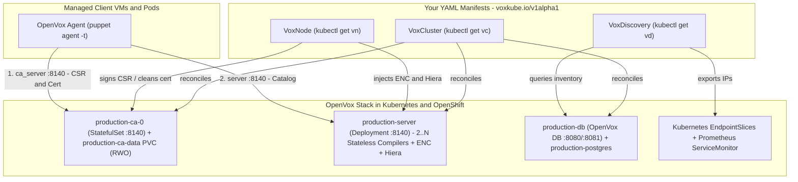

# VoxKube (`voxkube-operator`)

[](#ai-built-notice)
[](#custom-resources-guide-custom-resources)
[](#why-voxkube-why-voxkube)
[](LICENSE)

> [!IMPORTANT]
> **AI-Built Project Notice (`#ai-built-notice`)**: This entire project (**`VoxKube`** / `voxkube-operator` -- architecture, CRDs, Go controllers, container images, ESO & `cert-manager` Hiera Bridge, GitHub App authentication, PuppetDB `EndpointSlice` discovery, Helm chart, unit tests, and documentation) was **designed, architected, and built entirely with AI**.

**VoxKube** is a Kubernetes and OpenShift operator that runs a complete [OpenVox](https://voxpupuli.org/openvox/) (open-source Puppet 8) infrastructure using three Custom Resources:

- **`VoxCluster` (`kubectl get vc`)** -- Deploys and manages your OpenVox stack: a dedicated Certificate Authority (`<cluster>-ca`), horizontally scalable stateless catalog compilers (`<cluster>-server`), OpenVox DB / PuppetDB (`<cluster>-db`), and PostgreSQL (`<cluster>-postgres` or an external database).
- **`VoxNode` (`kubectl get vn`)** -- Manages an individual client VM or server: approves its certificate request (CSR), defines its Puppet classes/role/parameters (ENC), provisions `cert-manager` SSL certificates or External Secrets for that machine, and cleans it up from both the CA and PuppetDB when deleted.
- **`VoxDiscovery` (`kubectl get vd`)** -- Queries OpenVox DB for active machines matching your facts or classes and exports their IPs as native Kubernetes `EndpointSlice`s and Prometheus `ServiceMonitor`s.

---

## Why VoxKube? (`#why-voxkube`)

Running Puppet / OpenVox inside Kubernetes or OpenShift traditionally hits four pain points. VoxKube solves all of them out of the box:

1. **Separated CA (`StatefulSet`) vs. Stateless Compilers (`Deployment`)**:
   - OpenVox CA state (`serial`, `inventory.txt`, `ca_crl.pem`, `signed/`, `requests/`) is file-based and not safe for concurrent multi-pod writes.
   - VoxKube runs a dedicated 1-replica **`<cluster>-ca` `StatefulSet`** backed by a standard `ReadWriteOnce` PersistentVolumeClaim (`<cluster>-ca-data`), while **`<cluster>-server`** runs as a stateless `Deployment` (`2..N` replicas) with CA disabled so you can scale catalog compilation horizontally without `ReadWriteMany` storage.
2. **Disaster-Recovery (DR) Safe CA Storage**:
   - The CA bootstrap container checks whether `ca_crt.pem` already exists on the `<cluster>-ca-data` PVC before seeding.
   - If a pod restarts or you restore a cluster from storage backup, VoxKube reuses the existing CA certificate, private key, CRL, and signed client inventory on the PVC. Your existing VMs continue checking in without re-enrolling.
3. **100% OpenShift `restricted-v2` SCC Compliant**:
   - All workloads (`voxkube-operator`, `openvox-server`, `openvox-db`, `postgresql`) run rootless without hardcoded UIDs/GIDs, allowing OpenShift to assign arbitrary namespace UIDs cleanly.
4. **First-Party Container Images (`linux/amd64`)**:
   - Built directly from official Vox Pupuli OpenVox 8 packages (`yum.voxpupuli.org`) on Red Hat UBI 9 via GitHub Actions:
     - `ghcr.io/yboikov/voxkube-operator:<git sha>` (and `latest`)
     - `ghcr.io/yboikov/openvox-server:8.18.0` / `ghcr.io/yboikov/openvox-db:8.18.0`
   - OpenVox versions are **pinned** (see [Image versions](#image-versions)), never "whatever the repo has today".

---

## How It Works



---

## 5-Minute Quickstart

### Step 1: Install the Operator via Helm

From a release (recommended; the chart pins the matching operator image):

```bash
helm upgrade --install voxkube-operator oci://ghcr.io/yboikov/charts/voxkube-operator \
  --version 0.1.0 \
  --namespace openvox \
  --create-namespace
```

From a checkout of `main` (unreleased code), pin the operator image to a commit:

```bash
helm upgrade --install voxkube-operator ./charts/voxkube-operator \
  --namespace openvox \
  --create-namespace \
  --set image.tag=<short git sha>   # every main build is pushed as ghcr.io/yboikov/voxkube-operator:<sha>
```

Check what is running with `kubectl -n openvox logs deploy/voxkube-operator | head -1`, which prints the operator version, commit and default OpenVox images.

### Step 2: Create a `VoxCluster`

Apply a `VoxCluster` manifest to bring up the CA, Compiler Pool, OpenVox DB, and PostgreSQL:

```yaml
apiVersion: voxkube.io/v1alpha1
kind: VoxCluster
metadata:
  name: production
  namespace: openvox
spec:
  code:
    mode: pvc # Use "git" to sync a Puppet control-repo with g10k
  ca:
    storageSize: 2Gi
  server:
    image: ghcr.io/yboikov/openvox-server:8.18.0
    replicas: 2
    javaArgs: "-Xms512m -Xmx512m"
  database:
    enabled: true
    image: ghcr.io/yboikov/openvox-db:8.18.0
    postgres:
      mode: builtin # ephemeral, dev/demo only; use mode: external (e.g. CloudNativePG) in production
  networking:
    externalHostname: puppet.example.com
    serviceType: ClusterIP
```

Check the deployed pods and services:

```bash
kubectl get vc,pods,pvc,svc -n openvox
```

You will see:
- `production-ca-0` (`StatefulSet`) and `service/production-ca` (`:8140`) for CA operations.
- `production-server-*` (`Deployment`) and `service/production` (`:8140`) for catalog compilation.
- `production-db-*` and `production-postgres-0` for OpenVox DB.

`kubectl get vc` shows the phase moving through `InitializingCA`, `DeployingDatabase` and `DeployingServer` to `Running`. The conditions (`kubectl describe vc production`) show which component is still starting.

With `code.mode: pvc` and no `claimName`, the compilers serve a small demo `production` environment, which is enough for this walkthrough.

---

### Step 3: Enroll & Classify a Client Node (`VoxNode`)

1. Point your client's `/etc/puppetlabs/puppet/puppet.conf` to the CA service and Server service:
   ```ini
   [main]
   certname = web-01.example.com
   ca_server = production-ca.openvox.svc.cluster.local
   server = production.openvox.svc.cluster.local
   environment = production
   ```
2. Submit a certificate request from the client:
   ```bash
   /opt/puppetlabs/bin/puppet ssl submit_request
   ```
3. Create a `VoxNode` resource in Kubernetes to sign the certificate and classify the machine:
   ```yaml
   apiVersion: voxkube.io/v1alpha1
   kind: VoxNode
   metadata:
     name: web-01
     namespace: openvox
   spec:
     clusterRef: production
     certname: web-01.example.com
     state: Active
     classification:
       environment: production
       role: role::webserver
       classes:
         - profile::nginx
       parameters:
         http_port: "8080"
         welcome_message: "Managed by VoxKube"
   ```
4. Run `puppet agent -t` on the client:
   ```bash
   /opt/puppetlabs/bin/puppet agent -t
   ```
   The agent downloads its signed certificate from `production-ca`, requests its catalog from `production`, and applies the classes and parameters defined in `VoxNode/web-01`.

---

## Custom Resources Guide (`#custom-resources`)

### 1. Deploying Puppet Code from Git (`VoxCluster`)

In production, set `spec.code.mode: git` to synchronize your Puppet `control-repo` automatically using `g10k`. VoxKube polls the remote Git repository outbound (`git ls-remote`) so you do not need inbound webhooks through your firewall:

```yaml
spec:
  code:
    mode: git
    git:
      remote: https://github.com/myorg/puppet-control-repo.git
      authType: githubApp # or sshKey / httpsToken (with credentialsSecretRef) / none
      githubApp:
        appID: 123456
        installationID: 98765432
        privateKeySecretRef:
          name: github-app-private-key
          key: private-key.pem
      pollInterval: 60s
      synchronizedRollout: true # roll all compilers together when any branch changes
      generateTypes: true
```

To trigger an immediate Git poll without waiting for `pollInterval`:

```bash
kubectl annotate voxcluster production -n openvox voxkube.io/sync-now="$(date +%s)" --overwrite
```

---

### 2. Injecting Secrets & SSL Certificates into Hiera (`VoxNode` + ESO + `cert-manager`)

VoxKube includes a built-in Hiera Secret Bridge that mounts Kubernetes Secrets into `/etc/puppetlabs/puppet/hiera-secrets` and automatically adds `lookup_options` with `convert_to: "Sensitive"` so secrets never leak in Puppet logs or reports:

- **Common Secrets**: List secret names under `spec.hieraSecrets.commonSecrets` on `VoxCluster`, or label any Secret (for example from External Secrets Operator) with `voxkube.io/hiera-secret: "true"`.
- **Role Secrets**: Label a Secret with `voxkube.io/hiera-secret: "true"`, `voxkube.io/hiera-scope: "role"`, and `voxkube.io/hiera-role: "webserver"`.
- **Per-Node SSL Certificates via `cert-manager`**: Request one or more certificates directly on a `VoxNode`:
  ```yaml
  spec:
    certificates:
      - name: public_web
        issuerRef:
          name: letsencrypt-prod
          kind: ClusterIssuer
        dnsNames:
          - app.example.com
        targetCertPath: /etc/nginx/ssl/app.example.com.crt
        targetKeyPath: /etc/nginx/ssl/app.example.com.key
  ```
  VoxKube creates the `cert-manager` `Certificate`, waits for the TLS Secret, and injects `certs::public_web::tls_crt`, `certs::public_web::tls_key`, and `openvox::certs` into that node's Hiera data. All values are `Sensitive`, so read them with `.unwrap`.

---

### 3. Decommissioning a Node (`VoxNode`)

When a VM is retired, either set `spec.state: Decommissioned` or delete the `VoxNode`:

```bash
kubectl delete voxnode web-01 -n openvox
```

VoxKube's finalizer atomically:
1. Revokes and cleans the node's certificate on `<cluster>-ca` (`PUT /puppet-ca/v1/clean`).
2. Deactivates the node in OpenVox DB (`POST /pdb/cmd/v1` `deactivate node`).
3. Removes its ENC and Hiera entries from `<cluster>-server`.

---

### 4. Exporting PuppetDB Inventory to Prometheus (`VoxDiscovery`)

Use `VoxDiscovery` to turn OpenVox DB into a Kubernetes service discovery source for Prometheus:

```yaml
apiVersion: voxkube.io/v1alpha1
kind: VoxDiscovery
metadata:
  name: puppet-node-exporter
  namespace: openvox
spec:
  clusterRef: production
  syncInterval: 60s
  addressFact: networking.ip
  selector:
    environment: production
    facts:
      kernel: Linux
  ports:
    - name: metrics
      port: 9100
      protocol: TCP
  serviceMonitor:
    enabled: true
    interval: 30s
    preserveNodeHostnameAsInstance: true
    tls:
      enabled: true
      mode: openvoxCA
```

---

## API Reference (`#api-reference`)

| | |
|---|---|
| API group | `voxkube.io` |
| Version | `v1alpha1` |
| Scope | All kinds are **Namespaced** |
| Kinds | `VoxCluster` (`vc`), `VoxNode` (`vn`), `VoxDiscovery` (`vd`) |

### Conventions

- **Same-namespace references.** `clusterRef`, every Secret name, and every `SecretKeySelector` are resolved in the namespace of the referencing object. Cross-namespace references are not supported.
- **Durations.** `code.git.pollInterval` and `VoxDiscovery.spec.syncInterval` use Go durations (`30s`, `5m`, `1h`). An invalid value falls back to the default. `ca.ttl` also accepts `d` (days) and `y` (365 days). PuppetDB housekeeping TTLs (`7d`, `14d`) use PuppetDB's format and are written verbatim to `database.ini`. cert-manager `duration` / `renewBefore` use cert-manager's format (`2160h`).
- **Reconcile cadence.** A `VoxCluster` is reconciled on every change to its spec, to owned objects, to any Secret or `VoxNode` in its namespace, and at least every 60 s (every 15 s while not `Running`, or every `pollInterval` if that is shorter). Setting a new value on the annotation `voxkube.io/sync-now` forces an immediate reconcile, including a Git poll.
- **Rollouts.** Configuration files mounted via `subPath` can't update in place, so every pod template carries `voxkube.io/config-hash` (and `voxkube.io/tls-hash` for pods serving the service certificate). A changed file or a renewed certificate therefore rolls the affected pods.

> [!IMPORTANT]
> **Production checklist**
> - Use `database.postgres.mode: external` (for example CloudNativePG). `builtin` runs one PostgreSQL pod on **ephemeral storage** and is meant for development and demos only.
> - Build the `openvox-server` image from this repository (it includes `openvoxdb-termini`). Older images can't send facts, catalogs or reports to OpenVox DB.
> - The CA Secret `<cluster>-ca-tls` and PVC `<cluster>-ca-data` are **not** deleted with the `VoxCluster`. Back them up; deleting them means re-enrolling every agent.

---

### `VoxCluster`

Deploys one OpenVox stack: CA, compiler pool, OpenVox DB, PostgreSQL (demo) or an external database, Hiera Secret Bridge, ENC, Services and an optional Route.

Printer columns: `.status.phase`, `.status.readyReplicas`, `.status.observedCommit`, `.status.serverURL`, age.

#### `spec`

| Field | Type | Required | Description |
|---|---|---|---|
| `code` | [`ClusterCodeSpec`](#voxclusterspeccode) | no | How Puppet code reaches the compilers. |
| `ca` | [`ClusterCASpec`](#voxclusterspecca) | no | Dedicated OpenVox CA. |
| `server` | [`ClusterServerSpec`](#voxclusterspecserver) | no | Compiler pool. Also supplies the image and pod security context for the CA. |
| `database` | [`ClusterDatabaseSpec`](#voxclusterspecdatabase) | no | OpenVox DB and PostgreSQL. |
| `networking` | [`ClusterNetworkingSpec`](#voxclusterspecnetworking) | no | Service type, TLS SANs, OpenShift Route. |
| `hieraSecrets` | [`HieraSecretsSpec`](#voxclusterspechierasecrets) | no | Secret to Hiera bridge. |
| `workflows` | [`ClusterWorkflowsSpec`](#voxclusterspecworkflows) | no | ENC, metadata, reports, maintenance. |

#### `VoxCluster.spec.code`

| Field | Type | Default | Validation | Description |
|---|---|---|---|---|
| `mode` | string | `git` | `git` \| `pvc` \| `imageVolume` | Code source. If the chosen mode has no source configured (`git` without `git`, `pvc` without `claimName`, `imageVolume` without `image`), a small demo `production` environment is seeded instead, and `CodeReady` reports reason `DemoCode`. |
| `git` | [`GitCodeSpec`](#voxclusterspeccodegit) | – | – | Control-repo deployed with g10k. Every branch becomes an environment. |
| `claimName` | string | – | – | `mode: pvc`: PVC mounted **read-only** at `/etc/puppetlabs/code`. It must contain `environments/`. Use a RWX/ROX volume when running more than one replica. |
| `image` | string | – | – | `mode: imageVolume`: OCI image mounted read-only at `/etc/puppetlabs/code` (Kubernetes image volumes must be enabled on the cluster). It must contain `environments/`. Changing the reference rolls the compilers. |

#### `VoxCluster.spec.code.git`

| Field | Type | Default | Validation | Description |
|---|---|---|---|---|
| `remote` | string | – | **required** | Control-repo URL (`https://…` or SSH such as `git@host:org/repo.git`). |
| `authType` | string | `githubApp` | `githubApp` \| `sshKey` \| `httpsToken` \| `none` | `githubApp` without a `githubApp` block is treated as `none`. |
| `githubApp` | [`GitHubAppAuthSpec`](#voxclusterspeccodegitgithubapp) | – | – | For `authType: githubApp`. |
| `credentialsSecretRef` | string | – | – | `sshKey`: Secret with `ssh-privatekey` and optionally `known_hosts` (without it, host keys are accepted on first use). `httpsToken`: Secret with `token` (plus optional `username`, default `x-access-token`) or with `username` + `password`. |
| `pollInterval` | duration | `60s` | Go duration | How often the operator polls the remote (synchronized mode), or how often each sidecar redeploys (sidecar mode). |
| `synchronizedRollout` | bool | `true` | – | `true`: the operator polls `info/refs` (HTTP(S) remotes only) and rolls all compilers whenever **any branch** moves, so every pod serves the same revision. `false`, or any SSH remote: every compiler runs a `g10k-sync` sidecar that redeploys every `pollInterval`, independently. |
| `generateTypes` | bool | `true` | – | Runs `puppet generate types` for every environment after each g10k deployment. |

How it's wired: ConfigMap `<cluster>-g10k` holds `g10k.yaml`, `deploy.sh`, `sidecar.sh` and `askpass.sh`. Compilers get a `g10k-init` init container, plus a `g10k-sync` sidecar in sidecar mode. HTTPS credentials reach git through `GIT_ASKPASS` and never appear in URLs. SSH keys are copied to a private temp file and used via `GIT_SSH_COMMAND`.

#### `VoxCluster.spec.code.git.githubApp`

| Field | Type | Default | Validation | Description |
|---|---|---|---|---|
| `appID` | int64 | – | **required**, ≥ 1 | GitHub App ID. |
| `installationID` | int64 | – | **required**, ≥ 1 | Installation ID. |
| `privateKeySecretRef` | `SecretKeySelector` (`name`, `key`) | – | **required** | The App's RSA private key in PEM format. |
| `apiBaseURL` | string | `https://api.github.com` | – | Override for GitHub Enterprise Server. |

The operator mints an installation token (`POST {apiBaseURL}/app/installations/{id}/access_tokens`) and caches it in Secret `<cluster>-g10k-git-token` (keys `token` and `username`, annotation `voxkube.io/expires-at`). It mints a new one only when the cached token expires within 10 minutes. The Secret is mounted into the g10k containers.

#### `VoxCluster.spec.ca`

| Field | Type | Default | Validation | Description |
|---|---|---|---|---|
| `enabled` | bool | `true` | – | `false` skips the CA StatefulSet, Service and PVC (use an external CA). The `<cluster>-ca-tls` Secret is still generated for the compilers and DB, and `VoxNode` treats nodes as signed. |
| `storageSize` | quantity | `2Gi` | – | Size of PVC `<cluster>-ca-data` (applied at creation). |
| `storageClassName` | string | – | – | StorageClass for the CA PVC (applied at creation). |
| `ttl` | string | `10y` | – | Validity of the CA certificate, applied when the CA is first generated. |
| `autosignMode` | string | `voxnode` | `voxnode` \| `psk` \| `off` \| `true` | `voxnode`: a CSR is signed when its `VoxNode` is `Active`. `off`: nothing is signed automatically (`VoxNode` only reports the state; sign with `puppetserver ca sign`). `true`: the CA signs every CSR. `psk`: the CA signs CSRs whose `challengePassword` attribute (`csr_attributes.yaml` → `custom_attributes`) matches the pre-shared key. |
| `pskSecretRef` | string | – | required for `psk` | Secret with key `psk`. `autosignMode: psk` without it puts the cluster in phase `Error`. |

#### `VoxCluster.spec.server`

| Field | Type | Default | Validation | Description |
|---|---|---|---|---|
| `image` | string | the operator's pinned OpenVox Server image | – | Used by the compilers, the g10k containers **and the CA StatefulSet**. See [Image versions](#image-versions). |
| `imagePullPolicy` | string | `IfNotPresent` | `Always` \| `IfNotPresent` \| `Never` | Applied to every container that uses `image`. |
| `replicas` | int32 | `2` | ≥ 1 | Compiler replicas. Ignored while `autoscaling.enabled` (the HPA owns the count). |
| `javaArgs` | string | `-Xms1g -Xmx1g` | – | `JAVA_ARGS` for compilers. The CA pod always uses `-Xms256m -Xmx384m`. |
| `maxActiveInstances` | int32 | `2` | ≥ 1 | `jruby-puppet.max-active-instances` on compilers. The CA always uses `1`. |
| `resources` | `ResourceRequirements` | – | – | Applied to the `openvox-server` container. Set `requests.cpu` when using autoscaling. |
| `autoscaling` | [`ServerAutoscalingSpec`](#voxclusterspecserverautoscaling) | – | – | CPU-based HorizontalPodAutoscaler. |
| `securityContext` | [`PodSecurityContextSpec`](#voxclusterspecserversecuritycontext) | – | – | Pod-level overrides for the CA, compiler, OpenVox DB and built-in PostgreSQL pods. |

#### `VoxCluster.spec.server.autoscaling`

| Field | Type | Default | Description |
|---|---|---|---|
| `enabled` | bool | `false` | Creates `autoscaling/v2` HPA `<cluster>-server`. Turning it off deletes the HPA. |
| `minReplicas` | int32 | `2` | Also the initial replica count. |
| `maxReplicas` | int32 | `6` | Raised to `minReplicas` if lower. |
| `targetCPUUtilizationPercentage` | int32 | `75` | Average CPU utilization target. |

#### `VoxCluster.spec.server.securityContext`

Defaults (with no override): `runAsNonRoot: true`, `seccompProfile: RuntimeDefault`, and **no** UID/GID/fsGroup, so OpenShift `restricted-v2` assigns them. Every container additionally gets `allowPrivilegeEscalation: false`, `runAsNonRoot: true`, `capabilities.drop: [ALL]` and `seccompProfile: RuntimeDefault`.

| Field | Type | Validation | Description |
|---|---|---|---|
| `runAsUser` | int64 | – | Pod UID. |
| `runAsGroup` | int64 | – | Pod primary GID. |
| `runAsNonRoot` | bool | – | Overrides the default `true`. |
| `fsGroup` | int64 | – | Volume supplemental group. |
| `fsGroupChangePolicy` | string | `Always` \| `OnRootMismatch` | Volume ownership change policy. |

#### `VoxCluster.spec.database`

| Field | Type | Default | Validation | Description |
|---|---|---|---|---|
| `enabled` | bool | `true` | – | `false` skips PostgreSQL and OpenVox DB, and compilers don't use PuppetDB (`reports` defaults to `store`). |
| `image` | string | the operator's pinned OpenVox DB image | – | OpenVox DB image. See [Image versions](#image-versions). |
| `replicas` | int32 | `1` | ≥ 1 | Replicas of Deployment `<cluster>-db`. |
| `postgres` | [`ClusterPostgresSpec`](#voxclusterspecdatabasepostgres) | – | – | Database backend. |
| `housekeeping` | [`DatabaseHousekeepingSpec`](#voxclusterspecdatabasehousekeeping) | – | – | Written to `database.ini`. |

#### `VoxCluster.spec.database.postgres`

| Field | Type | Default | Validation | Description |
|---|---|---|---|---|
| `mode` | string | `builtin` | `external` \| `builtin` | `external`: any PostgreSQL ≥ 11 with the `pg_trgm` extension available (for example CloudNativePG). `builtin`: a single PostgreSQL pod on an `emptyDir`, **for dev/demo only**. Its data is lost when the pod restarts. |
| `host` | string | – | required for `external` | For example `<cnpg-cluster>-rw.<namespace>.svc`. |
| `port` | int32 | `5432` | – | Connection port (and the built-in container/Service port). |
| `databaseName` | string | `openvoxdb` | – | Database name. |
| `credentialsSecretRef` | string | – | required for `external` | Secret with `username` and `password` keys. A CloudNativePG `<cluster>-app` Secret works as-is. For `builtin` without it, the operator generates `<cluster>-postgres-credentials` once. |
| `sslMode` | string | `require` | `disable` \| `allow` \| `prefer` \| `require` \| `verify-ca` \| `verify-full` | JDBC `sslmode` for `external` (not used for `builtin`). `verify-*` modes need the server CA in the OpenVox DB JVM trust store. |
| `image` | string | `quay.io/sclorg/postgresql-16-c9s:latest` | – | Built-in PostgreSQL image. |

`database.ini`, which contains the credentials, is rendered into Secret `<cluster>-db-database`. A password change (for example CNPG rotating the app Secret) rolls the OpenVox DB pods.

Example with CloudNativePG:

```yaml
spec:
  database:
    postgres:
      mode: external
      host: openvoxdb-rw.openvox.svc
      credentialsSecretRef: openvoxdb-app   # created by CNPG
      sslMode: require
---
apiVersion: postgresql.cnpg.io/v1
kind: Cluster
metadata:
  name: openvoxdb
  namespace: openvox
spec:
  instances: 3
  bootstrap:
    initdb:
      database: openvoxdb
      owner: openvoxdb
      postInitApplicationSQL:
        - CREATE EXTENSION IF NOT EXISTS pg_trgm
  storage:
    size: 20Gi
```

#### `VoxCluster.spec.database.housekeeping`

| Field | Type | Default | `database.ini` key |
|---|---|---|---|
| `nodeTTL` | string | `7d` | `node-ttl` |
| `nodePurgeTTL` | string | `14d` | `node-purge-ttl` |
| `reportTTL` | string | `14d` | `report-ttl` |
| `gcInterval` | int32 (minutes) | `60` | `gc-interval` |

#### `VoxCluster.spec.networking`

| Field | Type | Default | Validation | Description |
|---|---|---|---|---|
| `externalHostname` | string | – | – | Added as a SAN on the service certificate, and used as the Route host when `openShiftRoute.host` is empty. |
| `additionalDNSNames` | []string | – | – | Extra SANs. |
| `serviceType` | string | `ClusterIP` | `ClusterIP` \| `NodePort` \| `LoadBalancer` | Type of Service `<cluster>` (port `8140`, named `puppet`). The CA, DB and PostgreSQL Services are always `ClusterIP`. |
| `openShiftRoute.enabled` | bool | `false` | – | Creates a `route.openshift.io/v1` Route `<cluster>` with TLS `passthrough`. Skipped if the Route API doesn't exist. |
| `openShiftRoute.host` | string | `externalHostname` | – | Route host (also added as a SAN). |
| `openShiftRoute.annotations` | map[string]string | – | – | Annotations on the Route. |

The service certificate covers `<cluster>`, `<cluster>-ca` and `<cluster>-db` in every in-cluster form (`name`, `name.ns`, `name.ns.svc`, `name.ns.svc.cluster.local`), plus the names above. It is re-issued automatically when this list changes. The CA Service `<cluster>-ca` isn't exposed by the Route, so agents outside the Kubernetes cluster need another way to reach `ca_server`.

#### `VoxCluster.spec.hieraSecrets`

| Field | Type | Default | Description |
|---|---|---|---|
| `enabled` | bool | `true` | `false` stops rendering `<cluster>-hiera-secrets` and doesn't mount it into compilers. |
| `labelSelector` | map[string]string | `voxkube.io/hiera-secret: "true"` | Secrets whose labels contain **all** of these pairs are injected. When set, it **replaces** the default selector. |
| `commonSecrets` | []string | – | Secret names whose keys go into `common.yaml`, labelled or not. Missing Secrets are skipped. |

See [Hiera Secret Bridge contract](#hiera-secret-bridge-contract) for scopes and file layout.

#### `VoxCluster.spec.workflows`

| Field | Type | Default | Validation | Description |
|---|---|---|---|---|
| `nodeClassification.mode` | string | `voxnode` | `voxnode` \| `externalHttp` \| `none` | `voxnode`: classification comes from `VoxNode` resources. `externalHttp`: the `VoxNode` classification if there is one, otherwise `GET <externalURL>/<certname>` (must return ENC YAML), otherwise the default. `none`: no ENC (`node_terminus` isn't set). |
| `nodeClassification.defaultEnvironment` | string | `production` | – | Environment for nodes without a `VoxNode`, and for `VoxNode`s with an empty `classification.environment`. |
| `nodeClassification.autoCreateVoxNode` | bool | `true` | – | Creates a `VoxNode` (label `voxkube.io/auto-created: "true"`) for every certname the CA knows that has none: pending CSRs get `state: PendingApproval`, signed certificates get `state: Active`. Revoked certificates and the cluster's own certificate are skipped. |
| `nodeClassification.externalURL` | string | – | – | Base URL for `externalHttp`. |
| `facts.injectKubernetesMetadata` | bool | `true` | – | Adds top-scope ENC parameters `voxkube_cluster`, `voxkube_namespace` and `voxkube_node` (the `VoxNode` name; absent for nodes without one). |
| `reports.processors` | []string | `[puppetdb]` (or `[store]` without a database) | – | puppet.conf `reports`. |
| `reports.webhookURL` | string | – | – | Appends Puppet's built-in `http` processor and sets `reporturl`. |
| `maintenance.globalNoop` | bool | `false` | – | Adds top-scope ENC parameter `noop: true` for every node. Puppet doesn't act on this variable by itself: honour it in your code (for example with `noop()` from `trlinkin/noop`). |

#### `VoxCluster.status`

| Field | Type | Description |
|---|---|---|
| `phase` | string | `InitializingCA` (CA not ready) → `DeployingDatabase` (OpenVox DB or built-in PostgreSQL not ready) → `DeployingServer` (no compiler ready) → `Degraded` (fewer ready compilers than desired, or code delivery failing) → `Running`. `Error` when the reconcile fails (the message is in the `Ready` condition). `Pending` is reserved. |
| `observedGeneration` | int64 | `metadata.generation` last processed. |
| `serverURL` | string | `https://<cluster>.<ns>.svc.cluster.local:8140` |
| `caURL` | string | `https://<cluster>-ca.<ns>.svc.cluster.local:8140`, or empty if `ca.enabled: false`. |
| `databaseURL` | string | `https://<cluster>-db.<ns>.svc.cluster.local:8081` (mTLS), or empty if the database is disabled. |
| `caSecretName` | string | `<cluster>-ca-tls` |
| `hieraSecretName` | string | `<cluster>-hiera-secrets`, or empty if disabled. |
| `observedCommit` | string | Control-repo `HEAD` SHA last seen by the operator. |
| `readyReplicas` | int32 | Ready compiler pods. |
| `conditions` | []`Condition` | `Ready`, `CAReady`, `DatabaseReady`, `CodeReady` (reasons `GitSynced`, `GitSidecar`, `GitPollFailed`, `GitAuthFailed`, `PersistentVolumeClaim`, `ImageVolume`, `DemoCode`), `ServerReady`. |

#### Resources created per `VoxCluster` `<c>`

All of these are labelled `app.kubernetes.io/name=voxkube`, `app.kubernetes.io/instance=<c>`, `app.kubernetes.io/component=<component>` and `app.kubernetes.io/managed-by=voxkube-operator`. They are owned by the `VoxCluster` (garbage-collected with it) **except the CA Secret and the CA PVC**.

| Kind | Name | Notes |
|---|---|---|
| Secret (`kubernetes.io/tls`) | `<c>-ca-tls` | **Retained.** `ca.crt`, `ca.key`, `ca.pub` (CA, generated once), `crl.pem` (synced from the CA every reconcile), `tls.crt`, `tls.key`, `tls.pub`: service certificate `CN=<c>.<ns>.svc`, valid 1 year, re-issued 30 days before expiry or when SANs change. It carries the Puppet `pp_cli_auth` extension, which the operator needs for the CA admin API. |
| PersistentVolumeClaim | `<c>-ca-data` | **Retained.** CA state; reused on restart or restore if `ca_crt.pem` exists. |
| ConfigMap, StatefulSet, Service | `<c>-ca-config`, `<c>-ca` | CA, port `8140`. |
| ConfigMap | `<c>-g10k` | `git` mode only. |
| Secret | `<c>-g10k-git-token` | `authType: githubApp` only. |
| Secret | `<c>-postgres-credentials` | `builtin` without `credentialsSecretRef`. |
| ConfigMap, StatefulSet, Service | `<c>-postgres-init`, `<c>-postgres` | `builtin` only. |
| ConfigMap / Secret | `<c>-db-config` (`jetty.ini`) / `<c>-db-database` (`database.ini`) | – |
| Deployment, Service | `<c>-db` | Ports `8080` (`http`) and `8081` (`https`, mTLS). |
| Secret | `<c>-hiera-secrets` | Mounted at `/etc/puppetlabs/puppet/hiera-secrets` (updates live). |
| ConfigMap | `<c>-enc-nodes` | One `<certname>.yaml` per non-decommissioned `VoxNode` (updates live). |
| ConfigMap | `<c>-server-config` | `puppet.conf`, `puppetdb.conf`, `routes.yaml`, `enc.sh`, `enc-default.yaml`, `hiera.yaml`, … |
| Deployment, Service | `<c>-server`, `<c>` | Compilers, port `8140`. |
| HorizontalPodAutoscaler | `<c>-server` | `autoscaling.enabled` only. |
| Route | `<c>` | `openShiftRoute.enabled` only. |

Annotations set by the operator: `voxkube.io/spec-hash` on managed workloads and Services; `voxkube.io/config-hash`, `voxkube.io/tls-hash`, `voxkube.io/code-revision` and `voxkube.io/observed-commit` on pod templates.

---

### `VoxNode`

One managed Puppet agent: certificate lifecycle, ENC classification, cert-manager certificates, node-scoped Hiera secrets and last-run status.

Printer columns: `.spec.clusterRef`, `.spec.certname`, `.spec.classification.role`, `.spec.state`, `.status.phase`, `.status.readyCertificates`, age.

#### `spec`

| Field | Type | Default | Validation | Description |
|---|---|---|---|---|
| `clusterRef` | string | – | **required** | `VoxCluster` in the same namespace. |
| `certname` | string | – | **required** | Agent certname (FQDN), unique per cluster. |
| `state` | string | `Active` | `PendingApproval` \| `Active` \| `Revoked` \| `Decommissioned` | See the [state machine](#voxnode-state-machine). |
| `classification` | [`NodeClassificationSpec`](#voxnodespecclassification) | – | – | ENC data. |
| `certificates` | [][`CertManagerCertRequest`](#voxnodespeccertificates) | – | – | cert-manager certificates injected into Hiera. |
| `secrets` | [][`NodeSecretRef`](#voxnodespecsecrets) | – | – | Secrets injected into this node's Hiera file. |

#### `VoxNode.spec.classification`

| Field | Type | Default | Description |
|---|---|---|---|
| `environment` | string | cluster `defaultEnvironment` | Puppet environment. |
| `role` | string | – | Top-scope parameter `role`. It also selects Hiera file `roles_<role>.yaml`. |
| `classes` | []string | – | Classes. |
| `parameters` | map[string]any (JSON) | – | Extra top-scope parameters (any JSON value). `role`, `voxkube_*` and `noop` override keys of the same name. |

ENC output (`enc.sh <certname>`):

```yaml
environment: production
classes: [profile::nginx]
parameters:
  http_port: "8080"
  role: role::webserver
  voxkube_cluster: production      # facts.injectKubernetesMetadata
  voxkube_namespace: openvox
  voxkube_node: web-01
  # noop: true                     # maintenance.globalNoop
```

#### `VoxNode.spec.certificates[]`

| Field | Type | Default | Validation | Description |
|---|---|---|---|---|
| `name` | string | – | **required** | Logical name, used in the Hiera keys. |
| `issuerRef.name` | string | – | **required** | cert-manager Issuer or ClusterIssuer. |
| `issuerRef.kind` | string | `ClusterIssuer` | `Issuer` \| `ClusterIssuer` | – |
| `issuerRef.group` | string | `cert-manager.io` | – | – |
| `dnsNames` | []string | `[<certname>]` | – | DNS SANs. |
| `ipAddresses` | []string | – | – | IP SANs. |
| `duration` | string | `2160h` | – | `Certificate.spec.duration`. |
| `renewBefore` | string | `720h` | – | `Certificate.spec.renewBefore`. |
| `targetCertPath` / `targetKeyPath` | string | – | – | Passed through in the `openvox::certs` hash. The operator doesn't write files on the VM; your Puppet code must. |
| `secretName` | string | generated | – | Overrides **both** the `Certificate` name and its `secretName`. |

The generated name is `voxnode-cert-<a>-<b>`, where `<a>` and `<b>` are `metadata.name` and `name`, each lowercased, cut at the first `.`, with every character outside `[a-z0-9-]` replaced by `-`. The `VoxNode` controller watches these Secrets, so `readyCertificates` updates as soon as cert-manager issues them.

Hiera keys in `nodes_<certname>.yaml` (all wrapped in `Sensitive`; call `.unwrap` in your code):

| Key | Value |
|---|---|
| `certs::<name>::tls_crt`, `certs::<name>::tls_key`, `certs::<name>::ca_crt` | PEM strings (`ca_crt` only if present). |
| `openvox::certs` | `{<name>: {tls_crt, tls_key, ca_crt?, target_cert_path?, target_key_path?}}` |

#### `VoxNode.spec.secrets[]`

| Field | Type | Validation | Description |
|---|---|---|---|
| `secretName` | string | **required** | Secret in the same namespace. A missing Secret is skipped. |
| `hieraPrefix` | string | **required** | Each key `k` of the Secret becomes `<hieraPrefix>::k` in `nodes_<certname>.yaml`. |

#### `VoxNode` state machine

| `spec.state` | Operator actions | `status.phase` | `Ready` (reason) | Requeue |
|---|---|---|---|---|
| `PendingApproval` | Nothing is signed. The message says whether a CSR has arrived. | `PendingCSR` | `False` (`PendingApproval`) | on change |
| `Active`, no CSR yet | – | `PendingCSR` | `False` (`AwaitingCSR`) | 30 s |
| `Active`, CSR pending | Signs it (`PUT …/certificate_status/<certname>`), unless `autosignMode: off`. | `Signed` / `PendingCSR` | `True` (`CertificateSigned`) / `False` (`AwaitingManualSigning`) | 30 s while waiting |
| `Active`, signed, never seen in OpenVox DB | Reconciles certificates, ENC and Hiera. | `Signed` | `True` (`CertificateSigned`) | 5 min |
| `Active`, reporting | Reads `/pdb/query/v4/nodes/<certname>`. | `Active` | `True` (`NodeActive`) | 5 min |
| `Active`, certificate revoked on the CA | – | `Error` | `False` (`CertificateRevokedOnCA`) | on change |
| `Revoked` | `PUT …/certificate_status/<certname> {"desired_state":"revoked"}`. The next `VoxCluster` reconcile copies the new CRL to the compilers. | `Revoked` | `True` (`CertificateRevoked`) | on change |
| `Decommissioned` | `PUT /puppet-ca/v1/clean`, then PuppetDB `deactivate node`, then deletes the node's `Certificate`s and removes its ENC and Hiera entries. CA and DB errors are logged and don't block. | `Decommissioned` | `True` (`NodeDecommissioned`) | – |
| *object deleted* | Finalizer `voxkube.io/node-cleanup` runs the decommission steps (skipped if the `VoxCluster` is gone). | – | – | – |
| *cluster missing* | – | `Error` | `False` (`ClusterNotFound`) | on cluster change |

`VoxNode`s are also re-queued whenever their `VoxCluster` changes (for example when the CA becomes ready).

#### `VoxNode.status`

| Field | Type | Description |
|---|---|---|
| `phase` | string | See the state machine. |
| `certificateSigned` | bool | CA state is `signed` (always `true` with `ca.enabled: false`). |
| `certificateFingerprint` | string | Fingerprint reported by the CA. |
| `caCleaned` / `puppetDBDeactivated` | bool | `true` after `Decommissioned`. |
| `readyCertificates` | int32 | Requested certificates whose Secret has `tls.crt` and `tls.key`. |
| `lastReportStatus` | string | `latest_report_status` from OpenVox DB (`changed`, `unchanged`, `failed`). |
| `lastSeenTime` | timestamp | Latest of the report, facts and catalog timestamps in OpenVox DB. |
| `conditions` | []`Condition` | `Ready`. |

---

### `VoxDiscovery`

Exports active OpenVox DB nodes as a headless Service with `EndpointSlice`s, plus an optional Prometheus `ServiceMonitor`.

Printer columns: `.spec.clusterRef`, `.status.discoveredNodes`, `.status.endpointSliceCount`, `.status.serviceName`, `.status.lastSyncTime`, age.

#### `spec`

| Field | Type | Default | Validation | Description |
|---|---|---|---|---|
| `clusterRef` | string | – | **required** | `VoxCluster` whose OpenVox DB is queried. |
| `syncInterval` | duration | `60s` | Go duration | Requeue interval. |
| `selector` | [`DiscoverySelectorSpec`](#voxdiscoveryspecselector) | – | – | Node filter. All criteria must match (AND). |
| `addressFact` | string | `networking.ip` | – | Dotted fact path for the endpoint address (for example `networking.ip6` for IPv6). Nodes without a valid IP are skipped. |
| `ports` | [][`DiscoveryPort`](#voxdiscoveryspecports) | – | **required** | Ports on the Service, the slices and the ServiceMonitor endpoints. |
| `serviceMonitor` | [`DiscoveryServiceMonitorSpec`](#voxdiscoveryspecservicemonitor) | – | – | Optional ServiceMonitor. |

The operator runs this PQL query over mTLS (`GET <databaseURL>/pdb/query/v4?query=…`):

```
inventory[certname, environment, facts] {
  certname in nodes[certname] { node_state = "active" }
  and environment = "<environment>"
  and certname in resources[certname] { type = "Class" and title = "Profile::Node_exporter" }   # per class
  and (<pql>)
}
```

`VoxDiscovery` is optional: nothing creates one for you, so dev/test clusters without one get no discovery Service or EndpointSlices. If the referenced `VoxCluster` has `spec.database.enabled: false`, the `VoxDiscovery` deletes the headless Service, EndpointSlices and ServiceMonitor it created, never queries OpenVox DB, and reports `Ready=False` with reason `DatabaseDisabled`. It starts working again as soon as the database is enabled.

Fact filters are then applied client-side. Nodes whose `VoxNode` is `Revoked` or `Decommissioned` are dropped. **If the query fails, the existing slices are left untouched** (so Prometheus keeps its targets), and `Ready=False` with reason `QueryFailed` is reported.

#### `VoxDiscovery.spec.selector`

| Field | Type | Description |
|---|---|---|
| `environment` | string | Node environment. |
| `facts` | map[string]string | Exact string match per dotted fact path (`true` and `"true"` are equal). |
| `classes` | []string | Classes in the node's last catalog (written as in Puppet code, `profile::node_exporter`). |
| `pql` | string | Extra PQL filter expression ANDed into the query, e.g. `facts.os.family = "RedHat"`. Write only the expression inside the braces. |

#### `VoxDiscovery.spec.ports[]`

| Field | Type | Default | Validation |
|---|---|---|---|
| `name` | string | – | **required**. Also the ServiceMonitor endpoint `port`. |
| `port` | int32 | – | **required**, 1–65535 |
| `protocol` | string | `TCP` | `TCP` \| `UDP` \| `SCTP` |

#### `VoxDiscovery.spec.serviceMonitor`

| Field | Type | Default | Validation | Description |
|---|---|---|---|---|
| `enabled` | bool | `false` | – | Creates `monitoring.coreos.com/v1` `ServiceMonitor` `<vd>`, one endpoint per port. Skipped if the CRD is absent. |
| `interval` / `scrapeTimeout` | string | `30s` / `10s` | – | Scrape settings. |
| `preserveNodeHostnameAsInstance` | bool | `true` | – | Relabels `__meta_kubernetes_endpoint_node_name` → `instance`, so `instance` is the certname. |
| `additionalLabels` | map[string]string | – | – | Extra labels on the ServiceMonitor. |
| `tls.enabled` | bool | `false` | – | Sets `scheme: https` and `tlsConfig`. |
| `tls.mode` | string | `openvoxCA` | `openvoxCA` \| `secretRef` | `openvoxCA` mints Secret `<vd>-prometheus-scraper-tls` (`ca.crt`, `tls.crt`, `tls.key`; `CN=prometheus-scraper`, valid 1 year, renewed 30 days before expiry, **no** CA admin rights). `secretRef` uses `tls.secretName` (keys `ca.crt`, `tls.crt`, `tls.key`). |
| `tls.secretName` | string | – | – | For `secretRef`. |

Prometheus connects to the endpoint IP, so with TLS the exporter's certificate must contain the node's IP as a SAN (Puppet agent certificates normally don't).

#### Resources created per `VoxDiscovery` `<vd>`

All of these are owned by the `VoxDiscovery` and labelled `app.kubernetes.io/name=voxkube-discovery`, `app.kubernetes.io/instance=<vd>` and `app.kubernetes.io/managed-by=voxkube-operator`.

| Kind | Name | Notes |
|---|---|---|
| Service | `<vd>` | Headless (`clusterIP: None`), no selector. |
| EndpointSlice | `<vd>-<n>` (IPv4), `<vd>-v6-<n>` (IPv6) | At most 100 endpoints each, sorted by certname. `hostname` = first DNS label of the certname, `nodeName` = certname. Surplus slices are pruned. |
| ServiceMonitor | `<vd>` | When `serviceMonitor.enabled`. |
| Secret | `<vd>-prometheus-scraper-tls` | When `tls.enabled` and `mode: openvoxCA`. |

#### `VoxDiscovery.status`

| Field | Type | Description |
|---|---|---|
| `discoveredNodes` | int32 | Endpoints exported. |
| `endpointSliceCount` | int32 | Slices managed (at least 1). |
| `serviceName` | string | `<vd>` |
| `scraperSecretName` | string | TLS Secret used by the ServiceMonitor, if any. |
| `lastSyncTime` | timestamp | Last successful sync. |
| `conditions` | []`Condition` | `Ready` (`Synced`, `QueryFailed`, `ClusterNotFound`, `DatabaseDisabled`). |

---

### Hiera Secret Bridge contract

The compilers use this `hiera.yaml` (global layer, `datadir` `/etc/puppetlabs/puppet/hiera-secrets`), highest priority first:

1. `nodes_%{trusted.certname}.yaml`
2. `roles_%{role}.yaml` (`role` is the ENC top-scope parameter from `VoxNode.spec.classification.role`)
3. `common.yaml`

Secrets are selected by these labels and annotations (on `Secret` objects in the `VoxCluster`'s namespace):

| Key | Kind | Values | Meaning |
|---|---|---|---|
| `voxkube.io/hiera-secret` | label | `"true"` | Opt-in, when `hieraSecrets.labelSelector` is not set. |
| `voxkube.io/hiera-scope` | label | `common` (default), `role`, `node` | Target file. |
| `voxkube.io/hiera-role` | label | role name | Required for `scope=role`. The data goes to `roles_<value>.yaml`. |
| `voxkube.io/hiera-node` | label | certname | Required for `scope=node`. The data goes to `nodes_<value>.yaml`. |
| `voxkube.io/hiera-prefix` | annotation | e.g. `profile::db` | Key `k` becomes `<prefix>::k`. Applies to labelled Secrets and `commonSecrets`. |

Rules:

- **Every** top-level key, including `openvox::certs`, is added to `lookup_options` with `convert_to: Sensitive`.
- Later sources overwrite earlier ones for the same key. The order is: `commonSecrets`, then labelled Secrets (in API list order), then for node files `VoxNode.spec.secrets`, then certificates.
- The bridge is per namespace. With several `VoxCluster`s in one namespace, labelled Secrets apply to all of them.

---

### OpenVox HTTP APIs used by the operator

All CA and DB calls use mTLS with `ca.crt`, `tls.crt` and `tls.key` from `<cluster>-ca-tls`. The service certificate carries `pp_cli_auth`, which the default `auth.conf` requires for the CA admin endpoints.

| Purpose | Request |
|---|---|
| Certificate state | `GET {caURL}/puppet-ca/v1/certificate_status/{certname}` |
| Sign / revoke | `PUT {caURL}/puppet-ca/v1/certificate_status/{certname}` with `{"desired_state":"signed"\|"revoked"}` |
| List CSRs and certificates (auto-create) | `GET {caURL}/puppet-ca/v1/certificate_statuses/any_key` |
| Clean | `PUT {caURL}/puppet-ca/v1/clean` with `{"certnames":["…"]}` |
| CRL sync | `GET {caURL}/puppet-ca/v1/certificate_revocation_list/ca` |
| Node status | `GET {databaseURL}/pdb/query/v4/nodes/{certname}` |
| Deactivate node | `POST {databaseURL}/pdb/cmd/v1` (`deactivate node`, v3) |
| Discovery | `GET {databaseURL}/pdb/query/v4?query=<PQL>` |
| GitHub App token | `POST {apiBaseURL}/app/installations/{id}/access_tokens` |
| Git poll | `GET {remote}/info/refs?service=git-upload-pack` |

### Operator command-line flags

| Flag | Default | Description |
|---|---|---|
| `--metrics-bind-address` | `:8080` | Metrics endpoint. |
| `--metrics-secure` | `false` | Serve metrics over HTTPS with authn/authz. |
| `--metrics-cert-dir` | – | Directory with `tls.crt` and `tls.key` for metrics. |
| `--health-probe-bind-address` | `:8081` | `/healthz` and `/readyz`. |
| `--leader-elect` | `false` | Enable leader election (the Helm chart sets `leaderElect: true`). |
| `--watch-namespace` | – (all) | Restrict the operator to one namespace. |

Standard controller-runtime `--zap-*` logging flags are also accepted.

### Image versions

The OpenVox packages inside the images are pinned to exact versions:

| Where | What |
|---|---|
| `images/openvox-server/Containerfile` | `ARG OPENVOX_SERVER_VERSION`, `ARG OPENVOXDB_VERSION` (for `openvoxdb-termini`) |
| `images/openvox-db/Containerfile` | `ARG OPENVOXDB_VERSION` |
| `internal/controller/versions.go` | Defaults used when `spec.server.image` / `spec.database.image` are empty |
| `charts/voxkube-operator/values.yaml` | `cluster.server.image`, `cluster.database.image` |

The build fails if the installed version differs from the pin. The installed package list is in `/usr/share/voxkube/openvox-packages.txt` inside each image, and in the `org.opencontainers.image.version` label.

Tags pushed from `main` for each OpenVox image:

| Tag | Example | Mutable? |
|---|---|---|
| `<version>` | `8.18.0` | Moves when the image is rebuilt (e.g. base image updates) for the same OpenVox version. |
| `<version>-<sha>` | `8.18.0-1a2b3c4` | **Immutable.** Use this, or a digest, for production GitOps. |
| `<sha>`, `latest` | | `latest` follows `main`. |

Renovate (`renovate.json`) opens one grouped PR when a new OpenVox 8.x release appears, updating every location above. It never proposes 9.x, because the images use the `openvox8` repository. Keep the server and DB on the same version. Pull requests build the images (no push), so a bad pin fails before merge.

### Known limitations

- The CA is generated by the operator; importing an existing Puppet CA isn't supported yet. CA rotation is manual.
- Compilers rely on Jetty's CRL reload to pick up `crl.pem` changes (no restart is triggered).
- In cluster-wide mode the operator caches all Secrets (needed for the label-based Hiera bridge). Use `--watch-namespace` to limit this.

---

## Versioning & Releases

VoxKube uses [SemVer](https://semver.org/). While the API is `v1alpha1`, minor releases (`0.y.0`) may contain breaking changes, listed in [CHANGELOG.md](CHANGELOG.md).

| Artifact | Versioned as |
|---|---|
| Operator image `ghcr.io/yboikov/voxkube-operator` | `0.1.0`, `0.1` (releases); `<sha>` and `latest` (every `main` build) |
| Helm chart `oci://ghcr.io/yboikov/charts/voxkube-operator` | `0.1.0`. The chart `version` always equals `appVersion`, so a chart release installs the same operator release. |
| Operator binary | `--version` and the first log line show version, commit and build date; `dev` for local builds. Unreleased `main` builds report `<chart version>-dev.<sha>`. |
| OpenVox images | Pinned to the OpenVox version, independent of the operator version (see [Image versions](#image-versions)). |

**Releasing**

1. In a PR: set `version` and `appVersion` in `charts/voxkube-operator/Chart.yaml` to the new version, and move the `[Unreleased]` entries in `CHANGELOG.md` under it. Merge.
2. Create the release, either way:
   - **GitHub UI:** Releases → *Draft a new release* → *Choose a tag* → type `v0.2.0` → *Create new tag on publish*, target `main` → *Generate release notes* → *Publish release*.
   - **CLI:** `git tag -a v0.2.0 -m "VoxKube v0.2.0" && git push origin v0.2.0` (CI creates the release itself).
3. CI builds and pushes the images, checks that the tag matches `Chart.yaml`, pushes the chart to `oci://ghcr.io/yboikov/charts`, and attaches the chart package and `voxkube-crds.yaml` to the release (creating it with generated notes if it doesn't exist yet). If the tag doesn't match `Chart.yaml`, the run fails: delete the release and tag, fix `Chart.yaml`, and try again.

Helm does not upgrade CRDs. After upgrading the chart, apply the new CRDs: `kubectl apply --server-side -f https://github.com/yboikov/voxkube-operator/releases/download/v0.2.0/voxkube-crds.yaml`.

## Development & Local Testing

```bash
# Run unit and controller tests
go test ./... -v

# Lint the Helm chart
helm lint charts/voxkube-operator

# Regenerate CRD manifests and deepcopy code after API changes
make generate manifests
```
