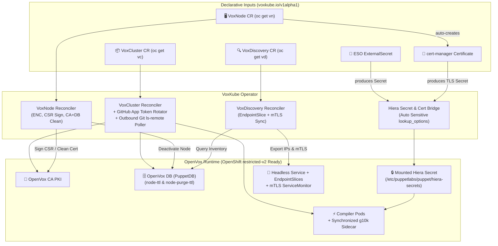

# 🦊 VoxKube (`voxkube-operator`)

[](#ai-built-notice)
[](#crds)
[](#openshift-compatibility)
[](LICENSE)

> [!IMPORTANT]
> **AI-Built Project Notice (`#ai-built-notice`)**: This entire project (**`VoxKube`** / `voxkube-operator` -- architecture, CRDs, Go controllers, ESO & `cert-manager` Hiera Bridge, GitHub App authentication, PuppetDB `EndpointSlice` discovery, Helm chart, unit tests, and documentation) was **designed, architected, and built entirely with AI**.

**`VoxKube`** (`voxkube.io/v1alpha1`) is a next-generation, rock-solid **OpenShift- and Kubernetes-native Operator for OpenVox and Puppet**. It replaces complex multi-CRD setups with **three intuitive Custom Resource Definitions (`VoxCluster`, `VoxNode`, and `VoxDiscovery`)**.

<!-- features: keep in sync with docs/_snippets/features.md -->
- 📦 **One-Manifest Stack (`VoxCluster`)** - Deploy OpenVox CA, horizontally scalable catalog compilers, OpenVox DB (PuppetDB), PostgreSQL (external CNPG/RDS or built-in StatefulSet), and OpenShift Routes from a single CRD (`oc get vc`)
- 🔒 **100% OpenShift `restricted-v2` SCC Compliant** - Zero hardcoded `runAsUser` or `fsGroup` defaults; works out-of-the-box with OpenShift arbitrary namespace UID/GID ranges and native TLS passthrough `Route`s
- 🔐 **Native ESO & `cert-manager` -> Hiera Bridge (`Sensitive`)** - Automatically injects External Secrets Operator (ESO) Secrets and multiple `cert-manager` SSL certificates per VM into Hiera (`common.yaml`, `roles/<role>.yaml`, `nodes/<certname>.yaml`) with `lookup_options` marking every secret key as `Sensitive`
- 🖥️ **Declarative Node Lifecycle & Atomic Cleanup (`VoxNode`)** - Kubernetes-native ENC (`environment`, `role`, `classes`, `parameters`), `kubectl`-native CSR signing approval, and atomic CA certificate cleaning (`PUT /puppet-ca/v1/clean`) + PuppetDB node deactivation (`POST /pdb/cmd/v1` `deactivate node`)
- 🗄️ **PuppetDB Housekeeping TTLs** - Built-in `node-ttl`, `node-purge-ttl`, `report-ttl`, and `gc-interval` configuration so stale VMs are automatically deactivated and purged
- 🔍 **Native PuppetDB -> `EndpointSlice` & mTLS `ServiceMonitor` (`VoxDiscovery`)** - Exports active Puppet VMs matching fact/class/environment filters into Kubernetes `EndpointSlice`s and Prometheus `ServiceMonitor`s with zero-touch OpenVox CA mTLS scraping (`tls.mode: openvoxCA`)
- 🔄 **Outbound-Only Git / `g10k` Sync + Native GitHub App Auth** - Central outbound `git ls-remote` poller (zero inbound webhooks needed from Git to cluster), RS256 JWT GitHub App installation token rotation, synchronized compiler rollout, and `puppet generate types` environment isolation
<!-- /features -->

---

## Architecture



---

## Installation via Helm (`charts/voxkube-operator`)

### 1. Install the Operator Only

```bash
helm upgrade --install voxkube-operator charts/voxkube-operator \
  --namespace openvox \
  --create-namespace
```

### 2. Single-Command Operator + `VoxCluster` Stack Install

You can install the operator **and** deploy a production `VoxCluster` in one command by setting `cluster.enabled=true`:

```bash
helm upgrade --install voxkube-operator charts/voxkube-operator \
  --namespace openvox \
  --create-namespace \
  --set cluster.enabled=true \
  --set cluster.name=production \
  --set cluster.code.git.remote=https://github.com/myorg/puppet-control-repo.git \
  --set cluster.networking.externalHostname=puppet.apps.ocp.example.com \
  --set cluster.networking.openShiftRoute.enabled=true
```

---

## Custom Resource Definitions (`#crds`)

### 1. `VoxCluster` (`oc get vc`)

Deploys the entire OpenVox stack (CA, Compilers with outbound `g10k` + GitHub App auth, OpenVox DB with TTL housekeeping, Hiera Secret Bridge, Services, and OpenShift `Route`):

```yaml
apiVersion: voxkube.io/v1alpha1
kind: VoxCluster
metadata:
  name: production
  namespace: openvox
spec:
  code:
    mode: git
    git:
      remote: https://github.com/myorg/puppet-control-repo.git
      authType: githubApp
      githubApp:
        appID: 123456
        installationID: 98765432
        privateKeySecretRef:
          name: github-app-private-key
          key: private-key.pem
      pollInterval: 60s
      synchronizedRollout: true
      generateTypes: true
  server:
    replicas: 2
    javaArgs: "-Xms1g -Xmx1g"
  database:
    enabled: true
    postgres:
      mode: builtin
      storageSize: 10Gi
    housekeeping:
      nodeTTL: 7d
      nodePurgeTTL: 14d
      reportTTL: 14d
      gcInterval: 60
  networking:
    externalHostname: puppet.apps.ocp.example.com
    openShiftRoute:
      enabled: true
  hieraSecrets:
    enabled: true
    commonSecrets:
      - global-puppet-secrets
```

Trigger an immediate outbound Git code sync at any time without webhooks:

```bash
oc annotate voxcluster production -n openvox voxkube.io/sync-now="$(date +%s)" --overwrite
```

---

### 2. `VoxNode` (`oc get vn`)

Manages per-VM CSR signing, Kubernetes-native ENC (`environment`, `role`, `classes`, `parameters`), multiple `cert-manager` SSL certificates per VM, per-node ESO secrets, and atomic CA + PuppetDB cleanup:

```yaml
apiVersion: voxkube.io/v1alpha1
kind: VoxNode
metadata:
  name: web01-example-com
  namespace: openvox
spec:
  clusterRef: production
  certname: web01.example.com
  state: Active # PendingApproval | Active | Revoked | Decommissioned
  classification:
    environment: production
    role: webserver
    classes:
      - profile::base
      - profile::nginx
  certificates:
    - name: public_web
      issuerRef:
        name: letsencrypt-prod
        kind: ClusterIssuer
      dnsNames:
        - app.example.com
      targetCertPath: /etc/nginx/ssl/app.example.com.crt
      targetKeyPath: /etc/nginx/ssl/app.example.com.key
    - name: internal_api
      issuerRef:
        name: corp-vault-issuer
        kind: ClusterIssuer
      dnsNames:
        - web01.internal.example.com
      targetCertPath: /etc/nginx/ssl/internal-api.crt
      targetKeyPath: /etc/nginx/ssl/internal-api.key
```

To atomically revoke & clean a VM's certificate on the OpenVox CA **and** deactivate it in OpenVox DB (PuppetDB):

```bash
oc patch voxnode web01-example-com -n openvox --type=merge -p '{"spec":{"state":"Decommissioned"}}'
# or simply:
oc delete voxnode web01-example-com -n openvox
```

---

### 3. `VoxDiscovery` (`oc get vd`)

Queries OpenVox DB (PuppetDB) for active VMs matching fact/class/environment filters and exports them into native Kubernetes `EndpointSlice`s and an mTLS-configured Prometheus `ServiceMonitor`:

```yaml
apiVersion: voxkube.io/v1alpha1
kind: VoxDiscovery
metadata:
  name: puppet-node-exporter
  namespace: openvox
spec:
  clusterRef: production
  syncInterval: 60s
  addressFact: networking.ip
  selector:
    environment: production
    facts:
      kernel: Linux
    classes:
      - profile::node_exporter
  ports:
    - name: metrics
      port: 9100
      protocol: TCP
  serviceMonitor:
    enabled: true
    interval: 30s
    preserveNodeHostnameAsInstance: true
    tls:
      enabled: true
      mode: openvoxCA # Zero-touch mTLS using Puppet's existing PKI!
```

---

## Development & Testing

```bash
# Generate deepcopy methods and CRD manifests
make generate manifests

# Run Go unit and controller tests
go test ./... -v

# Lint and template-test the Helm chart
helm lint charts/voxkube-operator
helm template voxkube charts/voxkube-operator --set cluster.enabled=true
```
